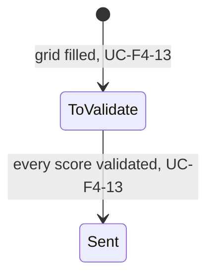

🏠 [Specs](../../../README.md) › 🧩 [Functional capabilities](../../README.md) › 🎙️ [F4 Meetings](../README.md) ›
🗃️ [Data](README.md) › 🗃️ E-F4-21 Interview debrief

# 🗃️ E-F4-21 Interview debrief

**Status:** ✅ specified

## Purpose

The interview debrief the flow charts name with the words "Debrief"
([FL-F4-09](../flows/fl-f04-09-score-calls-and-interviews.md)). The owner decided to create it
([D516](../../../06-decisions/foundations/d516-naming-rules-and-the-seven-classes-of-names.md)); its fields are derived
from the specifications and confirmed by the owner (D572).

## Fields

| Name | Type | Required | Validation | Default | Example | Personal data | Custom fields |
|---|---|---|---|---|---|---|---|
| title | text | yes | - | - | Debrief site manager, Martin | no | no |
| interview | meeting | yes | - | - | Interview: site manager, 26 Nov | no | no |
| applicant | applicant | yes | - | - | Karim B. | yes | no |
| job position | job position | yes | - | - | Site manager | no | no |
| candidate report | text | no | the company's template | - | Notice period 2 months, at 12:40 | yes | no |
| evaluation grid | evaluation grid | if scoring on | every score validated by a person, BR-F4-21 | - | 78 match score, validated | yes | no |
| hiring manager | user | yes | - | - | Pierre Martin | yes | no |
| sent on | date and time | no | - | - | 2026-11-27 16:00 | no | no |
| state | to validate, sent | yes | the lifecycle below | to validate | sent | no | no |

Derived from [UC-F4-13](../use-cases/09-score-calls-and-interviews/uc-f04-13-interview-a-candidate.md) (the candidate
report on the company's template, the validated grid, the debrief sent to the hiring manager, report and answers only
with scoring off), [FL-F4-09](../flows/fl-f04-09-score-calls-and-interviews.md),
[BR-F4-21](../business-rules/br-f04-21-candidate-scoring-is-high-risk-ai.md) (nothing reaches the hiring manager before
validation), [BR-F4-20](../business-rules/br-f04-20-scores-come-with-their-evidence.md),
[S-F4-12 Interview evaluation](../screens/09-score-calls-and-interviews/s-f04-12-interview-evaluation.md) and the list
[S-F4-L21](../screens/00-lists/s-f04-l21-interview-debriefs.md).

## Relations

From one interview, a [meeting](e-f04-01-meeting.md); carries its validated [evaluation
grid](e-f04-07-evaluation-grid.md); kept on the [applicant](../../f09-hr-and-projects/data/e-f09-07-applicant.md) for a
[job position](../../f09-hr-and-projects/data/e-f09-06-job-position.md); sent to the hiring manager, a
[user](../../f01-administration/data/e-f01-03-user.md). A candidate's request for an explanation or a review is a [human
review request](e-f04-20-human-review-request.md).

## Lifecycle

The hiring manager sees it only once sent (BR-F4-21); with scoring off it holds the report and the answers, and is sent
without scores.

## Indexes and search

By title, applicant, job position, hiring manager, state; for HR and the hiring manager of the position
([BR-F4-04](../business-rules/br-f04-04-transcripts-stay-with-participants.md)).

## Retention

As the other records of its capability.

## Audit

Every change, as the other records of its capability.

## Import and export

CSV or XLSX of the visible rows and columns from [S-F4-L21](../screens/00-lists/s-f04-l21-interview-debriefs.md); no
import.

## Used by

- [UC-F4-13 Interview a candidate](../use-cases/09-score-calls-and-interviews/uc-f04-13-interview-a-candidate.md)

## Open questions

None.

---

⬅️ [E-F4-20 Human review request](e-f04-20-human-review-request.md) · ⬆️ [Up](README.md) ·
➡️ [E-F4-22 Meeting agenda](e-f04-22-meeting-agenda.md)
