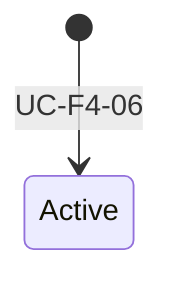

🏠 [Specs](../../../README.md) › 🧩 [Functional capabilities](../../README.md) › 🎙️ [F4 Meetings](../README.md) ›
🗃️ [Data](README.md) › 🗃️ E-F4-22 Meeting agenda

# 🗃️ E-F4-22 Meeting agenda

**Status:** ✅ specified

## Purpose

The meeting agenda the flow charts name with the words "Agenda"
([FL-F4-04](../flows/fl-f04-04-find-and-reuse-meetings.md)). The owner decided to create it
([D516](../../../06-decisions/foundations/d516-naming-rules-and-the-seven-classes-of-names.md)); its fields are derived
from the specifications and confirmed by the owner (D572).

## Fields

| Name | Type | Required | Validation | Default | Example | Personal data | Custom fields |
|---|---|---|---|---|---|---|---|
| title | text | yes | - | the meeting's title | Weekly site meeting | no | no |
| meeting | meeting | yes | one agenda per meeting, BR-F4-31 | - | Weekly site meeting, 16 Nov | no | no |
| drafted from | invitation and linked records, previous occurrence | yes | BR-F4-16, BR-F4-31 | - | previous occurrence | no | no |
| points | list of text | no | - | drafted, then edited by the organiser | Scaffolding removal date | no | no |
| open actions | list of action items | no | the previous occurrence's open actions, BR-F4-16 | - | Paul: order tiles, due Fri | yes | no |
| shared on | date and time | no | before the meeting, BR-F4-16 | - | 2026-11-15 18:00 | no | no |
| state | active | yes | the lifecycle below | active | active | no | no |

Derived from [UC-F4-06](../use-cases/04-find-and-reuse-meetings/uc-f04-06-find-and-reuse-past-meetings.md) (the next
agenda drafted from open actions and points),
[UC-F4-09](../use-cases/07-prepare-and-capture-anywhere/uc-f04-09-prepare-a-meeting.md) (the agenda draft joins the prep
brief), [BR-F4-16](../business-rules/br-f04-16-recurring-meetings-get-their-next-agenda.md),
[BR-F4-31](../business-rules/br-f04-31-every-meeting-has-an-agenda.md),
[S-F4-06 Meetings](../screens/04-find-and-reuse-meetings/s-f04-06-meetings.md) and the list
[S-F4-L22](../screens/00-lists/s-f04-l22-meeting-agendas.md) with its action Compare agendas.

## Relations

Belongs to one [meeting](e-f04-01-meeting.md), which always has one (BR-F4-31); a recurring meeting's agenda lists the
previous occurrence's open [action items](e-f04-04-action-item.md) and joins its
[prep brief](e-f04-24-meeting-prep-brief.md); read by the meeting time analysis
([UC-F4-31](../use-cases/14-video-messages-and-webinars/uc-f04-31-analyse-time-spent-in-meetings.md)).

## Lifecycle

## Indexes and search

By title, meeting, state; the agendas of several employees' meetings are compared side by side from
[S-F4-L22](../screens/00-lists/s-f04-l22-meeting-agendas.md), each user seeing only the agendas of the meetings they may
read; an HR meeting's agenda only for HR and the employee (BR-F4-31).

## Retention

As the other records of its capability.

## Audit

Every change, as the other records of its capability.

## Import and export

CSV or XLSX of the visible rows and columns from [S-F4-L22](../screens/00-lists/s-f04-l22-meeting-agendas.md); no
import. The agenda is written to the meeting's calendar event
([BR-F4-17](../business-rules/br-f04-17-calendars-sync-both-ways.md)).

## Used by

- [UC-F4-06 Find and reuse past meetings](../use-cases/04-find-and-reuse-meetings/uc-f04-06-find-and-reuse-past-meetings.md)

## Open questions

None.

---

⬅️ [E-F4-21 Interview debrief](e-f04-21-interview-debrief.md) · ⬆️ [Up](README.md) ·
➡️ [E-F4-23 Meeting notes](e-f04-23-meeting-notes.md)
