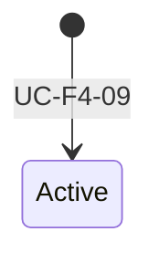

🏠 [Specs](../../../README.md) › 🧩 [Functional capabilities](../../README.md) › 🎙️ [F4 Meetings](../README.md) ›
🗃️ [Data](README.md) › 🗃️ E-F4-24 Meeting prep brief

# 🗃️ E-F4-24 Meeting prep brief

**Status:** 🔄 waiting for the owner

## Purpose

(Proposed) The meeting prep brief the flow charts name with the words "Prep brief"
([FL-F4-07](../flows/fl-f04-07-prepare-and-capture-anywhere.md)). The owner decided to create it
([D516](../../../06-decisions/foundations/d516-naming-rules-and-the-seven-classes-of-names.md)); what it holds waits for
the owner's confirmation.

## Fields

(Proposed) To define with the owner: the flow charts name the record, not its fields.

## Relations

(Proposed) To define with the owner, from the use cases below.

## Lifecycle

## Indexes and search

(Proposed) To define with the owner.

## Retention

(Proposed) As the other records of its capability, to confirm with the owner.

## Audit

(Proposed) Every change, as the other records of its capability.

## Import and export

(Proposed) To define with the owner.

## Used by

- [UC-F4-09 Prepare a meeting](../use-cases/07-prepare-and-capture-anywhere/uc-f04-09-prepare-a-meeting.md)

## Open questions

(Proposed) Its fields, relations and states wait for the owner (waiting list, step 36e).

---

⬅️ [E-F4-23 Meeting notes](e-f04-23-meeting-notes.md) · ⬆️ [Up](README.md) ·
➡️ [E-F4-25 Meeting recording setting](e-f04-25-meeting-recording-setting.md)
