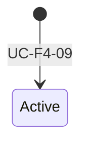

🏠 [Specs](../../../README.md) › 🧩 [Functional capabilities](../../README.md) › 🎙️ [F4 Meetings](../README.md) ›
🗃️ [Data](README.md) › 🗃️ E-F4-24 Meeting prep brief

# 🗃️ E-F4-24 Meeting prep brief

**Status:** ✅ specified

## Purpose

The meeting prep brief the flow charts name with the words "Prep brief"
([FL-F4-07](../flows/fl-f04-07-prepare-and-capture-anywhere.md)). The owner decided to create it
([D516](../../../06-decisions/foundations/d516-naming-rules-and-the-seven-classes-of-names.md)); its fields are derived
from the specifications and confirmed by the owner (D572).

## Fields

| Name | Type | Required | Validation | Default | Example | Personal data | Custom fields |
|---|---|---|---|---|---|---|---|
| title | text | yes | - | - | Brief Durand SA | no | no |
| meeting | meeting | yes | - | - | Durand SA at 14:00, 10 Nov | no | no |
| participants | list of person and role | yes | - | the meeting's participants | J. Durand (buyer, Durand SA) | yes | no |
| linked records | records | no | the meeting's links, BR-F4-12 | from the meeting | Deal Kitchen 2027, stage Proposal | no | no |
| last exchanges | list of meetings and emails | no | only what the reader may see, BR-F3-02 | - | Meeting of 3 Oct: asked for 1,150 per unit | yes | no |
| open actions | list of action items | no | - | - | Paul: order tiles | yes | no |
| open points | list of text | no | the organiser adds or removes points, UC-F4-09 | - | Colour of the tiles | no | no |
| agenda | meeting agenda | no | recurring meetings, BR-F4-16 | - | Weekly site meeting, 16 Nov | no | no |
| drafted on | date and time | yes | an hour before the meeting, or on demand | - | 2026-11-10 13:00 | no | no |
| state | active | yes | the lifecycle below | active | active | no | no |

Derived from [UC-F4-09](../use-cases/07-prepare-and-capture-anywhere/uc-f04-09-prepare-a-meeting.md) (participants and
their roles, the linked customer, deal or project, the last meetings and emails, open actions and points, drafted an
hour before or on demand, the recurring meeting's agenda),
[FL-F4-07](../flows/fl-f04-07-prepare-and-capture-anywhere.md),
[S-F4-08 Meeting prep brief](../screens/07-prepare-and-capture-anywhere/s-f04-08-meeting-prep-brief.md) and the list
[S-F4-L24](../screens/00-lists/s-f04-l24-meeting-prep-briefs.md).

## Relations

Kept with one [meeting](e-f04-01-meeting.md) and its linked records; lists its [action items](e-f04-04-action-item.md)
and, for a recurring meeting, its [agenda](e-f04-22-meeting-agenda.md); the participants' times are compared on their
[employee calendars](e-f04-26-employee-calendar.md). Each reader's brief holds only what they may see
([BR-F3-02](../../f03-assistant/business-rules/br-f03-02-answers-use-only-what-the-user-may-see.md)).

## Lifecycle

## Indexes and search

By title, meeting, state; for the organiser and the internal participants.

## Retention

As the other records of its capability.

## Audit

Every change, as the other records of its capability.

## Import and export

CSV or XLSX of the visible rows and columns from [S-F4-L24](../screens/00-lists/s-f04-l24-meeting-prep-briefs.md); no
import.

## Used by

- [UC-F4-09 Prepare a meeting](../use-cases/07-prepare-and-capture-anywhere/uc-f04-09-prepare-a-meeting.md)

## Open questions

None. The brief is drafted by SimpleERP and the organiser may edit it, adding or removing a point, as
[UC-F4-09](../use-cases/07-prepare-and-capture-anywhere/uc-f04-09-prepare-a-meeting.md) says; the use case beats the
screen that showed it read-only ([D573](../../../06-decisions/foundations/d573-precedence-between-spec-pages.md)).

---

⬅️ [E-F4-23 Meeting notes](e-f04-23-meeting-notes.md) · ⬆️ [Up](README.md) ·
➡️ [E-F4-25 Meeting recording setting](e-f04-25-meeting-recording-setting.md)
