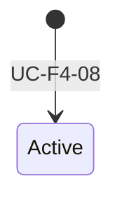

🏠 [Specs](../../../README.md) › 🧩 [Functional capabilities](../../README.md) › 🎙️ [F4 Meetings](../README.md) ›
🗃️ [Data](README.md) › 🗃️ E-F4-25 Meeting recording setting

# 🗃️ E-F4-25 Meeting recording setting

**Status:** ✅ specified

## Purpose

The meeting recording setting the flow charts name with the words "Recording retention"
([FL-F4-06](../flows/fl-f04-06-set-up-meetings-and-calendars.md)). The owner decided to create it
([D516](../../../06-decisions/foundations/d516-naming-rules-and-the-seven-classes-of-names.md)); its fields are derived
from the specifications and confirmed by the owner (D572).

## Fields

| Name | Type | Required | Validation | Default | Example | Personal data | Custom fields |
|---|---|---|---|---|---|---|---|
| name | text | yes | - | - | Sales meetings | no | no |
| applies to | company, team, user | yes | - | - | Sales | no | no |
| retention | number of days | yes | BR-F4-03 | 7 | 30 | no | no |
| recording mode | audio and video, audio only, transcript only | yes | - | - | audio only | no | no |
| bot joins calendar meetings | on, off | yes | BR-F4-06 | on | on | no | no |
| bot display name | text | yes | fixed, not editable: the bot joins as "SimpleERP recorder", BR-F4-01 | SimpleERP recorder | SimpleERP recorder | no | no |
| custom vocabulary | list of terms | no | per team | - | Placo, BA13 | no | no |
| call recording | list of purposes: training, proof of an order, quality | no | after the staff committee is consulted, BR-F4-11 | none: off, D449 | proof of an order | no | no |
| desktop capture | on, off | yes | BR-F4-19 | on | on | no | no |
| video messages | on, off | no | - | - | on | no | no |
| candidate scoring | on, off | yes | after the deployer duties are accepted, BR-F4-21 | off | off | no | no |
| locked | yes, no | no | by an administrator | - | yes | no | no |
| state | active | yes | the lifecycle below | active | active | no | no |

Derived from
[UC-F4-08](../use-cases/06-set-up-meetings-and-calendars/uc-f04-08-set-up-meeting-sources-calendars-and-retention.md)
(the recording retention), [S-F4-07 Meeting
settings](../screens/06-set-up-meetings-and-calendars/s-f04-07-meeting-settings.md) (recording mode, custom vocabulary
per team, the administrator lock, candidate scoring),
[BR-F4-03](../business-rules/br-f04-03-recordings-are-deleted-once-checked.md) (7 days by default, longer if an
administrator chooses), [BR-F4-01](../business-rules/br-f04-01-every-recording-is-announced.md) (the bot's fixed name),
[BR-F4-06](../business-rules/br-f04-06-the-bot-joins-calendar-meetings-by-default.md) (on by
default, each user's own default, off for the company),
[BR-F4-11](../business-rules/br-f04-11-business-calls-are-recorded.md) (call recording per purpose, team or company),
[BR-F4-19](../business-rules/br-f04-19-desktop-capture-is-announced-too.md),
[BR-F4-21](../business-rules/br-f04-21-candidate-scoring-is-high-risk-ai.md),
[UC-F4-28](../use-cases/14-video-messages-and-webinars/uc-f04-28-record-and-share-a-video-message.md) (video messages
switched on for the company), [BR-F4-33](../business-rules/br-f04-33-video-messages-follow-meeting-retention.md) and the
list [S-F4-L25](../screens/00-lists/s-f04-l25-meeting-recording-settings.md).

## Relations

Applies to the company, a [team](../../f03-assistant/data/e-f03-23-team.md) or a
[user](../../f01-administration/data/e-f01-03-user.md), whose own default shows in My connections
([S-F3-06](../../f03-assistant/screens/06-use-an-outside-tool/s-f03-06-my-connections.md)); read by every
[meeting](e-f04-01-meeting.md) it covers and by [video messages](e-f04-27-video-message.md), which keep its retention
(BR-F4-33). Set on the same screen as the [calendar syncs](e-f04-05-calendar-sync.md) and the
[agent connections](../../f01-administration/data/e-f01-08-agent-connection.md) of the platforms and phone system.

## Lifecycle

## Indexes and search

By name, what it applies to, state.

## Retention

As the other records of its capability.

## Audit

Every change, as the other records of its capability.

## Import and export

CSV or XLSX of the visible rows and columns from
[S-F4-L25](../screens/00-lists/s-f04-l25-meeting-recording-settings.md); no import.

## Used by

- [UC-F4-08 Set up meeting sources and calendars](../use-cases/06-set-up-meetings-and-calendars/uc-f04-08-set-up-meeting-sources-calendars-and-retention.md)

## Open questions

None. The bot joins as "SimpleERP recorder", as [BR-F4-01](../business-rules/br-f04-01-every-recording-is-announced.md)
says; the business rule beats the screen that offered "<Company> recorder, SimpleERP" ([D573](../../../06-decisions/foundations/d573-precedence-between-spec-pages.md)).

---

⬅️ [E-F4-24 Meeting prep brief](e-f04-24-meeting-prep-brief.md) · ⬆️ [Up](README.md) ·
➡️ [E-F4-26 Employee calendar](e-f04-26-employee-calendar.md)
