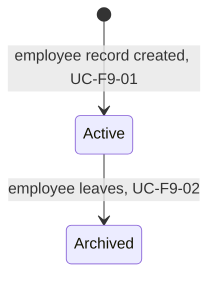

🏠 [Specs](../../../README.md) › 🧩 [Functional capabilities](../../README.md) › 🎙️ [F4 Meetings](../README.md) ›
🗃️ [Data](README.md) › 🗃️ E-F4-26 Employee calendar

# 🗃️ E-F4-26 Employee calendar

**Status:** ✅ specified

## Purpose

Every employee's calendar ([D519](../../../06-decisions/ux/d519-view-cards-reviewed-list-pages-and-workspaces.md),
VC-13: "All employes MUST have one. Provide the ability to compare one employee agenda to others", clarified "both"):
the meetings, appointments and absences of one employee, so that several employees' calendars can be compared side by
side, each user seeing what [BR-F4-32](../business-rules/br-f04-32-who-sees-a-colleagues-calendar.md) lets them see.
It is synced with the employee's own calendar when they connect one
([E-F4-05 Calendar sync](e-f04-05-calendar-sync.md)).

## Fields

| Name | Type | Required | Validation | Default | Example | Personal data | Custom fields |
|---|---|---|---|---|---|---|---|
| employee | user | yes | one calendar per employee | - | Léa Moreau | yes | no |
| status | active, archived | yes | - | active | active | no | no |
| calendar sync | link | no | E-F4-05 | - | Google Calendar, Workspace mode | no | no |
| working hours | text | no | - | the site's opening hours | Monday to Friday, 9:00 to 17:30 | no | no |
| time zone | choice | yes | a time zone of the IANA database | the site's | Europe/Paris | no | no |

## Relations

One per [employee record](../../f09-hr-and-projects/data/e-f09-01-employee-record.md); shows the
[meetings](e-f04-01-meeting.md) the employee takes part in, with their [agendas](e-f04-22-meeting-agenda.md);
kept in step with the employee's own calendar through a calendar sync.

## Lifecycle

## Indexes and search

By employee, status and time zone.

## Retention

While the employee is active; archived when they leave, then kept as their employee record is.

## Audit

Created, archived, and every change of its working hours or time zone.

## Import and export

Exported as an iCalendar file of the events the user may see.

## Used by

- [UC-F4-09 Prepare a meeting](../use-cases/07-prepare-and-capture-anywhere/uc-f04-09-prepare-a-meeting.md)

## Open questions

None.

---

⬅️ [E-F4-25 Meeting recording setting](e-f04-25-meeting-recording-setting.md) · ⬆️ [Up](README.md) ·
➡️ [E-F4-27 Video message](e-f04-27-video-message.md)
