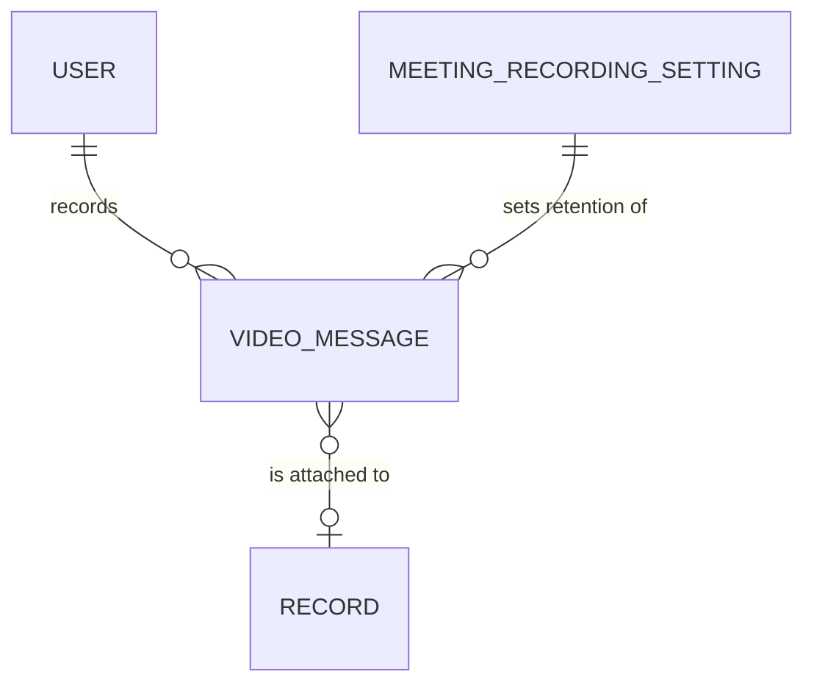
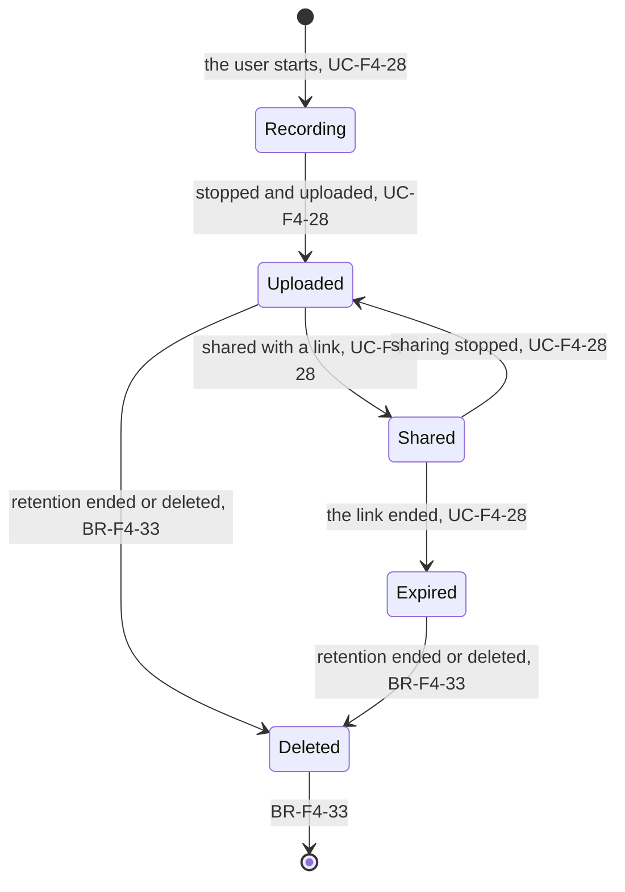

🏠 [Specs](../../../README.md) › 🧩 [Functional capabilities](../../README.md) › 🎙️ [F4 Meetings](../README.md) ›
🗃️ [Data](README.md) › 🗃️ E-F4-27 Video message

# 🗃️ E-F4-27 Video message

**Status:** ✅ specified

## Purpose

A short video recorded by a user to share, with its transcript, summary, link and views
([D523](../../../06-decisions/f04-meetings/d523-benchmark-gaps-f04-meetings.md)).

## Fields

| Name | Type | Required | Validation | Default | Example | Personal data | Custom fields |
|---|---|---|---|---|---|---|---|
| author | user | yes | - | the creator | Sophie L. | yes | no |
| source | screen, camera, both | yes | - | both | screen and camera | no | no |
| recording | video file | yes | up to 10 minutes | - | 2 min 10 | yes | no |
| transcript | text | no | - | - | Here is the option B price... | yes | no |
| summary | text | no | up to 600 characters | - | Walk-through of quote 2031 | no | no |
| linked record | any record | no | - | - | Quote 2031 | no | no |
| shared with | list of people or a link | no | allowed domains only | - | Dupont SA | yes | no |
| link ends | date | when shared | at most the retention end | 30 days | 2026-12-14 | no | no |
| password | secret | no | - | none | set | no | no |
| views | list of viewer, date, duration | no | - | - | 2 views, 2 min 10 | yes | no |
| delete on | date | yes | the meeting retention | the retention end | 2027-02-12 | no | no |
| state | recording, uploaded, shared, expired, deleted | yes | the lifecycle below | recording | shared | no | no |

## Relations

- [E-F1-03 User](../../f01-administration/data/e-f01-03-user.md)
- [E-F4-25 Meeting recording setting](e-f04-25-meeting-recording-setting.md)

## Lifecycle

## Indexes and search

By author, state, linked record and delete date.

## Retention

As [BR-F4-33](../business-rules/br-f04-33-video-messages-follow-meeting-retention.md) says: the meeting retention.

## Audit

Recorded, shared, each view with the viewer, unshared, deleted.

## Import and export

The author downloads their own message before it is deleted.

## Used by

- [UC-F4-28 Record and share a video message](../use-cases/14-video-messages-and-webinars/uc-f04-28-record-and-share-a-video-message.md)

## Open questions

None.

---

⬅️ [E-F4-26 Employee calendar](e-f04-26-employee-calendar.md) · ⬆️ [Up](README.md) ·
➡️ [E-F4-28 Webinar](e-f04-28-webinar.md)
