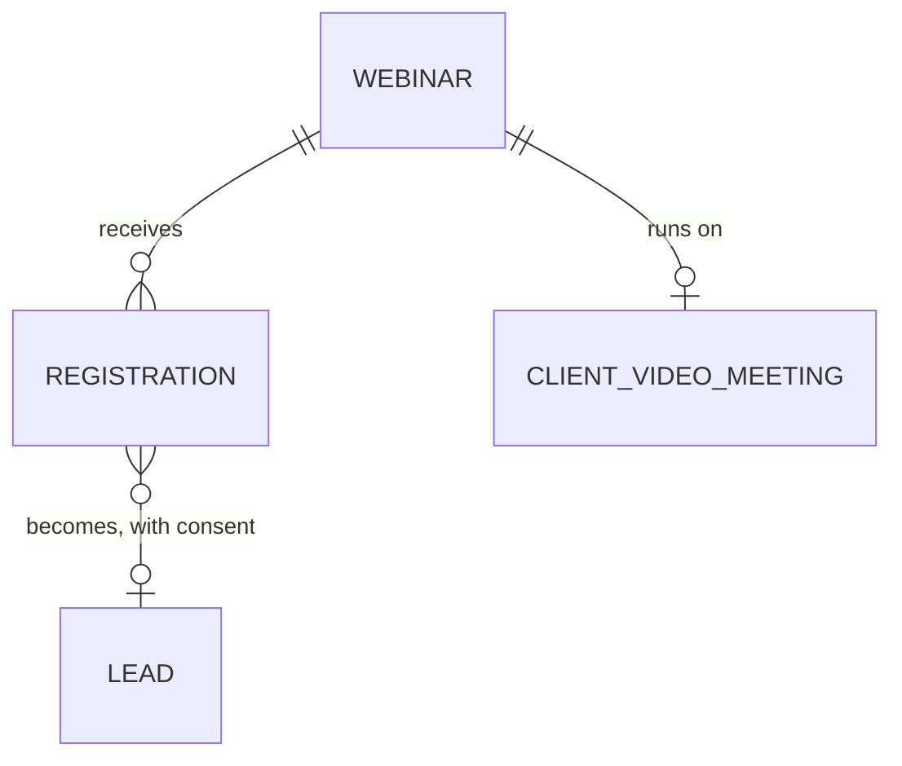
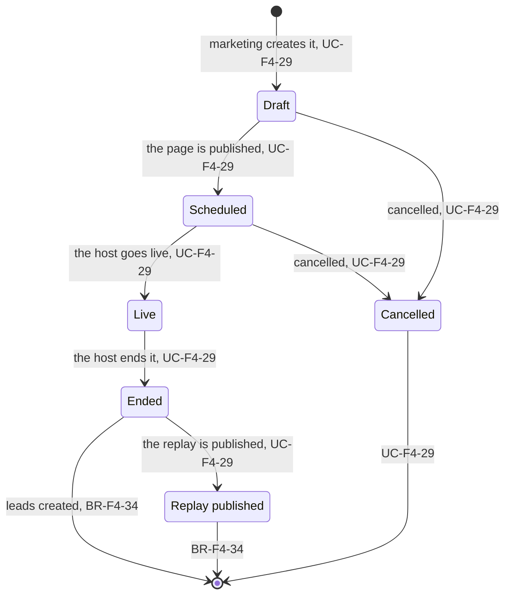

🏠 [Specs](../../../README.md) › 🧩 [Functional capabilities](../../README.md) › 🎙️ [F4 Meetings](../README.md) ›
🗃️ [Data](README.md) › 🗃️ E-F4-28 Webinar

# 🗃️ E-F4-28 Webinar

**Status:** ✅ specified

## Purpose

A live online talk with its registrations, attendance, questions, replay and leads
([D523](../../../06-decisions/f04-meetings/d523-benchmark-gaps-f04-meetings.md)).

## Fields

| Name | Type | Required | Validation | Default | Example | Personal data | Custom fields |
|---|---|---|---|---|---|---|---|
| title | text | yes | up to 120 characters | - | Autumn product launch | no | no |
| starts at | date and time | yes | in the future when scheduled | - | 2026-11-26 15:00 | no | no |
| host, speakers | users and guests | yes | - | - | Sophie L., Marc D. | yes | no |
| maximum attendees | number | no | 1 to 500 | 100 | 100 | no | no |
| registrations | list of name, email, agreements | no | the two agreements separate and unticked | - | 84 registered, 51 agreed | yes | no |
| attendance | list of person and time present | no | - | - | 63 attended | yes | no |
| questions | list of text, asker, answer | no | - | - | Does it work with our bank? | yes | no |
| replay | offered, ready, link | no | ends with the retention | offered | ready | no | no |
| follow-up email | text | no | approved by the host | the AI assistant's draft | Thanks for joining | no | no |
| state | draft, scheduled, live, ended, replay published, cancelled | yes | the lifecycle below | draft | scheduled | no | no |
| leads created | number | no | only consenting attendees | 0 | 51 | no | no |

## Relations

- [E-F4-16 Client video meeting](e-f04-16-client-video-meeting.md)
- [E-F6-20 Lead](../../f06-customers-and-sales/data/e-f06-20-lead.md)

## Lifecycle

## Indexes and search

By date, state and host; registrations by email.

## Retention

Registrations of people who did not agree to be contacted are kept 12 months; the replay and transcript
follow the meeting retention ([BR-F4-33](../business-rules/br-f04-33-video-messages-follow-meeting-retention.md),
[CR-FR-052](../../../10-country-packs/france/data-protection/cr-fr-052-storage-limitation.md)).

## Audit

Each state change, each registration with the agreements as shown, each lead created, each replay view.

## Import and export

Registrations are exported as a spreadsheet by marketing; no import.

## Used by

- [UC-F4-29 Host a webinar](../use-cases/14-video-messages-and-webinars/uc-f04-29-host-a-webinar.md)

## Open questions

None.

---

⬅️ [E-F4-27 Video message](e-f04-27-video-message.md) · ⬆️ [Up](README.md) ·
➡️ [E-F4-29 Note template](e-f04-29-note-template.md)
