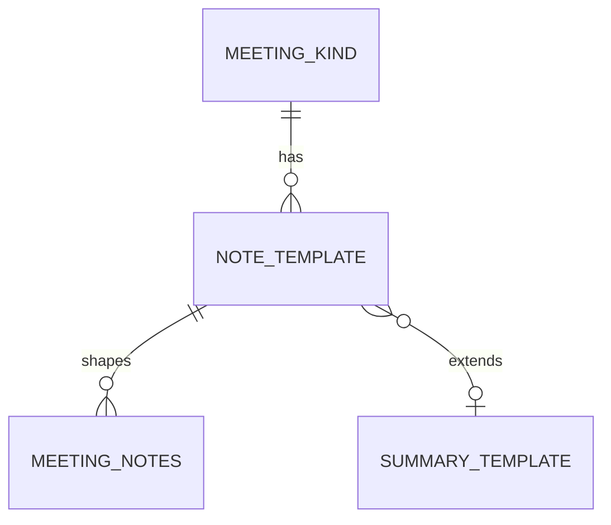
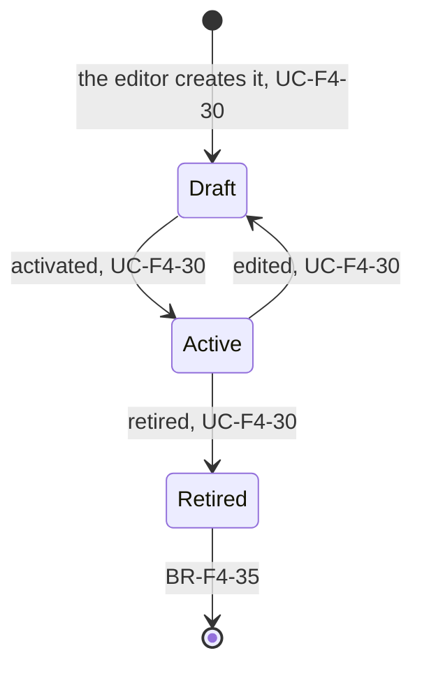

🏠 [Specs](../../../README.md) › 🧩 [Functional capabilities](../../README.md) › 🎙️ [F4 Meetings](../README.md) ›
🗃️ [Data](README.md) › 🗃️ E-F4-29 Note template

# 🗃️ E-F4-29 Note template

**Status:** ✅ specified

## Purpose

The named fields the notes of one kind of meeting must hold, and where confirmed values go
([D523](../../../06-decisions/f04-meetings/d523-benchmark-gaps-f04-meetings.md)).

## Fields

| Name | Type | Required | Validation | Default | Example | Personal data | Custom fields |
|---|---|---|---|---|---|---|---|
| name | text | yes | unique per team | - | Discovery call | no | no |
| meeting kind | kind of meeting | yes | - | - | Customer call | no | no |
| team | team or all | yes | - | all | Sales | no | no |
| fields | list of label, type, hint, record field | yes | labels unique, at most 20 | - | Budget, number | no | no |
| version | number | yes | - | 1 | 3 | no | no |
| state | draft, active, retired | yes | the lifecycle below | draft | active | no | no |
| created by | user | yes | - | the creator | Sophie L. | yes | no |
| meetings using it | number | no | - | 0 | 42 | no | no |

## Relations

- [E-F4-17 Meeting summary](e-f04-17-meeting-summary.md)
- [E-F4-01 Meeting](e-f04-01-meeting.md)
- [E-F4-03 Summary template](e-f04-03-summary-template.md)

## Lifecycle

## Indexes and search

By meeting kind, team and state.

## Retention

A retired template and its versions are kept as long as a meeting uses them.

## Audit

Each version, activation and retirement, with who and when.

## Import and export

Templates travel in configuration packs, see
[UC-F2-11](../../f02-no-code-configuration/use-cases/06-share-a-configuration/uc-f02-11-export-or-import-a-configuration-as-a-pack.md).

## Used by

- [UC-F4-30 Choose a note template per meeting type](../use-cases/14-video-messages-and-webinars/uc-f04-30-choose-a-note-template-per-meeting-type.md)

## Open questions

None.

---

⬅️ [E-F4-28 Webinar](e-f04-28-webinar.md) · ⬆️ [Up](README.md)
