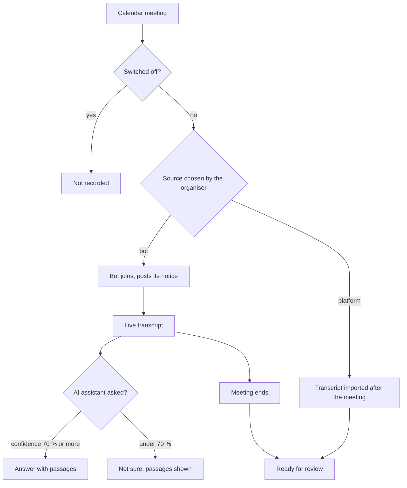

🏠 [Specs](../../../README.md) › 🧩 [Functional capabilities](../../README.md) › 🎙️ [F4 Meetings](../README.md) ›
🔀 [Flows](README.md) › 🔀 FL-F4-01 Record an online meeting

# 🔀 FL-F4-01 Record an online meeting

**Status:** ✅ specified

## Summary

From a calendar meeting to a transcript waiting for review, by the bot or the platform.

## Personas

- [U02 Manager](../../../01-users/personas/u02-manager.md)
- [U03 Sales](../../../01-users/personas/u03-sales.md)
- [U13 Owner](../../../01-users/personas/u13-owner.md)
- Any internal participant (D218)

## Flowchart

## Sequence diagram

See
[UC-F4-01](../use-cases/01-record-an-online-meeting/uc-f04-01-record-an-online-meeting-with-the-bot.md#sequence-diagram).

## Steps

| Step | Persona | Screen | Use case | What happens |
|---|---|---|---|---|
| 1 | U02, U03, U13 | [S-F4-01](../screens/01-record-an-online-meeting/s-f04-01-meeting.md) | [UC-F4-01](../use-cases/01-record-an-online-meeting/uc-f04-01-record-an-online-meeting-with-the-bot.md) | Recording on, source chosen |
| 2 | Any internal participant | [S-F4-02](../screens/01-record-an-online-meeting/s-f04-02-live-transcript.md) | [UC-F4-01](../use-cases/01-record-an-online-meeting/uc-f04-01-record-an-online-meeting-with-the-bot.md) | Live transcript |
| 3 | Any internal participant | [S-F4-02](../screens/01-record-an-online-meeting/s-f04-02-live-transcript.md) | [UC-F4-01](../use-cases/01-record-an-online-meeting/uc-f04-01-record-an-online-meeting-with-the-bot.md) | Ask the AI assistant during the meeting |
| 4 | U02, U03, U13 | [S-F4-01](../screens/01-record-an-online-meeting/s-f04-01-meeting.md) | [UC-F4-02](../use-cases/01-record-an-online-meeting/uc-f04-02-import-a-platform-s-own-transcript.md) | Platform transcript imported |

### Entities and screens

| Entity | States in this flow | Shown at step and screen | Aggregated view |
|---|---|---|---|
| [E-F4-01 Meeting](../data/e-f04-01-meeting.md) | Planned, Live, Ended, Waiting for review | 1, 4 [S-F4-01](../screens/01-record-an-online-meeting/s-f04-01-meeting.md); 2, 3 [S-F4-02](../screens/01-record-an-online-meeting/s-f04-02-live-transcript.md) | Meetings |
| [E-F4-18 Recording notice](../data/e-f04-18-recording-notice.md) | Active | 1, 4 [S-F4-01](../screens/01-record-an-online-meeting/s-f04-01-meeting.md); 2, 3 [S-F4-02](../screens/01-record-an-online-meeting/s-f04-02-live-transcript.md) | Recording notices |
| [E-F4-02 Transcript](../data/e-f04-02-transcript.md) | Live | 1, 4 [S-F4-01](../screens/01-record-an-online-meeting/s-f04-01-meeting.md); 2, 3 [S-F4-02](../screens/01-record-an-online-meeting/s-f04-02-live-transcript.md) | Transcripts |
| [E-F3-02 Assistant answer](../../f03-assistant/data/e-f03-02-assistant-answer.md) | Recorded | Shown elsewhere: [S-F3-01 Assistant panel](../../f03-assistant/screens/01-ask-the-assistant/s-f03-01-assistant-panel.md) | Assistant answers |
| [E-F24-02 Tool connection](../../f24-integrations-hub/data/e-f24-02-tool-connection.md) | Proposed, Active, Revoked | Shown elsewhere: [S-F21-10 Connections](../../f21-onboarding-and-modules/screens/03-team-and-data/s-f21-10-connections.md) | Tool connections |

## Errors

The bot refused entry; no platform transcript; the connection drops.

## Images

Every step and error, for each persona taking part, in light and dark mode (D120). Steps are numbered as in the Steps
table; E rows are the error cases.

| Step | Persona | Device | Light | Dark |
|---|---|---|---|---|
| 1 | U03 | desktop | [light](../images/01-record-an-online-meeting/u03-sales/1-recording-on-desktop-light.png) | [dark](../images/01-record-an-online-meeting/u03-sales/1-recording-on-desktop-dark.png) |
| 1 | U03 | phone | [light](../images/01-record-an-online-meeting/u03-sales/1-recording-on-phone-light.png) | [dark](../images/01-record-an-online-meeting/u03-sales/1-recording-on-phone-dark.png) |
| 1 | U03 | tablet | [light](../images/01-record-an-online-meeting/u03-sales/1-recording-on-tablet-light.png) | [dark](../images/01-record-an-online-meeting/u03-sales/1-recording-on-tablet-dark.png) |
| 1 | U02 | desktop | [light](../images/01-record-an-online-meeting/u02-manager/1-recording-on-desktop-light.png) | [dark](../images/01-record-an-online-meeting/u02-manager/1-recording-on-desktop-dark.png) |
| 1 | U02 | phone | [light](../images/01-record-an-online-meeting/u02-manager/1-recording-on-phone-light.png) | [dark](../images/01-record-an-online-meeting/u02-manager/1-recording-on-phone-dark.png) |
| 1 | U13 | desktop | [light](../images/01-record-an-online-meeting/u13-owner/1-recording-on-desktop-light.png) | [dark](../images/01-record-an-online-meeting/u13-owner/1-recording-on-desktop-dark.png) |
| 1 | U13 | phone | [light](../images/01-record-an-online-meeting/u13-owner/1-recording-on-phone-light.png) | [dark](../images/01-record-an-online-meeting/u13-owner/1-recording-on-phone-dark.png) |
| 2 | U02 | desktop | [light](../images/01-record-an-online-meeting/u02-manager/2-live-transcript-desktop-light.png) | [dark](../images/01-record-an-online-meeting/u02-manager/2-live-transcript-desktop-dark.png) |
| 3 | U03 | desktop | [light](../images/01-record-an-online-meeting/u03-sales/3-ask-during-the-meeting-desktop-light.png) | [dark](../images/01-record-an-online-meeting/u03-sales/3-ask-during-the-meeting-desktop-dark.png) |
| 4 | U03 | desktop | [light](../images/01-record-an-online-meeting/u03-sales/4-platform-transcript-desktop-light.png) | [dark](../images/01-record-an-online-meeting/u03-sales/4-platform-transcript-desktop-dark.png) |
| 4 | U03 | phone | [light](../images/01-record-an-online-meeting/u03-sales/4-platform-transcript-phone-light.png) | [dark](../images/01-record-an-online-meeting/u03-sales/4-platform-transcript-phone-dark.png) |
| 4 | U03 | tablet | [light](../images/01-record-an-online-meeting/u03-sales/4-platform-transcript-tablet-light.png) | [dark](../images/01-record-an-online-meeting/u03-sales/4-platform-transcript-tablet-dark.png) |
| 4 | U02 | desktop | [light](../images/01-record-an-online-meeting/u02-manager/4-platform-transcript-desktop-light.png) | [dark](../images/01-record-an-online-meeting/u02-manager/4-platform-transcript-desktop-dark.png) |
| 4 | U02 | phone | [light](../images/01-record-an-online-meeting/u02-manager/4-platform-transcript-phone-light.png) | [dark](../images/01-record-an-online-meeting/u02-manager/4-platform-transcript-phone-dark.png) |
| 4 | U13 | desktop | [light](../images/01-record-an-online-meeting/u13-owner/4-platform-transcript-desktop-light.png) | [dark](../images/01-record-an-online-meeting/u13-owner/4-platform-transcript-desktop-dark.png) |
| 4 | U13 | phone | [light](../images/01-record-an-online-meeting/u13-owner/4-platform-transcript-phone-light.png) | [dark](../images/01-record-an-online-meeting/u13-owner/4-platform-transcript-phone-dark.png) |
| E1 | U03 | desktop | [light](../images/01-record-an-online-meeting/u03-sales/e1-bot-refused-desktop-light.png) | [dark](../images/01-record-an-online-meeting/u03-sales/e1-bot-refused-desktop-dark.png) |
| E1 | U03 | phone | [light](../images/01-record-an-online-meeting/u03-sales/e1-bot-refused-phone-light.png) | [dark](../images/01-record-an-online-meeting/u03-sales/e1-bot-refused-phone-dark.png) |
| E1 | U03 | tablet | [light](../images/01-record-an-online-meeting/u03-sales/e1-bot-refused-tablet-light.png) | [dark](../images/01-record-an-online-meeting/u03-sales/e1-bot-refused-tablet-dark.png) |
| E2 | U03 | desktop | [light](../images/01-record-an-online-meeting/u03-sales/e2-no-platform-transcript-desktop-light.png) | [dark](../images/01-record-an-online-meeting/u03-sales/e2-no-platform-transcript-desktop-dark.png) |
| E2 | U03 | phone | [light](../images/01-record-an-online-meeting/u03-sales/e2-no-platform-transcript-phone-light.png) | [dark](../images/01-record-an-online-meeting/u03-sales/e2-no-platform-transcript-phone-dark.png) |
| E2 | U03 | tablet | [light](../images/01-record-an-online-meeting/u03-sales/e2-no-platform-transcript-tablet-light.png) | [dark](../images/01-record-an-online-meeting/u03-sales/e2-no-platform-transcript-tablet-dark.png) |
| E3 | U02 | desktop | [light](../images/01-record-an-online-meeting/u02-manager/e3-connection-dropped-desktop-light.png) | [dark](../images/01-record-an-online-meeting/u02-manager/e3-connection-dropped-desktop-dark.png) |
| E3 | U02 | phone | [light](../images/01-record-an-online-meeting/u02-manager/e3-connection-dropped-phone-light.png) | [dark](../images/01-record-an-online-meeting/u02-manager/e3-connection-dropped-phone-dark.png) |

## Open questions

None.

---

⬆️ [Up](README.md) · ➡️ [FL-F4-02 Record in person or by phone](fl-f04-02-record-in-person-or-by-phone.md)
