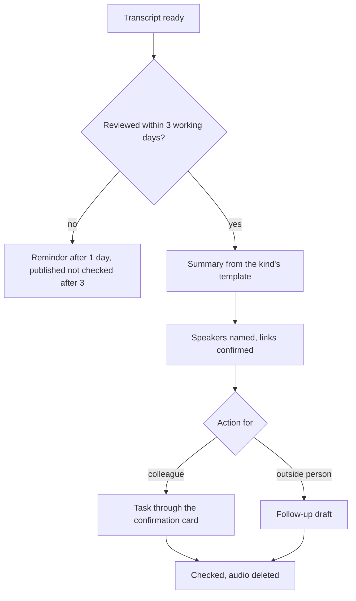

🏠 [Specs](../../../README.md) › 🧩 [Functional capabilities](../../README.md) › 🎙️ [F4 Meetings](../README.md) ›
🔀 [Flows](README.md) › 🔀 FL-F4-03 Review a meeting

# 🔀 FL-F4-03 Review a meeting

**Status:** ✅ specified

## Summary

From a transcript to checked outcomes.

## Personas

- Organisers: [U02 Manager](../../../01-users/personas/u02-manager.md),
  [U03 Sales](../../../01-users/personas/u03-sales.md), [U13 Owner](../../../01-users/personas/u13-owner.md),
  [U14 Field worker](../../../01-users/personas/u14-field-worker.md)
- Participants

## Flowchart

## Sequence diagram

See [UC-F4-05](../use-cases/03-review-a-meeting/uc-f04-05-review-a-meeting.md#sequence-diagram).

## Steps

| Step | Persona | Screen | Use case | What happens |
|---|---|---|---|---|
| 1 | Organisers | [S-F4-05](../screens/03-review-a-meeting/s-f04-05-meeting-review.md) | [UC-F4-05](../use-cases/03-review-a-meeting/uc-f04-05-review-a-meeting.md) | Summary, speakers, links |
| 2 | Organisers | [S-F4-05](../screens/03-review-a-meeting/s-f04-05-meeting-review.md) | [UC-F4-05](../use-cases/03-review-a-meeting/uc-f04-05-review-a-meeting.md) | Actions to tasks and follow-up |
| 3 | Participants | [S-F4-01](../screens/01-record-an-online-meeting/s-f04-01-meeting.md) | [UC-F4-05](../use-cases/03-review-a-meeting/uc-f04-05-review-a-meeting.md) | Published "not checked" |

### Entities and screens

| Entity | States in this flow | Shown at step and screen | Aggregated view |
|---|---|---|---|
| [E-F4-02 Transcript](../data/e-f04-02-transcript.md) | Live, Complete, Checked | 3 [S-F4-01](../screens/01-record-an-online-meeting/s-f04-01-meeting.md) | Transcripts |
| [E-T10-02 Notification](../../../03-technical/t10-translations-and-notifications/data/e-t10-02-notification.md) | Active | Shown elsewhere: [S-T10-02 Notification](../../../03-technical/t10-translations-and-notifications/screens/s-t10-02-notification.md), from the admin list [S-T10-L02](../../../03-technical/t10-translations-and-notifications/screens/00-lists/s-t10-l02-notifications.md) | Notifications |
| [E-F4-17 Meeting summary](../data/e-f04-17-meeting-summary.md) | Active | 1, 2 [S-F4-05](../screens/03-review-a-meeting/s-f04-05-meeting-review.md); 3 [S-F4-01](../screens/01-record-an-online-meeting/s-f04-01-meeting.md) | Meeting summaries |
| [E-F4-03 Summary template](../data/e-f04-03-summary-template.md) | Draft, Published | 1, 2 [S-F4-05](../screens/03-review-a-meeting/s-f04-05-meeting-review.md) | Summary templates |
| [E-F4-04 Action item](../data/e-f04-04-action-item.md) | Open, Done | 1, 2 [S-F4-05](../screens/03-review-a-meeting/s-f04-05-meeting-review.md) | Action items |
| [E-F9-18 Project and task](../../f09-hr-and-projects/data/e-f09-18-project-and-task.md) | New, Planned, Active, Delivered, Done | Shown elsewhere: [S-F9-17 Projects](../../f09-hr-and-projects/screens/06-plan-and-deliver-work/s-f09-17-projects.md) | Project and tasks |
| [E-F4-19 Follow-up email](../data/e-f04-19-follow-up-email.md) | Active | 1, 2 [S-F4-05](../screens/03-review-a-meeting/s-f04-05-meeting-review.md) | Follow-up emails |

## Errors

Summary not produced; a task owner who left.

## Images

Every step and error, for each persona taking part, in light and dark mode (D120). Steps are numbered as in the Steps
table; E rows are the error cases.

| Step | Persona | Device | Light | Dark |
|---|---|---|---|---|
| 1 | U02 | desktop | [light](../images/03-review-a-meeting/u02-manager/1-review-desktop-light.png) | [dark](../images/03-review-a-meeting/u02-manager/1-review-desktop-dark.png) |
| 2 | U02 | desktop | [light](../images/03-review-a-meeting/u02-manager/2-actions-to-tasks-desktop-light.png) | [dark](../images/03-review-a-meeting/u02-manager/2-actions-to-tasks-desktop-dark.png) |
| 3 | U01 | desktop | [light](../images/03-review-a-meeting/u01-employee/3-published-not-checked-desktop-light.png) | [dark](../images/03-review-a-meeting/u01-employee/3-published-not-checked-desktop-dark.png) |
| E1 | U02 | desktop | [light](../images/03-review-a-meeting/u02-manager/e1-summary-not-produced-desktop-light.png) | [dark](../images/03-review-a-meeting/u02-manager/e1-summary-not-produced-desktop-dark.png) |
| E1 | U02 | phone | [light](../images/03-review-a-meeting/u02-manager/e1-summary-not-produced-phone-light.png) | [dark](../images/03-review-a-meeting/u02-manager/e1-summary-not-produced-phone-dark.png) |
| E2 | U02 | desktop | [light](../images/03-review-a-meeting/u02-manager/e2-task-owner-left-desktop-light.png) | [dark](../images/03-review-a-meeting/u02-manager/e2-task-owner-left-desktop-dark.png) |
| E2 | U02 | phone | [light](../images/03-review-a-meeting/u02-manager/e2-task-owner-left-phone-light.png) | [dark](../images/03-review-a-meeting/u02-manager/e2-task-owner-left-phone-dark.png) |

## Open questions

None.

---

⬅️ [FL-F4-02 Record in person or by phone](fl-f04-02-record-in-person-or-by-phone.md) · ⬆️ [Up](README.md) ·
➡️ [FL-F4-04 Find and reuse meetings](fl-f04-04-find-and-reuse-meetings.md)
