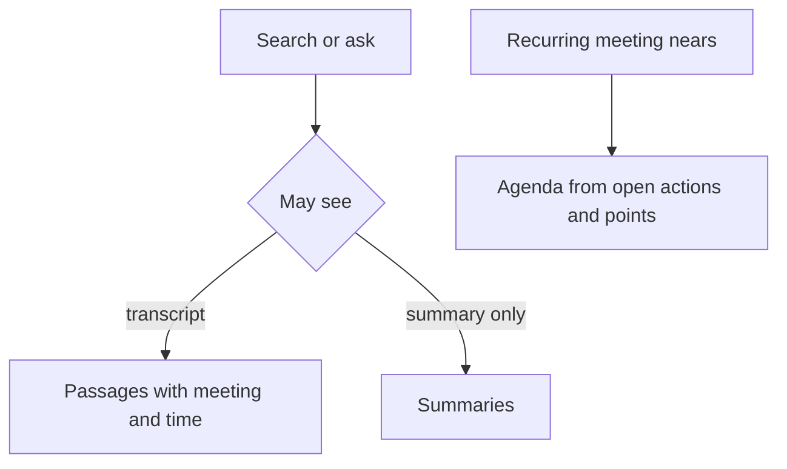

🏠 [Specs](../../../README.md) › 🧩 [Functional capabilities](../../README.md) › 🎙️ [F4 Meetings](../README.md) ›
🔀 [Flows](README.md) › 🔀 FL-F4-04 Find and reuse meetings

# 🔀 FL-F4-04 Find and reuse meetings

**Status:** ✅ specified

## Summary

From a question or a recurring meeting to what was said before.

## Personas

- Every internal persona, for the meetings they may see (BR-F4-04)

## Flowchart

## Sequence diagram

See [UC-F4-06](../use-cases/04-find-and-reuse-meetings/uc-f04-06-find-and-reuse-past-meetings.md#sequence-diagram).

## Steps

| Step | Persona | Screen | Use case | What happens |
|---|---|---|---|---|
| 1 | Every internal persona | [S-F4-06](../screens/04-find-and-reuse-meetings/s-f04-06-meetings.md) | [UC-F4-06](../use-cases/04-find-and-reuse-meetings/uc-f04-06-find-and-reuse-past-meetings.md) | Search and ask |
| 2 | Participants | [S-F4-06](../screens/04-find-and-reuse-meetings/s-f04-06-meetings.md) | [UC-F4-06](../use-cases/04-find-and-reuse-meetings/uc-f04-06-find-and-reuse-past-meetings.md) | Next agenda drafted |

### Entities and screens

| Entity | States in this flow | Shown at step and screen | Aggregated view |
|---|---|---|---|
| [E-F4-01 Meeting](../data/e-f04-01-meeting.md) | Planned, Live, Ended, Waiting for review, Checked | 1, 2 [S-F4-06](../screens/04-find-and-reuse-meetings/s-f04-06-meetings.md) | Meetings |
| [E-F4-02 Transcript](../data/e-f04-02-transcript.md) | Live, Complete, Checked | 1, 2 [S-F4-06](../screens/04-find-and-reuse-meetings/s-f04-06-meetings.md) | Transcripts |
| [E-F4-17 Meeting summary](../data/e-f04-17-meeting-summary.md) | Active | 1, 2 [S-F4-06](../screens/04-find-and-reuse-meetings/s-f04-06-meetings.md) | Meeting summaries |
| [E-F4-22 Meeting agenda](../data/e-f04-22-meeting-agenda.md) | Active | 1, 2 [S-F4-06](../screens/04-find-and-reuse-meetings/s-f04-06-meetings.md) | Meeting agendas |
| [E-F4-04 Action item](../data/e-f04-04-action-item.md) | Open | 1, 2 [S-F4-06](../screens/04-find-and-reuse-meetings/s-f04-06-meetings.md) | Action items |

## Errors

Nothing found.

## Images

Every step and error, for each persona taking part, in light and dark mode (D120). Steps are numbered as in the Steps
table; E rows are the error cases.

| Step | Persona | Device | Light | Dark |
|---|---|---|---|---|
| 1 | U03 | desktop | [light](../images/04-find-and-reuse-meetings/u03-sales/1-search-and-ask-desktop-light.png) | [dark](../images/04-find-and-reuse-meetings/u03-sales/1-search-and-ask-desktop-dark.png) |
| 2 | U02 | desktop | [light](../images/04-find-and-reuse-meetings/u02-manager/2-next-agenda-desktop-light.png) | [dark](../images/04-find-and-reuse-meetings/u02-manager/2-next-agenda-desktop-dark.png) |
| E1 | U03 | desktop | [light](../images/04-find-and-reuse-meetings/u03-sales/e1-nothing-found-desktop-light.png) | [dark](../images/04-find-and-reuse-meetings/u03-sales/e1-nothing-found-desktop-dark.png) |
| E1 | U03 | phone | [light](../images/04-find-and-reuse-meetings/u03-sales/e1-nothing-found-phone-light.png) | [dark](../images/04-find-and-reuse-meetings/u03-sales/e1-nothing-found-phone-dark.png) |
| E1 | U03 | tablet | [light](../images/04-find-and-reuse-meetings/u03-sales/e1-nothing-found-tablet-light.png) | [dark](../images/04-find-and-reuse-meetings/u03-sales/e1-nothing-found-tablet-dark.png) |

## Open questions

None.

---

⬅️ [FL-F4-03 Review a meeting](fl-f04-03-review-a-meeting.md) · ⬆️ [Up](README.md) ·
➡️ [FL-F4-05 HR meeting](fl-f04-05-hr-meeting.md)
