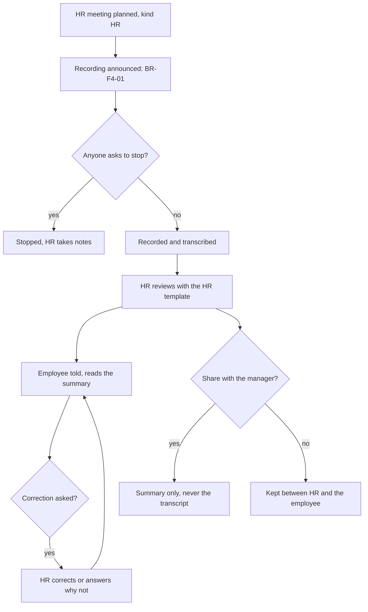

🏠 [Specs](../../../README.md) › 🧩 [Functional capabilities](../../README.md) › 🎙️ [F4 Meetings](../README.md) ›
🔀 [Flows](README.md) › 🔀 FL-F4-05 HR meeting

# 🔀 FL-F4-05 HR meeting

**Status:** ✅ specified

## Summary

An HR interview or review is recorded, announced and reviewed with the HR template; it stays between HR and the
employee, who reads it and can ask a correction; HR may share the summary, never the transcript, with the manager.

## Personas

- [U01 Employee](../../../01-users/personas/u01-employee.md)
- [U02 Manager](../../../01-users/personas/u02-manager.md)
- [U06 Human resources](../../../01-users/personas/u06-hr.md)

## Flowchart

## Sequence diagram

See [UC-F4-07](../use-cases/05-hr-meeting/uc-f04-07-hr-meeting.md#sequence-diagram).

## Steps

| Step | Persona | Screen | Use case | What happens |
|---|---|---|---|---|
| 1 | [U06](../../../01-users/personas/u06-hr.md) | [S-F4-01](../screens/01-record-an-online-meeting/s-f04-01-meeting.md) | [UC-F4-07](../use-cases/05-hr-meeting/uc-f04-07-hr-meeting.md) | Plan the HR meeting; the recording is announced |
| 2 | [U06](../../../01-users/personas/u06-hr.md) | [S-F4-05](../screens/03-review-a-meeting/s-f04-05-meeting-review.md) | [UC-F4-07](../use-cases/05-hr-meeting/uc-f04-07-hr-meeting.md) | Review with the HR summary template |
| 3 | [U01](../../../01-users/personas/u01-employee.md) | [S-F4-01](../screens/01-record-an-online-meeting/s-f04-01-meeting.md) | [UC-F4-07](../use-cases/05-hr-meeting/uc-f04-07-hr-meeting.md) | The employee reads the summary |
| 4 | [U01](../../../01-users/personas/u01-employee.md) | [S-F4-01](../screens/01-record-an-online-meeting/s-f04-01-meeting.md) | [UC-F4-07](../use-cases/05-hr-meeting/uc-f04-07-hr-meeting.md) | The employee asks a correction |
| 5 | [U06](../../../01-users/personas/u06-hr.md) | [S-F4-05](../screens/03-review-a-meeting/s-f04-05-meeting-review.md) | [UC-F4-07](../use-cases/05-hr-meeting/uc-f04-07-hr-meeting.md) | HR corrects or answers |
| 6 | [U02](../../../01-users/personas/u02-manager.md) | [S-F4-01](../screens/01-record-an-online-meeting/s-f04-01-meeting.md) | [UC-F4-07](../use-cases/05-hr-meeting/uc-f04-07-hr-meeting.md) | The manager reads the shared summary only |

### Entities and screens

| Entity | States in this flow | Shown at step and screen | Aggregated view |
|---|---|---|---|
| [E-F4-01 Meeting](../data/e-f04-01-meeting.md) | Planned | 1, 3, 4, 6 [S-F4-01](../screens/01-record-an-online-meeting/s-f04-01-meeting.md); 2, 5 [S-F4-05](../screens/03-review-a-meeting/s-f04-05-meeting-review.md) | Meetings |
| [E-F4-03 Summary template](../data/e-f04-03-summary-template.md) | Draft, Published | 2, 5 [S-F4-05](../screens/03-review-a-meeting/s-f04-05-meeting-review.md) | Summary templates |
| [E-F4-17 Meeting summary](../data/e-f04-17-meeting-summary.md) | Active | 1, 3, 4, 6 [S-F4-01](../screens/01-record-an-online-meeting/s-f04-01-meeting.md); 2, 5 [S-F4-05](../screens/03-review-a-meeting/s-f04-05-meeting-review.md) | Meeting summaries |
| [E-F4-02 Transcript](../data/e-f04-02-transcript.md) | Live, Complete, Checked | 1, 3, 4, 6 [S-F4-01](../screens/01-record-an-online-meeting/s-f04-01-meeting.md) | Transcripts |

## Errors

Someone asks to stop the recording (notes only), the employee disputes the summary, a manager tries to open the
transcript (refused, BR-F4-18).

## Images

Every step and error, for each persona taking part, in light and dark mode (D120). Steps are numbered as in the Steps
table; E rows are the error cases.

| Step | Persona | Device | Light | Dark |
|---|---|---|---|---|
| 1 | U06 | desktop | [light](../images/05-hr-meeting/u06-hr/1-hr-review-desktop-light.png) | [dark](../images/05-hr-meeting/u06-hr/1-hr-review-desktop-dark.png) |
| 2 | U01 | desktop | [light](../images/05-hr-meeting/u01-employee/2-employee-reads-desktop-light.png) | [dark](../images/05-hr-meeting/u01-employee/2-employee-reads-desktop-dark.png) |
| 2 | U01 | phone | [light](../images/05-hr-meeting/u01-employee/2-employee-reads-phone-light.png) | [dark](../images/05-hr-meeting/u01-employee/2-employee-reads-phone-dark.png) |
| 2 | U06 | desktop | [light](../images/05-hr-meeting/u06-hr/2-employee-reads-desktop-light.png) | [dark](../images/05-hr-meeting/u06-hr/2-employee-reads-desktop-dark.png) |
| 3 | U01 | desktop | [light](../images/05-hr-meeting/u01-employee/3-meeting-desktop-light.png) | [dark](../images/05-hr-meeting/u01-employee/3-meeting-desktop-dark.png) |
| 3 | U01 | phone | [light](../images/05-hr-meeting/u01-employee/3-meeting-phone-light.png) | [dark](../images/05-hr-meeting/u01-employee/3-meeting-phone-dark.png) |
| 4 | U01 | desktop | [light](../images/05-hr-meeting/u01-employee/4-meeting-desktop-light.png) | [dark](../images/05-hr-meeting/u01-employee/4-meeting-desktop-dark.png) |
| 4 | U01 | phone | [light](../images/05-hr-meeting/u01-employee/4-meeting-phone-light.png) | [dark](../images/05-hr-meeting/u01-employee/4-meeting-phone-dark.png) |
| 5 | U06 | desktop | [light](../images/05-hr-meeting/u06-hr/5-meeting-review-desktop-light.png) | [dark](../images/05-hr-meeting/u06-hr/5-meeting-review-desktop-dark.png) |
| 6 | U02 | desktop | [light](../images/05-hr-meeting/u02-manager/6-meeting-desktop-light.png) | [dark](../images/05-hr-meeting/u02-manager/6-meeting-desktop-dark.png) |
| 6 | U02 | phone | [light](../images/05-hr-meeting/u02-manager/6-meeting-phone-light.png) | [dark](../images/05-hr-meeting/u02-manager/6-meeting-phone-dark.png) |
| E1 | U01 | desktop | [light](../images/05-hr-meeting/u01-employee/e1-meeting-refused-desktop-light.png) | [dark](../images/05-hr-meeting/u01-employee/e1-meeting-refused-desktop-dark.png) |
| E1 | U01 | phone | [light](../images/05-hr-meeting/u01-employee/e1-meeting-refused-phone-light.png) | [dark](../images/05-hr-meeting/u01-employee/e1-meeting-refused-phone-dark.png) |

## Open questions

None.

---

⬅️ [FL-F4-04 Find and reuse meetings](fl-f04-04-find-and-reuse-meetings.md) · ⬆️ [Up](README.md) ·
➡️ [FL-F4-06 Set up meetings and calendars](fl-f04-06-set-up-meetings-and-calendars.md)
