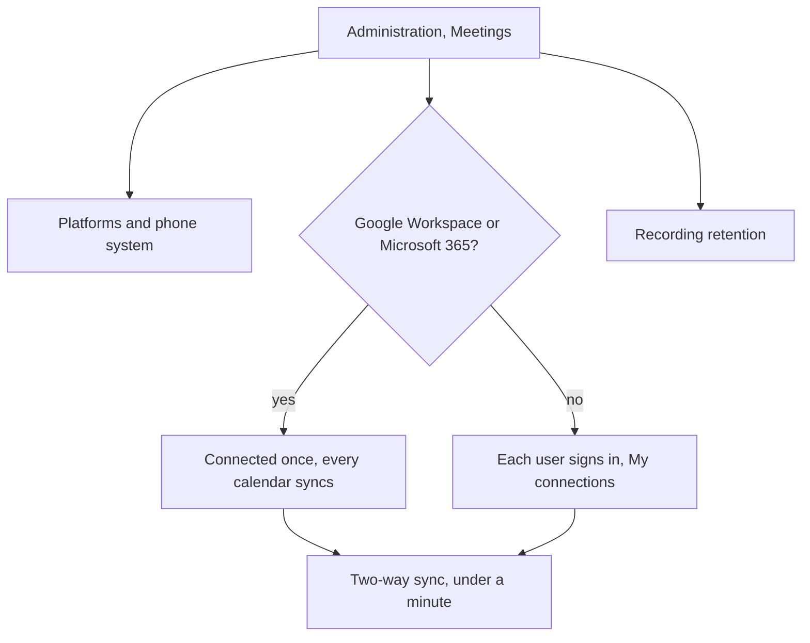

🏠 [Specs](../../../README.md) › 🧩 [Functional capabilities](../../README.md) › 🎙️ [F4 Meetings](../README.md) ›
🔀 [Flows](README.md) › 🔀 FL-F4-06 Set up meetings and calendars

# 🔀 FL-F4-06 Set up meetings and calendars

**Status:** ✅ specified

## Summary

From connecting sources and calendars to meetings in step with everyone's agenda.

## Personas

- [U07 Administrator](../../../01-users/personas/u07-administrator.md)
- Every internal persona (their own calendar)
- [U01 Employee](../../../01-users/personas/u01-employee.md), acting in the chart, step 36i (Proposed)

## Flowchart

## Sequence diagram

See
[UC-F4-08](../use-cases/06-set-up-meetings-and-calendars/uc-f04-08-set-up-meeting-sources-calendars-and-retention.md#sequence-diagram).

## Steps

| Step | Persona | Screen | Use case | What happens |
|---|---|---|---|---|
| 1 | U07 | [S-F4-07](../screens/06-set-up-meetings-and-calendars/s-f04-07-meeting-settings.md) | [UC-F4-08](../use-cases/06-set-up-meetings-and-calendars/uc-f04-08-set-up-meeting-sources-calendars-and-retention.md) | Sources, calendars, retention |
| 2 | Every internal persona | [S-F3-06](../../f03-assistant/screens/06-use-an-outside-tool/s-f03-06-my-connections.md) | [UC-F4-08](../use-cases/06-set-up-meetings-and-calendars/uc-f04-08-set-up-meeting-sources-calendars-and-retention.md) | Connect one's own calendar |

### Entities and screens

| Entity | States in this flow | Shown at step and screen | Aggregated view |
|---|---|---|---|
| [E-F24-02 Tool connection](../../f24-integrations-hub/data/e-f24-02-tool-connection.md) | Proposed, Active, Revoked | Shown elsewhere: [S-F21-10 Connections](../../f21-onboarding-and-modules/screens/03-team-and-data/s-f21-10-connections.md) | Tool connections |
| [E-F24-03 Suite component](../../f24-integrations-hub/data/e-f24-03-suite-component.md) | Active | Shown elsewhere: [S-F24-04 Suite files](../../f24-integrations-hub/screens/02-office-suites/s-f24-04-suite-files.md) | Suite components |
| [E-F4-05 Calendar sync](../data/e-f04-05-calendar-sync.md) | In sync, To reconnect, Failing | 1 [S-F4-07](../screens/06-set-up-meetings-and-calendars/s-f04-07-meeting-settings.md); 2 [S-F3-06](../../f03-assistant/screens/06-use-an-outside-tool/s-f03-06-my-connections.md) | Calendar syncs |
| [E-F3-07 Personal connection](../../f03-assistant/data/e-f03-07-personal-connection.md) | Connected, Expired | 2 [S-F3-06](../../f03-assistant/screens/06-use-an-outside-tool/s-f03-06-my-connections.md) | Personal connections |
| [E-F4-25 Meeting recording setting](../data/e-f04-25-meeting-recording-setting.md) | Active | 1 [S-F4-07](../screens/06-set-up-meetings-and-calendars/s-f04-07-meeting-settings.md); 2 [S-F3-06](../../f03-assistant/screens/06-use-an-outside-tool/s-f03-06-my-connections.md) | Meeting recording settings |

## Errors

A platform refusing the connection; a calendar to reconnect.

## Images

Every step and error, for each persona taking part, in light and dark mode (D120). Steps are numbered as in the Steps
table; E rows are the error cases.

| Step | Persona | Device | Light | Dark |
|---|---|---|---|---|
| 1 | U07 | desktop | [light](../images/06-set-up-meetings-and-calendars/u07-administrator/1-sources-calendars-retention-desktop-light.png) | [dark](../images/06-set-up-meetings-and-calendars/u07-administrator/1-sources-calendars-retention-desktop-dark.png) |
| 2 | U01 | desktop | [light](../images/06-set-up-meetings-and-calendars/u01-employee/2-connect-my-calendar-desktop-light.png) | [dark](../images/06-set-up-meetings-and-calendars/u01-employee/2-connect-my-calendar-desktop-dark.png) |
| E1 | U07 | desktop | [light](../images/06-set-up-meetings-and-calendars/u07-administrator/e1-platform-refused-desktop-light.png) | [dark](../images/06-set-up-meetings-and-calendars/u07-administrator/e1-platform-refused-desktop-dark.png) |
| E2 | U01 | phone | [light](../images/06-set-up-meetings-and-calendars/u01-employee/e2-calendar-to-reconnect-phone-light.png) | [dark](../images/06-set-up-meetings-and-calendars/u01-employee/e2-calendar-to-reconnect-phone-dark.png) |
| E2 | U01 | desktop | [light](../images/06-set-up-meetings-and-calendars/u01-employee/e2-calendar-to-reconnect-desktop-light.png) | [dark](../images/06-set-up-meetings-and-calendars/u01-employee/e2-calendar-to-reconnect-desktop-dark.png) |

## Open questions

None.

---

⬅️ [FL-F4-05 HR meeting](fl-f04-05-hr-meeting.md) · ⬆️ [Up](README.md) ·
➡️ [FL-F4-07 Prepare and capture anywhere](fl-f04-07-prepare-and-capture-anywhere.md)
