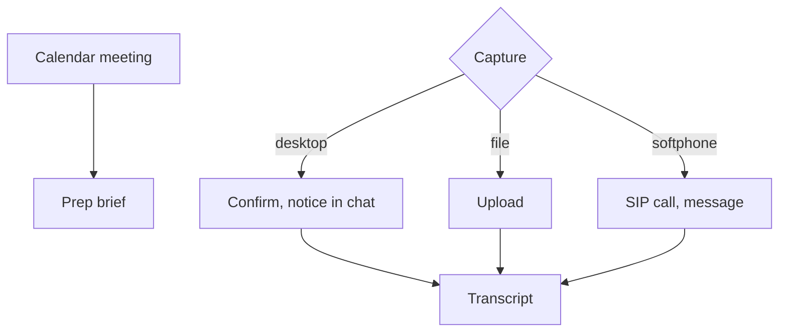

🏠 [Specs](../../../README.md) › 🧩 [Functional capabilities](../../README.md) › 🎙️ [F4 Meetings](../README.md) ›
🔀 [Flows](README.md) › 🔀 FL-F4-07 Prepare and capture anywhere

# 🔀 FL-F4-07 Prepare and capture anywhere

**Status:** ✅ specified

## Summary

Covers UC-F4-09, UC-F4-10, UC-F4-16 (D232).

## Personas

See each use case.

## Flowchart

## Sequence diagram

See each use case.

## Steps

| Step | Persona | Screen | Use case | What happens |
|---|---|---|---|---|
| 1 | See [UC-F4-09](../use-cases/07-prepare-and-capture-anywhere/uc-f04-09-prepare-a-meeting.md) | [S-F4-08](../screens/07-prepare-and-capture-anywhere/s-f04-08-meeting-prep-brief.md) | [UC-F4-09](../use-cases/07-prepare-and-capture-anywhere/uc-f04-09-prepare-a-meeting.md) | Prepare a meeting |
| 2 | See [UC-F4-10](../use-cases/07-prepare-and-capture-anywhere/uc-f04-10-capture-from-the-desktop-a-file-or-dictation.md) | [S-F4-09](../screens/07-prepare-and-capture-anywhere/s-f04-09-desktop-recorder.md) | [UC-F4-10](../use-cases/07-prepare-and-capture-anywhere/uc-f04-10-capture-from-the-desktop-a-file-or-dictation.md) | Capture from the desktop, a file or dictation |
| 3 | See [UC-F4-16](../use-cases/07-prepare-and-capture-anywhere/uc-f04-16-call-from-the-softphone.md) | [S-F4-13](../screens/07-prepare-and-capture-anywhere/s-f04-13-softphone.md) | [UC-F4-16](../use-cases/07-prepare-and-capture-anywhere/uc-f04-16-call-from-the-softphone.md) | Call from the softphone |

### Entities and screens

| Entity | States in this flow | Shown at step and screen | Aggregated view |
|---|---|---|---|
| [E-F4-01 Meeting](../data/e-f04-01-meeting.md) | Planned, Live, Ended, Waiting for review, Checked | 1 [S-F4-08](../screens/07-prepare-and-capture-anywhere/s-f04-08-meeting-prep-brief.md); 2 [S-F4-09](../screens/07-prepare-and-capture-anywhere/s-f04-09-desktop-recorder.md); 3 [S-F4-13](../screens/07-prepare-and-capture-anywhere/s-f04-13-softphone.md) | Meetings |
| [E-F4-24 Meeting prep brief](../data/e-f04-24-meeting-prep-brief.md) | Active | 1 [S-F4-08](../screens/07-prepare-and-capture-anywhere/s-f04-08-meeting-prep-brief.md) | Meeting prep briefs |
| [E-F4-18 Recording notice](../data/e-f04-18-recording-notice.md) | Active | 2 [S-F4-09](../screens/07-prepare-and-capture-anywhere/s-f04-09-desktop-recorder.md) | Recording notices |
| [E-F4-10 Chat channel](../data/e-f04-10-chat-channel.md) | Active | Shown elsewhere: [S-F4-15 Chat](../screens/10-benchmark-additions/s-f04-15-chat.md) | Chat channels |
| [E-F4-02 Transcript](../data/e-f04-02-transcript.md) | Live, Complete, Checked | 2 [S-F4-09](../screens/07-prepare-and-capture-anywhere/s-f04-09-desktop-recorder.md) | Transcripts |
| [E-F4-26 Employee calendar](../data/e-f04-26-employee-calendar.md) | Active | Shown elsewhere: [S-F4-24 Employee calendar](../screens/s-f04-24-employee-calendar.md) | Employee calendars |

## Errors

As each use case.

## Images

Every step and error, for each persona taking part, in light and dark mode (D120). Steps are numbered as in the Steps
table; E rows are the error cases.

| Step | Persona | Device | Light | Dark |
|---|---|---|---|---|
| 1 | U03 | desktop | [light](../images/07-prepare-and-capture-anywhere/u03-sales/1-prep-brief-desktop-light.png) | [dark](../images/07-prepare-and-capture-anywhere/u03-sales/1-prep-brief-desktop-dark.png) |
| 2 | U02 | desktop | [light](../images/07-prepare-and-capture-anywhere/u02-manager/2-desktop-capture-or-upload-desktop-light.png) | [dark](../images/07-prepare-and-capture-anywhere/u02-manager/2-desktop-capture-or-upload-desktop-dark.png) |
| 3 | U03 | desktop | [light](../images/07-prepare-and-capture-anywhere/u03-sales/3-softphone-call-desktop-light.png) | [dark](../images/07-prepare-and-capture-anywhere/u03-sales/3-softphone-call-desktop-dark.png) |
| 3 | U03 | phone | [light](../images/07-prepare-and-capture-anywhere/u03-sales/3-softphone-call-phone-light.png) | [dark](../images/07-prepare-and-capture-anywhere/u03-sales/3-softphone-call-phone-dark.png) |
| E1 | U03 | desktop | [light](../images/07-prepare-and-capture-anywhere/u03-sales/e1-sip-registration-failed-desktop-light.png) | [dark](../images/07-prepare-and-capture-anywhere/u03-sales/e1-sip-registration-failed-desktop-dark.png) |
| E1 | U03 | phone | [light](../images/07-prepare-and-capture-anywhere/u03-sales/e1-sip-registration-failed-phone-light.png) | [dark](../images/07-prepare-and-capture-anywhere/u03-sales/e1-sip-registration-failed-phone-dark.png) |
| E1 | U03 | tablet | [light](../images/07-prepare-and-capture-anywhere/u03-sales/e1-sip-registration-failed-tablet-light.png) | [dark](../images/07-prepare-and-capture-anywhere/u03-sales/e1-sip-registration-failed-tablet-dark.png) |

## Open questions

None.

---

⬅️ [FL-F4-06 Set up meetings and calendars](fl-f04-06-set-up-meetings-and-calendars.md) · ⬆️ [Up](README.md) ·
➡️ [FL-F4-08 Share and reuse outside](fl-f04-08-share-and-reuse-outside.md)
