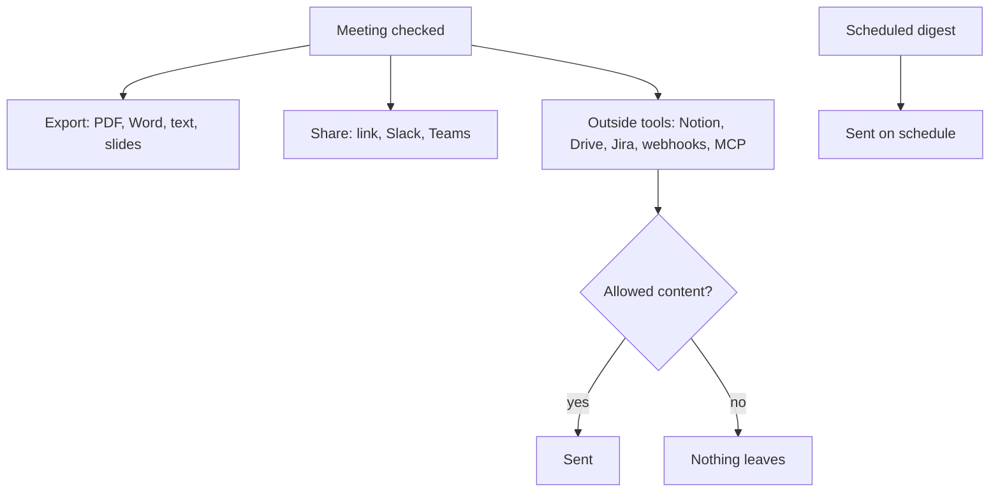

🏠 [Specs](../../../README.md) › 🧩 [Functional capabilities](../../README.md) › 🎙️ [F4 Meetings](../README.md) ›
🔀 [Flows](README.md) › 🔀 FL-F4-08 Share and reuse outside

# 🔀 FL-F4-08 Share and reuse outside

**Status:** ✅ specified

## Summary

Covers UC-F4-11, UC-F4-14, UC-F4-15 (D232).

## Personas

See each use case.

## Flowchart

## Sequence diagram

See each use case.

## Steps

| Step | Persona | Screen | Use case | What happens |
|---|---|---|---|---|
| 1 | See [UC-F4-11](../use-cases/08-share-and-reuse-outside/uc-f04-11-share-export-and-clip-a-meeting.md) | [S-F4-10](../screens/08-share-and-reuse-outside/s-f04-10-share-and-export.md) | [UC-F4-11](../use-cases/08-share-and-reuse-outside/uc-f04-11-share-export-and-clip-a-meeting.md) | Share, export and clip a meeting |
| 2 | See [UC-F4-14](../use-cases/08-share-and-reuse-outside/uc-f04-14-use-meetings-from-outside-tools.md) | [S-F4-14](../screens/08-share-and-reuse-outside/s-f04-14-meeting-automations.md) | [UC-F4-14](../use-cases/08-share-and-reuse-outside/uc-f04-14-use-meetings-from-outside-tools.md) | Use meetings from outside tools |
| 3 | See [UC-F4-15](../use-cases/08-share-and-reuse-outside/uc-f04-15-schedule-recurring-digests.md) | [S-F4-14](../screens/08-share-and-reuse-outside/s-f04-14-meeting-automations.md) | [UC-F4-15](../use-cases/08-share-and-reuse-outside/uc-f04-15-schedule-recurring-digests.md) | Schedule recurring digests |

### Entities and screens

| Entity | States in this flow | Shown at step and screen | Aggregated view |
|---|---|---|---|
| [E-F4-01 Meeting](../data/e-f04-01-meeting.md) | Checked | Shown elsewhere: [S-F4-01 Meeting](../screens/01-record-an-online-meeting/s-f04-01-meeting.md) | Meetings |
| [E-F24-02 Tool connection](../../f24-integrations-hub/data/e-f24-02-tool-connection.md) | Proposed, Active, Revoked | Shown elsewhere: [S-F21-10 Connections](../../f21-onboarding-and-modules/screens/03-team-and-data/s-f21-10-connections.md) | Tool connections |
| [E-T06-01 Tool](../../../03-technical/t06-mcp-and-a2a-gateway/data/e-t06-01-tool.md) | Active | Shown elsewhere: [S-T06-01 Tool](../../../03-technical/t06-mcp-and-a2a-gateway/screens/s-t06-01-tool.md), from the admin list [S-T06-L01](../../../03-technical/t06-mcp-and-a2a-gateway/screens/00-lists/s-t06-l01-tools.md) | Tools |
| [E-T05-02 Webhook subscription](../../../03-technical/t05-api-and-webhooks/data/e-t05-02-webhook-subscription.md) | Active | Shown elsewhere: [S-T05-02 Webhook subscription](../../../03-technical/t05-api-and-webhooks/screens/s-t05-02-webhook-subscription.md), from the admin list [S-T05-L02](../../../03-technical/t05-api-and-webhooks/screens/00-lists/s-t05-l02-webhook-subscriptions.md) | Webhook subscriptions |
| [E-F4-09 Scheduled digest](../data/e-f04-09-scheduled-digest.md) | Active, Paused | 2, 3 [S-F4-14](../screens/08-share-and-reuse-outside/s-f04-14-meeting-automations.md) | Scheduled digests |

## Errors

As each use case.

## Images

Every step and error, for each persona taking part, in light and dark mode (D120). Steps are numbered as in the Steps
table; E rows are the error cases.

| Step | Persona | Device | Light | Dark |
|---|---|---|---|---|
| 1 | U03 | desktop | [light](../images/08-share-and-reuse-outside/u03-sales/1-share-and-export-desktop-light.png) | [dark](../images/08-share-and-reuse-outside/u03-sales/1-share-and-export-desktop-dark.png) |
| 2 | U07 | desktop | [light](../images/08-share-and-reuse-outside/u07-administrator/2-outside-tools-desktop-light.png) | [dark](../images/08-share-and-reuse-outside/u07-administrator/2-outside-tools-desktop-dark.png) |
| 3 | U02 | desktop | [light](../images/08-share-and-reuse-outside/u02-manager/3-scheduled-digest-desktop-light.png) | [dark](../images/08-share-and-reuse-outside/u02-manager/3-scheduled-digest-desktop-dark.png) |
| E1 | U07 | desktop | [light](../images/08-share-and-reuse-outside/u07-administrator/e1-tool-refused-desktop-light.png) | [dark](../images/08-share-and-reuse-outside/u07-administrator/e1-tool-refused-desktop-dark.png) |

## Open questions

None.

---

⬅️ [FL-F4-07 Prepare and capture anywhere](fl-f04-07-prepare-and-capture-anywhere.md) · ⬆️ [Up](README.md) ·
➡️ [FL-F4-09 Score calls and interviews](fl-f04-09-score-calls-and-interviews.md)
