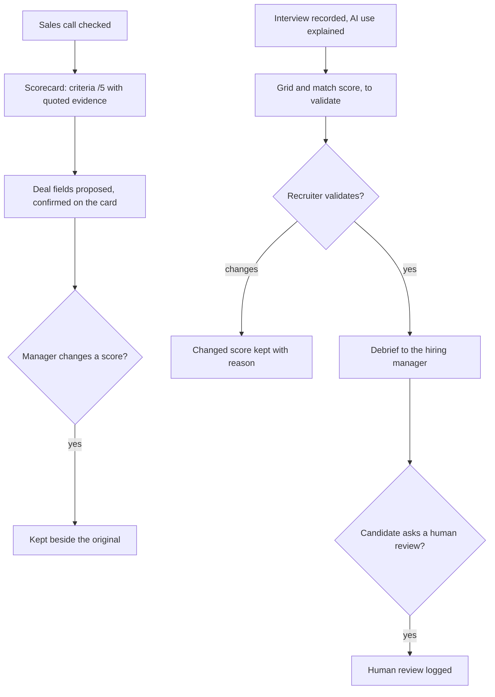

🏠 [Specs](../../../README.md) › 🧩 [Functional capabilities](../../README.md) › 🎙️ [F4 Meetings](../README.md) ›
🔀 [Flows](README.md) › 🔀 FL-F4-09 Score calls and interviews

# 🔀 FL-F4-09 Score calls and interviews

**Status:** ✅ specified

## Summary

A sales call gets a scorecard with evidence and deal fields to confirm; a job interview gets a report, an evaluation
grid and a match score marked to validate; a person validates or changes every score.

## Personas

- [U02 Manager](../../../01-users/personas/u02-manager.md)
- [U03 Sales](../../../01-users/personas/u03-sales.md)
- [U06 Human resources](../../../01-users/personas/u06-hr.md)

## Flowchart

## Sequence diagram

See each use case.

## Steps

| Step | Persona | Screen | Use case | What happens |
|---|---|---|---|---|
| 1 | [U03](../../../01-users/personas/u03-sales.md) | [S-F4-11](../screens/09-score-calls-and-interviews/s-f04-11-call-scorecard.md) | [UC-F4-12](../use-cases/09-score-calls-and-interviews/uc-f04-12-score-a-sales-call.md) | The sales call is scored with evidence |
| 2 | [U03](../../../01-users/personas/u03-sales.md) | [S-F4-11](../screens/09-score-calls-and-interviews/s-f04-11-call-scorecard.md) | [UC-F4-12](../use-cases/09-score-calls-and-interviews/uc-f04-12-score-a-sales-call.md) | Deal fields confirmed through the card |
| 3 | [U02](../../../01-users/personas/u02-manager.md) | [S-F4-11](../screens/09-score-calls-and-interviews/s-f04-11-call-scorecard.md) | [UC-F4-12](../use-cases/09-score-calls-and-interviews/uc-f04-12-score-a-sales-call.md) | The manager reviews and changes a score |
| 4 | [U06](../../../01-users/personas/u06-hr.md) | [S-F4-12](../screens/09-score-calls-and-interviews/s-f04-12-interview-evaluation.md) | [UC-F4-13](../use-cases/09-score-calls-and-interviews/uc-f04-13-interview-a-candidate.md) | The interview's grid and match score are produced |
| 5 | [U06](../../../01-users/personas/u06-hr.md) | [S-F4-12](../screens/09-score-calls-and-interviews/s-f04-12-interview-evaluation.md) | [UC-F4-13](../use-cases/09-score-calls-and-interviews/uc-f04-13-interview-a-candidate.md) | The recruiter validates or changes each score |
| 6 | [U02](../../../01-users/personas/u02-manager.md) | [S-F4-12](../screens/09-score-calls-and-interviews/s-f04-12-interview-evaluation.md) | [UC-F4-13](../use-cases/09-score-calls-and-interviews/uc-f04-13-interview-a-candidate.md) | The hiring manager reads the debrief |

### Entities and screens

| Entity | States in this flow | Shown at step and screen | Aggregated view |
|---|---|---|---|
| [E-F4-01 Meeting](../data/e-f04-01-meeting.md) | Checked | Shown elsewhere: [S-F4-01 Meeting](../screens/01-record-an-online-meeting/s-f04-01-meeting.md) | Meetings |
| [E-F4-06 Scorecard](../data/e-f04-06-scorecard.md) | Recorded | 1, 2, 3 [S-F4-11](../screens/09-score-calls-and-interviews/s-f04-11-call-scorecard.md) | Scorecards |
| [E-F4-02 Transcript](../data/e-f04-02-transcript.md) | Checked | Shown elsewhere: [S-F4-02 Live transcript](../screens/01-record-an-online-meeting/s-f04-02-live-transcript.md) | Transcripts |
| [E-F6-02 Opportunity](../../f06-customers-and-sales/data/e-f06-02-opportunity.md) | Active | Shown elsewhere: [S-F6-01 Pipeline](../../f06-customers-and-sales/screens/01-lead-to-quote/s-f06-01-pipeline.md) | Opportunities |
| [E-F15-09 AI use](../../f15-legal-assistant/data/e-f15-09-ai-use.md) | On, Off | Shown elsewhere: [S-F15-10 Privacy and AI register](../../f15-legal-assistant/screens/06-privacy-and-ai-duties/s-f15-10-privacy-and-ai-register.md) | AI uses |
| [E-F4-07 Evaluation grid](../data/e-f04-07-evaluation-grid.md) | Active | 4, 5, 6 [S-F4-12](../screens/09-score-calls-and-interviews/s-f04-12-interview-evaluation.md) | Evaluation grids |
| [E-F4-21 Interview debrief](../data/e-f04-21-interview-debrief.md) | Active | 4, 5, 6 [S-F4-12](../screens/09-score-calls-and-interviews/s-f04-12-interview-evaluation.md) | Interview debriefs |
| [E-F9-07 Applicant](../../f09-hr-and-projects/data/e-f09-07-applicant.md) | Active | Shown elsewhere: [S-F9-06 Applicant pipeline](../../f09-hr-and-projects/screens/02-recruit/s-f09-06-applicant-pipeline.md) | Applicants |
| [E-F4-20 Human review request](../data/e-f04-20-human-review-request.md) | Active | 1, 2, 3 [S-F4-11](../screens/09-score-calls-and-interviews/s-f04-11-call-scorecard.md) | Human review requests |

## Errors

Scoring off for the company, a field not stated in the call, a candidate refusing recording or asking a human review
(BR-F4-20, BR-F4-21).

## Images

Every step and error, for each persona taking part, in light and dark mode (D120). Steps are numbered as in the Steps
table; E rows are the error cases.

| Step | Persona | Device | Light | Dark |
|---|---|---|---|---|
| 1 | U03 | desktop | [light](../images/09-score-calls-and-interviews/u03-sales/1-sales-scorecard-desktop-light.png) | [dark](../images/09-score-calls-and-interviews/u03-sales/1-sales-scorecard-desktop-dark.png) |
| 1 | U03 | phone | [light](../images/09-score-calls-and-interviews/u03-sales/1-sales-scorecard-phone-light.png) | [dark](../images/09-score-calls-and-interviews/u03-sales/1-sales-scorecard-phone-dark.png) |
| 1 | U03 | tablet | [light](../images/09-score-calls-and-interviews/u03-sales/1-sales-scorecard-tablet-light.png) | [dark](../images/09-score-calls-and-interviews/u03-sales/1-sales-scorecard-tablet-dark.png) |
| 1 | U02 | desktop | [light](../images/09-score-calls-and-interviews/u02-manager/1-sales-scorecard-desktop-light.png) | [dark](../images/09-score-calls-and-interviews/u02-manager/1-sales-scorecard-desktop-dark.png) |
| 2 | U06 | desktop | [light](../images/09-score-calls-and-interviews/u06-hr/2-interview-evaluation-desktop-light.png) | [dark](../images/09-score-calls-and-interviews/u06-hr/2-interview-evaluation-desktop-dark.png) |
| 2 | U03 | desktop | [light](../images/09-score-calls-and-interviews/u03-sales/2-interview-evaluation-desktop-light.png) | [dark](../images/09-score-calls-and-interviews/u03-sales/2-interview-evaluation-desktop-dark.png) |
| 2 | U03 | phone | [light](../images/09-score-calls-and-interviews/u03-sales/2-interview-evaluation-phone-light.png) | [dark](../images/09-score-calls-and-interviews/u03-sales/2-interview-evaluation-phone-dark.png) |
| 2 | U03 | tablet | [light](../images/09-score-calls-and-interviews/u03-sales/2-interview-evaluation-tablet-light.png) | [dark](../images/09-score-calls-and-interviews/u03-sales/2-interview-evaluation-tablet-dark.png) |
| E1 | U06 | desktop | [light](../images/09-score-calls-and-interviews/u06-hr/e1-candidate-asks-explanation-desktop-light.png) | [dark](../images/09-score-calls-and-interviews/u06-hr/e1-candidate-asks-explanation-desktop-dark.png) |
| 3 | U02 | desktop | [light](../images/09-score-calls-and-interviews/u02-manager/3-call-scorecard-desktop-light.png) | [dark](../images/09-score-calls-and-interviews/u02-manager/3-call-scorecard-desktop-dark.png) |
| 3 | U02 | phone | [light](../images/09-score-calls-and-interviews/u02-manager/3-call-scorecard-phone-light.png) | [dark](../images/09-score-calls-and-interviews/u02-manager/3-call-scorecard-phone-dark.png) |
| 4 | U06 | desktop | [light](../images/09-score-calls-and-interviews/u06-hr/4-interview-evaluation-desktop-light.png) | [dark](../images/09-score-calls-and-interviews/u06-hr/4-interview-evaluation-desktop-dark.png) |
| 5 | U06 | desktop | [light](../images/09-score-calls-and-interviews/u06-hr/5-interview-evaluation-desktop-light.png) | [dark](../images/09-score-calls-and-interviews/u06-hr/5-interview-evaluation-desktop-dark.png) |
| 6 | U02 | desktop | [light](../images/09-score-calls-and-interviews/u02-manager/6-interview-evaluation-desktop-light.png) | [dark](../images/09-score-calls-and-interviews/u02-manager/6-interview-evaluation-desktop-dark.png) |
| 6 | U02 | phone | [light](../images/09-score-calls-and-interviews/u02-manager/6-interview-evaluation-phone-light.png) | [dark](../images/09-score-calls-and-interviews/u02-manager/6-interview-evaluation-phone-dark.png) |

## Open questions

None.

---

⬅️ [FL-F4-08 Share and reuse outside](fl-f04-08-share-and-reuse-outside.md) · ⬆️ [Up](README.md) ·
➡️ [FL-F4-10 Benchmark additions](fl-f04-10-benchmark-additions.md)
