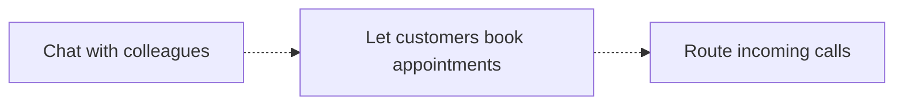

🏠 [Specs](../../../README.md) › 🧩 [Functional capabilities](../../README.md) › 🎙️ [F4 Meetings](../README.md) ›
🔀 [Flows](README.md) › 🔀 FL-F4-10 Benchmark additions

# 🔀 FL-F4-10 Benchmark additions

**Status:** ✅ specified

## Summary

The benchmark additions of D302: UC-F4-17, UC-F4-18, UC-F4-19. Each step stands on its own.

## Personas

- [U01 Employee](../../../01-users/personas/u01-employee.md)
- [U02 Manager](../../../01-users/personas/u02-manager.md)
- [U03 Sales](../../../01-users/personas/u03-sales.md)
- [U07 Administrator](../../../01-users/personas/u07-administrator.md)
- [U09 Customer](../../../01-users/personas/u09-customer.md)
- [U14 Field worker](../../../01-users/personas/u14-field-worker.md)

## Flowchart

## Sequence diagram

See each use case.

## Steps

| Step | Persona | Screen | Use case | What happens |
|---|---|---|---|---|
| 1 | U01, U02 | [S-F4-15](../screens/10-benchmark-additions/s-f04-15-chat.md) | [UC-F4-17](../use-cases/10-benchmark-additions/uc-f04-17-chat-with-colleagues.md) | Chat with colleagues |
| 2 | U09, U03, U14 | [S-F4-16](../screens/10-benchmark-additions/s-f04-16-booking-page.md) | [UC-F4-18](../use-cases/10-benchmark-additions/uc-f04-18-let-customers-book-appointments.md) | Let customers book appointments |
| 3 | U07, U03 | [S-F4-17](../screens/10-benchmark-additions/s-f04-17-call-routing.md) | [UC-F4-19](../use-cases/10-benchmark-additions/uc-f04-19-route-incoming-calls.md) | Route incoming calls |

### Entities and screens

| Entity | States in this flow | Shown at step and screen | Aggregated view |
|---|---|---|---|
| [E-F2-18 Resource booking](../../f02-no-code-configuration/data/e-f02-18-resource-booking.md) | Requested, Confirmed, Cancelled, Done, No show | Shown elsewhere: [S-SC06-08 Bookings](../../../08-sectors/sc06-hospitality/screens/03-rooms-and-bookings/s-sc06-08-bookings.md) | Resource bookings |
| [E-F4-01 Meeting](../data/e-f04-01-meeting.md) | Planned, Live, Ended, Waiting for review, Checked | Shown elsewhere: [S-F4-01 Meeting](../screens/01-record-an-online-meeting/s-f04-01-meeting.md) | Meetings |

## Errors

As each use case; E1 shows one of them.

## Images

Every step and error, for each persona taking part, in light and dark mode (D120). Steps are numbered as in the Steps
table; E rows are the error cases.

| Step | Persona | Device | Light | Dark |
|---|---|---|---|---|
| 1 | U01 | phone | [light](../images/10-benchmark-additions/u01-employee/1-chat-phone-light.png) | [dark](../images/10-benchmark-additions/u01-employee/1-chat-phone-dark.png) |
| 1 | U01 | desktop | [light](../images/10-benchmark-additions/u01-employee/1-chat-desktop-light.png) | [dark](../images/10-benchmark-additions/u01-employee/1-chat-desktop-dark.png) |
| 1 | U02 | desktop | [light](../images/10-benchmark-additions/u02-manager/1-chat-desktop-light.png) | [dark](../images/10-benchmark-additions/u02-manager/1-chat-desktop-dark.png) |
| 1 | U02 | phone | [light](../images/10-benchmark-additions/u02-manager/1-chat-phone-light.png) | [dark](../images/10-benchmark-additions/u02-manager/1-chat-phone-dark.png) |
| 2 | U09 | phone | [light](../images/10-benchmark-additions/u09-customer/2-booking-phone-light.png) | [dark](../images/10-benchmark-additions/u09-customer/2-booking-phone-dark.png) |
| 2 | U03 | desktop | [light](../images/10-benchmark-additions/u03-sales/2-booking-desktop-light.png) | [dark](../images/10-benchmark-additions/u03-sales/2-booking-desktop-dark.png) |
| 2 | U03 | phone | [light](../images/10-benchmark-additions/u03-sales/2-booking-phone-light.png) | [dark](../images/10-benchmark-additions/u03-sales/2-booking-phone-dark.png) |
| 2 | U03 | tablet | [light](../images/10-benchmark-additions/u03-sales/2-booking-tablet-light.png) | [dark](../images/10-benchmark-additions/u03-sales/2-booking-tablet-dark.png) |
| 2 | U14 | phone | [light](../images/10-benchmark-additions/u14-field-worker/2-booking-phone-light.png) | [dark](../images/10-benchmark-additions/u14-field-worker/2-booking-phone-dark.png) |
| 3 | U07 | desktop | [light](../images/10-benchmark-additions/u07-administrator/3-call-routing-desktop-light.png) | [dark](../images/10-benchmark-additions/u07-administrator/3-call-routing-desktop-dark.png) |
| 3 | U03 | desktop | [light](../images/10-benchmark-additions/u03-sales/3-call-routing-desktop-light.png) | [dark](../images/10-benchmark-additions/u03-sales/3-call-routing-desktop-dark.png) |
| 3 | U03 | phone | [light](../images/10-benchmark-additions/u03-sales/3-call-routing-phone-light.png) | [dark](../images/10-benchmark-additions/u03-sales/3-call-routing-phone-dark.png) |
| 3 | U03 | tablet | [light](../images/10-benchmark-additions/u03-sales/3-call-routing-tablet-light.png) | [dark](../images/10-benchmark-additions/u03-sales/3-call-routing-tablet-dark.png) |
| E1 | U09 | phone | [light](../images/10-benchmark-additions/u09-customer/e1-slot-taken-phone-light.png) | [dark](../images/10-benchmark-additions/u09-customer/e1-slot-taken-phone-dark.png) |

## Open questions

None.

---

⬅️ [FL-F4-09 Score calls and interviews](fl-f04-09-score-calls-and-interviews.md) · ⬆️ [Up](README.md) ·
➡️ [FL-F4-11 Insights and accessibility](fl-f04-11-insights-and-accessibility.md)
