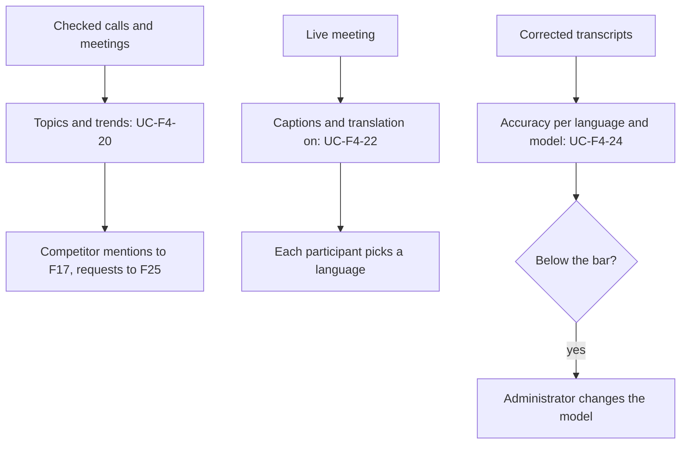

🏠 [Specs](../../../README.md) › 🧩 [Functional capabilities](../../README.md) › 🎙️ [F4 Meetings](../README.md) ›
🔀 [Flows](README.md) › 🔀 FL-F4-11 Insights and accessibility

# 🔀 FL-F4-11 Insights and accessibility

**Status:** ✅ specified

## Summary

What many calls say together (topics, objections, competitors, requests), live captions and translation for those who
need them, and how accurate transcription is per language and model.

## Personas

- [U03 Sales](../../../01-users/personas/u03-sales.md)
- [U07 Administrator](../../../01-users/personas/u07-administrator.md)
- [U13 Owner](../../../01-users/personas/u13-owner.md)

## Flowchart

## Sequence diagram

- [UC-F4-20 Analyse topics and trends across calls](../use-cases/11-insights-and-accessibility/uc-f04-20-analyse-topics-and-trends-across-calls.md#sequence-diagram)

## Steps

| Step | Persona | Screen | Use case | What happens |
|---|---|---|---|---|
| 1 | [U13](../../../01-users/personas/u13-owner.md) | [S-F4-18](../screens/11-insights-and-accessibility/s-f04-18-topics.md) | [UC-F4-20](../use-cases/11-insights-and-accessibility/uc-f04-20-analyse-topics-and-trends-across-calls.md) | See the topics and trends of the quarter's sales calls |
| 2 | [U03](../../../01-users/personas/u03-sales.md) | [S-F4-02](../screens/01-record-an-online-meeting/s-f04-02-live-transcript.md) | [UC-F4-22](../use-cases/11-insights-and-accessibility/uc-f04-22-turn-on-live-captions-and-translation.md) | Turn on captions translated into English |
| 3 | [U07](../../../01-users/personas/u07-administrator.md) | [S-F4-20](../screens/11-insights-and-accessibility/s-f04-20-transcription-accuracy.md) | [UC-F4-24](../use-cases/11-insights-and-accessibility/uc-f04-24-track-transcription-accuracy-per-language-and-model.md) | Compare transcription accuracy per language and model |

### Entities and screens

| Entity | States in this flow | Shown at step and screen | Aggregated view |
|---|---|---|---|
| [E-F4-01 Meeting](../data/e-f04-01-meeting.md) | Planned, Live, Ended, Waiting for review, Checked | 1 [S-F4-18](../screens/11-insights-and-accessibility/s-f04-18-topics.md); 2 [S-F4-02](../screens/01-record-an-online-meeting/s-f04-02-live-transcript.md) | Meetings |
| [E-F4-13 Call topic](../data/e-f04-13-call-topic.md) | Recorded | 1 [S-F4-18](../screens/11-insights-and-accessibility/s-f04-18-topics.md) | Call topics |
| [E-F17-20 Call topic signal](../../f17-competitive-analysis/data/e-f17-20-call-topic-signal.md) | Counted, Used, Dismissed | Shown elsewhere: [S-F17-13 Battle cards](../../f17-competitive-analysis/screens/03-analyse-and-arm-sales/s-f17-13-battle-cards.md) | Call topic signals |
| [E-F25-01 Bug or feature request](../../f25-devops-agents/data/e-f25-01-bug-or-feature-request.md) | Active | Shown elsewhere: [S-F25-02 Request a feature](../../f25-devops-agents/screens/01-intake/s-f25-02-request-a-feature.md) | Bug or feature requests |
| [E-F4-02 Transcript](../data/e-f04-02-transcript.md) | Live, Complete, Checked | 2 [S-F4-02](../screens/01-record-an-online-meeting/s-f04-02-live-transcript.md) | Transcripts |
| [E-F4-15 Accuracy measure](../data/e-f04-15-accuracy-measure.md) | Recorded | 3 [S-F4-20](../screens/11-insights-and-accessibility/s-f04-20-transcription-accuracy.md) | Accuracy measures |
| [E-T07-01 Model](../../../03-technical/t07-ai-providers-and-models/data/e-t07-01-model.md) | Active | Shown elsewhere: [S-T07-01 Model](../../../03-technical/t07-ai-providers-and-models/screens/s-t07-01-model.md), from the admin list [S-T07-L01](../../../03-technical/t07-ai-providers-and-models/screens/00-lists/s-t07-l01-models.md) | Models |

## Errors

Too few calls for a trend, a language without a caption model, no corrected transcript to measure (BR-F4-24, BR-F4-25,
BR-F4-27).

## Images

Every step and error, for each persona taking part, in light and dark mode (D120). Steps are numbered as in the Steps
table; E rows are the error cases.

| Step | Persona | Device | Light | Dark |
|---|---|---|---|---|
| 1 | U13 | desktop | [light](../images/11-insights-and-accessibility/u13-owner/1-topics-desktop-light.png) | [dark](../images/11-insights-and-accessibility/u13-owner/1-topics-desktop-dark.png) |
| 1 | U13 | phone | [light](../images/11-insights-and-accessibility/u13-owner/1-topics-phone-light.png) | [dark](../images/11-insights-and-accessibility/u13-owner/1-topics-phone-dark.png) |
| 2 | U03 | desktop | [light](../images/11-insights-and-accessibility/u03-sales/2-live-transcript-desktop-light.png) | [dark](../images/11-insights-and-accessibility/u03-sales/2-live-transcript-desktop-dark.png) |
| 2 | U03 | phone | [light](../images/11-insights-and-accessibility/u03-sales/2-live-transcript-phone-light.png) | [dark](../images/11-insights-and-accessibility/u03-sales/2-live-transcript-phone-dark.png) |
| 2 | U03 | tablet | [light](../images/11-insights-and-accessibility/u03-sales/2-live-transcript-tablet-light.png) | [dark](../images/11-insights-and-accessibility/u03-sales/2-live-transcript-tablet-dark.png) |
| 3 | U07 | desktop | [light](../images/11-insights-and-accessibility/u07-administrator/3-transcription-accuracy-desktop-light.png) | [dark](../images/11-insights-and-accessibility/u07-administrator/3-transcription-accuracy-desktop-dark.png) |
| E1 | U13 | desktop | [light](../images/11-insights-and-accessibility/u13-owner/e1-topics-refused-desktop-light.png) | [dark](../images/11-insights-and-accessibility/u13-owner/e1-topics-refused-desktop-dark.png) |
| E1 | U13 | phone | [light](../images/11-insights-and-accessibility/u13-owner/e1-topics-refused-phone-light.png) | [dark](../images/11-insights-and-accessibility/u13-owner/e1-topics-refused-phone-dark.png) |

## Open questions

None.

---

⬅️ [FL-F4-10 Benchmark additions](fl-f04-10-benchmark-additions.md) · ⬆️ [Up](README.md) ·
➡️ [FL-F4-12 Rooms and client video](fl-f04-12-rooms-and-client-video.md)
