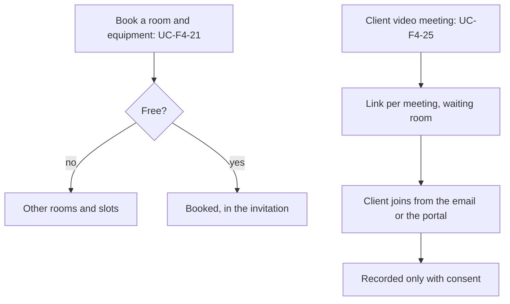

🏠 [Specs](../../../README.md) › 🧩 [Functional capabilities](../../README.md) › 🎙️ [F4 Meetings](../README.md) ›
🔀 [Flows](README.md) › 🔀 FL-F4-12 Rooms and client video

# 🔀 FL-F4-12 Rooms and client video

**Status:** ✅ specified

## Summary

Meeting rooms and equipment booked through the shared booking engine, and video meetings with clients
(teleconsultations, client meetings) hosted through the connected suite.

## Personas

- [U01 Employee](../../../01-users/personas/u01-employee.md)
- [U09 Customer](../../../01-users/personas/u09-customer.md)
- [U36 Professional](../../../01-users/personas/u36-professional.md)

## Flowchart

## Sequence diagram

- [UC-F4-25 Hold a client video meeting](../use-cases/12-rooms-and-client-video/uc-f04-25-hold-a-client-video-meeting.md#sequence-diagram)

## Steps

| Step | Persona | Screen | Use case | What happens |
|---|---|---|---|---|
| 1 | [U01](../../../01-users/personas/u01-employee.md) | [S-F4-19](../screens/12-rooms-and-client-video/s-f04-19-room-booking.md) | [UC-F4-21](../use-cases/12-rooms-and-client-video/uc-f04-21-book-a-meeting-room-and-equipment.md) | Book a meeting room with a screen |
| 2 | [U36](../../../01-users/personas/u36-professional.md) | [S-F4-21](../screens/12-rooms-and-client-video/s-f04-21-client-video-meeting.md) | [UC-F4-25](../use-cases/12-rooms-and-client-video/uc-f04-25-hold-a-client-video-meeting.md) | Start a video meeting with a client |
| 3 | [U09](../../../01-users/personas/u09-customer.md) | [S-F4-21](../screens/12-rooms-and-client-video/s-f04-21-client-video-meeting.md) | [UC-F4-25](../use-cases/12-rooms-and-client-video/uc-f04-25-hold-a-client-video-meeting.md) | The client joins from the link |

### Entities and screens

| Entity | States in this flow | Shown at step and screen | Aggregated view |
|---|---|---|---|
| [E-F2-17 Bookable resource setting](../../f02-no-code-configuration/data/e-f02-17-bookable-resource-setting.md) | Draft, Published, Archived | 1 [S-F4-19](../screens/12-rooms-and-client-video/s-f04-19-room-booking.md) | Bookable resource settings |
| [E-F4-01 Meeting](../data/e-f04-01-meeting.md) | Planned, Live, Ended, Waiting for review, Checked | 1 [S-F4-19](../screens/12-rooms-and-client-video/s-f04-19-room-booking.md); 2, 3 [S-F4-21](../screens/12-rooms-and-client-video/s-f04-21-client-video-meeting.md) | Meetings |
| [E-F4-16 Client video meeting](../data/e-f04-16-client-video-meeting.md) | Planned, Waiting | 2, 3 [S-F4-21](../screens/12-rooms-and-client-video/s-f04-21-client-video-meeting.md) | Client video meetings |
| [E-T10-02 Notification](../../../03-technical/t10-translations-and-notifications/data/e-t10-02-notification.md) | Active | Shown elsewhere: [S-T10-02 Notification](../../../03-technical/t10-translations-and-notifications/screens/s-t10-02-notification.md), from the admin list [S-T10-L02](../../../03-technical/t10-translations-and-notifications/screens/00-lists/s-t10-l02-notifications.md) | Notifications |
| [E-F1-17 Portal account](../../f01-administration/data/e-f01-17-portal-account.md) | Invited, Active, Blocked, Deactivated | Shown elsewhere: [S-F1-19 Portal accounts](../../f01-administration/screens/12-portal-accounts-and-integrations/s-f01-19-portal-accounts.md) | Portal accounts |

## Errors

A room taken meanwhile, a client link expired, a client refusing recording (BR-F2-18, BR-F4-28).

## Images

Every step and error, for each persona taking part, in light and dark mode (D120). Steps are numbered as in the Steps
table; E rows are the error cases.

| Step | Persona | Device | Light | Dark |
|---|---|---|---|---|
| 1 | U01 | desktop | [light](../images/12-rooms-and-client-video/u01-employee/1-room-booking-desktop-light.png) | [dark](../images/12-rooms-and-client-video/u01-employee/1-room-booking-desktop-dark.png) |
| 1 | U01 | phone | [light](../images/12-rooms-and-client-video/u01-employee/1-room-booking-phone-light.png) | [dark](../images/12-rooms-and-client-video/u01-employee/1-room-booking-phone-dark.png) |
| 2 | U36 | desktop | [light](../images/12-rooms-and-client-video/u36-professional/2-client-video-meeting-desktop-light.png) | [dark](../images/12-rooms-and-client-video/u36-professional/2-client-video-meeting-desktop-dark.png) |
| 2 | U36 | phone | [light](../images/12-rooms-and-client-video/u36-professional/2-client-video-meeting-phone-light.png) | [dark](../images/12-rooms-and-client-video/u36-professional/2-client-video-meeting-phone-dark.png) |
| 3 | U09 | phone | [light](../images/12-rooms-and-client-video/u09-customer/3-client-video-meeting-phone-light.png) | [dark](../images/12-rooms-and-client-video/u09-customer/3-client-video-meeting-phone-dark.png) |
| E1 | U01 | desktop | [light](../images/12-rooms-and-client-video/u01-employee/e1-room-booking-refused-desktop-light.png) | [dark](../images/12-rooms-and-client-video/u01-employee/e1-room-booking-refused-desktop-dark.png) |
| E1 | U01 | phone | [light](../images/12-rooms-and-client-video/u01-employee/e1-room-booking-refused-phone-light.png) | [dark](../images/12-rooms-and-client-video/u01-employee/e1-room-booking-refused-phone-dark.png) |

## Open questions

None.

---

⬅️ [FL-F4-11 Insights and accessibility](fl-f04-11-insights-and-accessibility.md) · ⬆️ [Up](README.md) ·
➡️ [FL-F4-13 Outside people and follow-up](fl-f04-13-outside-people-and-follow-up.md)
