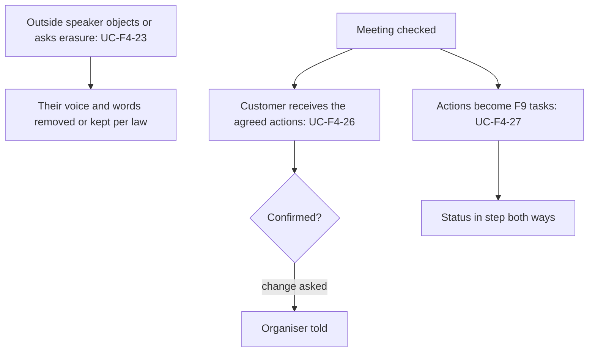

🏠 [Specs](../../../README.md) › 🧩 [Functional capabilities](../../README.md) › 🎙️ [F4 Meetings](../README.md) ›
🔀 [Flows](README.md) › 🔀 FL-F4-13 Outside people and follow-up

# 🔀 FL-F4-13 Outside people and follow-up

**Status:** ✅ specified

## Summary

Outside speakers object to their recording or ask for erasure; customers receive the actions agreed and confirm them;
meeting actions stay in step with F9 tasks.

## Personas

- [U02 Manager](../../../01-users/personas/u02-manager.md)
- [U07 Administrator](../../../01-users/personas/u07-administrator.md)
- [U09 Customer](../../../01-users/personas/u09-customer.md)

## Flowchart

## Sequence diagram

- [UC-F4-26 Receive and confirm the agreed actions](../use-cases/13-outside-people-and-follow-up/uc-f04-26-receive-and-confirm-the-agreed-actions.md#sequence-diagram)

## Steps

| Step | Persona | Screen | Use case | What happens |
|---|---|---|---|---|
| 1 | [U07](../../../01-users/personas/u07-administrator.md) | [S-F4-22](../screens/13-outside-people-and-follow-up/s-f04-22-speaker-requests.md) | [UC-F4-23](../use-cases/13-outside-people-and-follow-up/uc-f04-23-handle-an-outside-speakers-objection-or-erasure.md) | Handle an outside speaker's erasure request |
| 2 | [U09](../../../01-users/personas/u09-customer.md) | [S-F4-23](../screens/13-outside-people-and-follow-up/s-f04-23-agreed-actions.md) | [UC-F4-26](../use-cases/13-outside-people-and-follow-up/uc-f04-26-receive-and-confirm-the-agreed-actions.md) | The customer reads and confirms the agreed actions |
| 3 | [U02](../../../01-users/personas/u02-manager.md) | [S-F4-05](../screens/03-review-a-meeting/s-f04-05-meeting-review.md) | [UC-F4-27](../use-cases/13-outside-people-and-follow-up/uc-f04-27-keep-meeting-actions-in-step-with-tasks.md) | An action becomes a task and its status follows |

### Entities and screens

| Entity | States in this flow | Shown at step and screen | Aggregated view |
|---|---|---|---|
| [E-F4-14 Speaker request](../data/e-f04-14-speaker-request.md) | Received, Done, Refused | 1 [S-F4-22](../screens/13-outside-people-and-follow-up/s-f04-22-speaker-requests.md) | Speaker requests |
| [E-F4-02 Transcript](../data/e-f04-02-transcript.md) | Live, Complete, Checked | 1 [S-F4-22](../screens/13-outside-people-and-follow-up/s-f04-22-speaker-requests.md) | Transcripts |
| [E-F4-01 Meeting](../data/e-f04-01-meeting.md) | Planned, Live, Ended, Waiting for review, Checked | 2 [S-F4-23](../screens/13-outside-people-and-follow-up/s-f04-23-agreed-actions.md); 3 [S-F4-05](../screens/03-review-a-meeting/s-f04-05-meeting-review.md) | Meetings |
| [E-F4-04 Action item](../data/e-f04-04-action-item.md) | Open, Done | 2 [S-F4-23](../screens/13-outside-people-and-follow-up/s-f04-23-agreed-actions.md); 3 [S-F4-05](../screens/03-review-a-meeting/s-f04-05-meeting-review.md) | Action items |
| [E-F9-18 Project and task](../../f09-hr-and-projects/data/e-f09-18-project-and-task.md) | New, Planned, Active, Delivered, Done | Shown elsewhere: [S-F9-17 Projects](../../f09-hr-and-projects/screens/06-plan-and-deliver-work/s-f09-17-projects.md) | Project and tasks |

## Errors

An erasure request on a meeting under legal hold, a customer disputing an action, a task deleted in F9 (BR-F4-26,
BR-F4-29, BR-F4-30).

## Images

Every step and error, for each persona taking part, in light and dark mode (D120). Steps are numbered as in the Steps
table; E rows are the error cases.

| Step | Persona | Device | Light | Dark |
|---|---|---|---|---|
| 1 | U07 | desktop | [light](../images/13-outside-people-and-follow-up/u07-administrator/1-speaker-requests-desktop-light.png) | [dark](../images/13-outside-people-and-follow-up/u07-administrator/1-speaker-requests-desktop-dark.png) |
| 2 | U09 | phone | [light](../images/13-outside-people-and-follow-up/u09-customer/2-agreed-actions-phone-light.png) | [dark](../images/13-outside-people-and-follow-up/u09-customer/2-agreed-actions-phone-dark.png) |
| 3 | U02 | desktop | [light](../images/13-outside-people-and-follow-up/u02-manager/3-meeting-review-desktop-light.png) | [dark](../images/13-outside-people-and-follow-up/u02-manager/3-meeting-review-desktop-dark.png) |
| 3 | U02 | phone | [light](../images/13-outside-people-and-follow-up/u02-manager/3-meeting-review-phone-light.png) | [dark](../images/13-outside-people-and-follow-up/u02-manager/3-meeting-review-phone-dark.png) |
| E1 | U07 | desktop | [light](../images/13-outside-people-and-follow-up/u07-administrator/e1-speaker-requests-refused-desktop-light.png) | [dark](../images/13-outside-people-and-follow-up/u07-administrator/e1-speaker-requests-refused-desktop-dark.png) |

## Open questions

None.

---

⬅️ [FL-F4-12 Rooms and client video](fl-f04-12-rooms-and-client-video.md) · ⬆️ [Up](README.md) ·
➡️ [FL-F4-14 Video messages, webinars and templates](fl-f04-14-video-messages-and-webinars.md)
