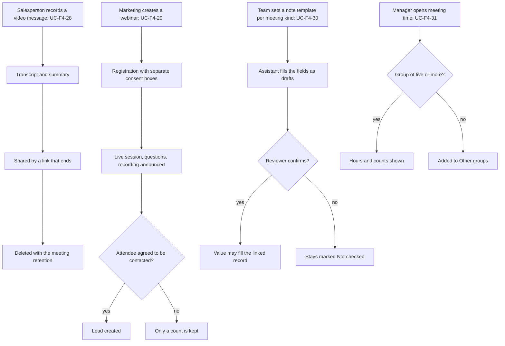
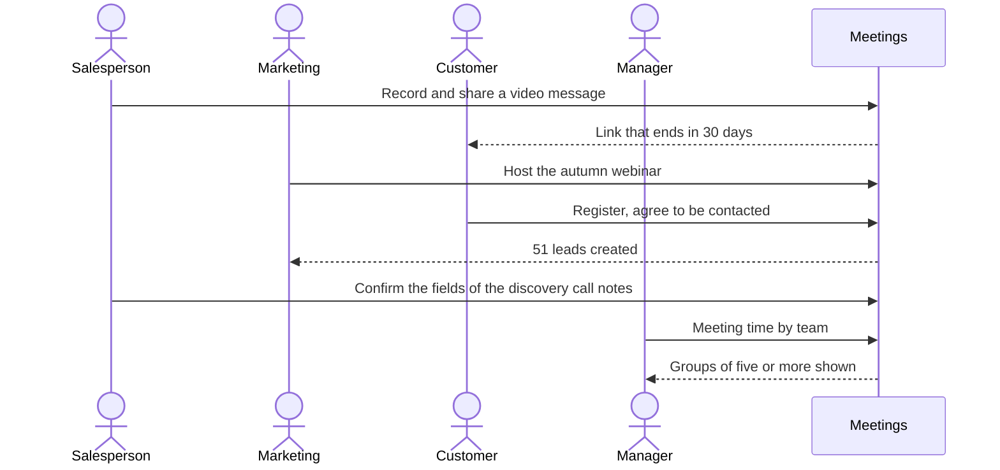

🏠 [Specs](../../../README.md) › 🧩 [Functional capabilities](../../README.md) › 🎙️ [F4 Meetings](../README.md) ›
🔀 [Flows](README.md) › 🔀 FL-F4-14 Video messages, webinars and templates

# 🔀 FL-F4-14 Video messages, webinars and templates

**Status:** ✅ specified

## Summary

Four additions to meetings: a recorded video message shared by a link that expires
([UC-F4-28](../use-cases/14-video-messages-and-webinars/uc-f04-28-record-and-share-a-video-message.md)), a webinar for
many people whose attendees become leads only with consent
([UC-F4-29](../use-cases/14-video-messages-and-webinars/uc-f04-29-host-a-webinar.md)), a note template per kind of
meeting whose AI-filled fields stay drafts until reviewed
([UC-F4-30](../use-cases/14-video-messages-and-webinars/uc-f04-30-choose-a-note-template-per-meeting-type.md)) and an
analysis of the time spent in meetings that never shows groups under five people
([UC-F4-31](../use-cases/14-video-messages-and-webinars/uc-f04-31-analyse-time-spent-in-meetings.md)). The owner chose
each in the 2026-11-14 interview ([D523](../../../06-decisions/f04-meetings/d523-benchmark-gaps-f04-meetings.md)).

## Personas

- [U03 Sales](../../../01-users/personas/u03-sales.md)
- [U01 Employee](../../../01-users/personas/u01-employee.md)
- [U12 Marketing and communication](../../../01-users/personas/u12-marketing.md)
- [U09 Customer](../../../01-users/personas/u09-customer.md)
- [U06 Human resources](../../../01-users/personas/u06-hr.md)
- [U02 Manager](../../../01-users/personas/u02-manager.md)
- [U13 Owner](../../../01-users/personas/u13-owner.md)

## Flowchart

## Sequence diagram

## Steps

| Step | Persona | Screen | Use case | What happens |
|---|---|---|---|---|
| 1 | [U03](../../../01-users/personas/u03-sales.md), [U01](../../../01-users/personas/u01-employee.md) | [S-F4-25](../screens/14-video-messages-and-webinars/s-f04-25-video-message.md) | [UC-F4-28](../use-cases/14-video-messages-and-webinars/uc-f04-28-record-and-share-a-video-message.md) | A salesperson records a video message for a customer and shares it, or an employee records one for a colleague on a phone |
| 2 | [U12](../../../01-users/personas/u12-marketing.md), [U09](../../../01-users/personas/u09-customer.md) | [S-F4-26](../screens/14-video-messages-and-webinars/s-f04-26-webinar.md) | [UC-F4-29](../use-cases/14-video-messages-and-webinars/uc-f04-29-host-a-webinar.md) | Marketing creates and hosts a webinar and a customer registers and attends from a phone |
| 3 | [U03](../../../01-users/personas/u03-sales.md), [U06](../../../01-users/personas/u06-hr.md) | [S-F4-27](../screens/14-video-messages-and-webinars/s-f04-27-note-templates.md) | [UC-F4-30](../use-cases/14-video-messages-and-webinars/uc-f04-30-choose-a-note-template-per-meeting-type.md) | Sales or HR defines the fields of the notes of a kind of meeting |
| 4 | [U02](../../../01-users/personas/u02-manager.md), [U13](../../../01-users/personas/u13-owner.md) | [S-F4-28](../screens/14-video-messages-and-webinars/s-f04-28-meeting-time-analytics.md) | [UC-F4-31](../use-cases/14-video-messages-and-webinars/uc-f04-31-analyse-time-spent-in-meetings.md) | A manager or the owner reads the time spent in meetings |

### Entities and screens

| Entity | States in this flow | Shown at step and screen | Aggregated view |
|---|---|---|---|
| [E-F4-27 Video message](../data/e-f04-27-video-message.md) | Recording, Uploaded, Shared, Expired, Deleted | 1 [S-F4-25](../screens/14-video-messages-and-webinars/s-f04-25-video-message.md) | Video messages |
| [E-F4-28 Webinar](../data/e-f04-28-webinar.md) | Draft, Scheduled, Live, Ended, Replay published, Cancelled | 2 [S-F4-26](../screens/14-video-messages-and-webinars/s-f04-26-webinar.md) | Webinars |
| [E-F4-29 Note template](../data/e-f04-29-note-template.md) | Draft, Active, Retired | 3 [S-F4-27](../screens/14-video-messages-and-webinars/s-f04-27-note-templates.md) | Note templates |

## Errors

- **E1 The recording fails.** The user is told at once and nothing is kept
  ([BR-F4-33](../business-rules/br-f04-33-video-messages-follow-meeting-retention.md)), step 1.
- **E2 An attendee did not agree to be contacted.** No lead is created
  ([BR-F4-34](../business-rules/br-f04-34-webinar-attendees-become-leads-only-with-consent.md)), step 2.
- **E3 An AI-filled field is not reviewed.** It stays marked Not checked and is not copied
  ([BR-F4-35](../business-rules/br-f04-35-ai-filled-template-fields-stay-drafts-until-reviewed.md)), step 3.
- **E4 A group has fewer than five people.** It is added to Other groups
  ([BR-F4-36](../business-rules/br-f04-36-meeting-analytics-never-show-groups-under-five-people.md)), step 4.

## Images

Every step and error, for each persona taking part, in light and dark mode (D120). Steps are numbered as in the Steps
table; E rows are the error cases.

| Step | Persona | Device | Light | Dark |
|---|---|---|---|---|
| 1 | U01 | phone | [light](../images/14-video-messages-and-webinars/u01-employee/1-video-message-phone-light.png) | [dark](../images/14-video-messages-and-webinars/u01-employee/1-video-message-phone-dark.png) |
| 1 | U03 | desktop | [light](../images/14-video-messages-and-webinars/u03-sales/1-video-message-desktop-light.png) | [dark](../images/14-video-messages-and-webinars/u03-sales/1-video-message-desktop-dark.png) |
| 1 | U01 | desktop | [light](../images/14-video-messages-and-webinars/u01-employee/1-video-message-desktop-light.png) | [dark](../images/14-video-messages-and-webinars/u01-employee/1-video-message-desktop-dark.png) |
| 1 | U01 | phone | [light](../images/14-video-messages-and-webinars/u01-employee/1-video-message-phone-light.png) | [dark](../images/14-video-messages-and-webinars/u01-employee/1-video-message-phone-dark.png) |
| 1 | U03 | desktop | [light](../images/14-video-messages-and-webinars/u03-sales/1-video-message-desktop-light.png) | [dark](../images/14-video-messages-and-webinars/u03-sales/1-video-message-desktop-dark.png) |
| 1 | U03 | phone | [light](../images/14-video-messages-and-webinars/u03-sales/1-video-message-phone-light.png) | [dark](../images/14-video-messages-and-webinars/u03-sales/1-video-message-phone-dark.png) |
| 1 | U03 | tablet | [light](../images/14-video-messages-and-webinars/u03-sales/1-video-message-tablet-light.png) | [dark](../images/14-video-messages-and-webinars/u03-sales/1-video-message-tablet-dark.png) |
| 2 | U09 | phone | [light](../images/14-video-messages-and-webinars/u09-customer/2-webinar-phone-light.png) | [dark](../images/14-video-messages-and-webinars/u09-customer/2-webinar-phone-dark.png) |
| 2 | U12 | desktop | [light](../images/14-video-messages-and-webinars/u12-marketing/2-webinar-desktop-light.png) | [dark](../images/14-video-messages-and-webinars/u12-marketing/2-webinar-desktop-dark.png) |
| 2 | U09 | phone | [light](../images/14-video-messages-and-webinars/u09-customer/2-webinar-phone-light.png) | [dark](../images/14-video-messages-and-webinars/u09-customer/2-webinar-phone-dark.png) |
| 2 | U12 | desktop | [light](../images/14-video-messages-and-webinars/u12-marketing/2-webinar-desktop-light.png) | [dark](../images/14-video-messages-and-webinars/u12-marketing/2-webinar-desktop-dark.png) |
| 2 | U12 | phone | [light](../images/14-video-messages-and-webinars/u12-marketing/2-webinar-phone-light.png) | [dark](../images/14-video-messages-and-webinars/u12-marketing/2-webinar-phone-dark.png) |
| 3 | U03 | desktop | [light](../images/14-video-messages-and-webinars/u03-sales/3-note-templates-desktop-light.png) | [dark](../images/14-video-messages-and-webinars/u03-sales/3-note-templates-desktop-dark.png) |
| 3 | U06 | desktop | [light](../images/14-video-messages-and-webinars/u06-hr/3-note-templates-desktop-light.png) | [dark](../images/14-video-messages-and-webinars/u06-hr/3-note-templates-desktop-dark.png) |
| 3 | U03 | desktop | [light](../images/14-video-messages-and-webinars/u03-sales/3-note-templates-desktop-light.png) | [dark](../images/14-video-messages-and-webinars/u03-sales/3-note-templates-desktop-dark.png) |
| 3 | U03 | phone | [light](../images/14-video-messages-and-webinars/u03-sales/3-note-templates-phone-light.png) | [dark](../images/14-video-messages-and-webinars/u03-sales/3-note-templates-phone-dark.png) |
| 3 | U03 | tablet | [light](../images/14-video-messages-and-webinars/u03-sales/3-note-templates-tablet-light.png) | [dark](../images/14-video-messages-and-webinars/u03-sales/3-note-templates-tablet-dark.png) |
| 3 | U06 | desktop | [light](../images/14-video-messages-and-webinars/u06-hr/3-note-templates-desktop-light.png) | [dark](../images/14-video-messages-and-webinars/u06-hr/3-note-templates-desktop-dark.png) |
| 4 | U02 | desktop | [light](../images/14-video-messages-and-webinars/u02-manager/4-meeting-time-analytics-desktop-light.png) | [dark](../images/14-video-messages-and-webinars/u02-manager/4-meeting-time-analytics-desktop-dark.png) |
| 4 | U13 | desktop | [light](../images/14-video-messages-and-webinars/u13-owner/4-meeting-time-analytics-desktop-light.png) | [dark](../images/14-video-messages-and-webinars/u13-owner/4-meeting-time-analytics-desktop-dark.png) |
| 4 | U02 | desktop | [light](../images/14-video-messages-and-webinars/u02-manager/4-meeting-time-analytics-desktop-light.png) | [dark](../images/14-video-messages-and-webinars/u02-manager/4-meeting-time-analytics-desktop-dark.png) |
| 4 | U02 | phone | [light](../images/14-video-messages-and-webinars/u02-manager/4-meeting-time-analytics-phone-light.png) | [dark](../images/14-video-messages-and-webinars/u02-manager/4-meeting-time-analytics-phone-dark.png) |
| 4 | U13 | desktop | [light](../images/14-video-messages-and-webinars/u13-owner/4-meeting-time-analytics-desktop-light.png) | [dark](../images/14-video-messages-and-webinars/u13-owner/4-meeting-time-analytics-desktop-dark.png) |
| 4 | U13 | phone | [light](../images/14-video-messages-and-webinars/u13-owner/4-meeting-time-analytics-phone-light.png) | [dark](../images/14-video-messages-and-webinars/u13-owner/4-meeting-time-analytics-phone-dark.png) |
| E1 | U03 | desktop | [light](../images/14-video-messages-and-webinars/u03-sales/e1-the-recording-fails-desktop-light.png) | [dark](../images/14-video-messages-and-webinars/u03-sales/e1-the-recording-fails-desktop-dark.png) |
| E1 | U03 | phone | [light](../images/14-video-messages-and-webinars/u03-sales/e1-the-recording-fails-phone-light.png) | [dark](../images/14-video-messages-and-webinars/u03-sales/e1-the-recording-fails-phone-dark.png) |
| E1 | U03 | tablet | [light](../images/14-video-messages-and-webinars/u03-sales/e1-the-recording-fails-tablet-light.png) | [dark](../images/14-video-messages-and-webinars/u03-sales/e1-the-recording-fails-tablet-dark.png) |

## Open questions

None.

---

⬅️ [FL-F4-13 Outside people and follow-up](fl-f04-13-outside-people-and-follow-up.md) · ⬆️ [Up](README.md)
