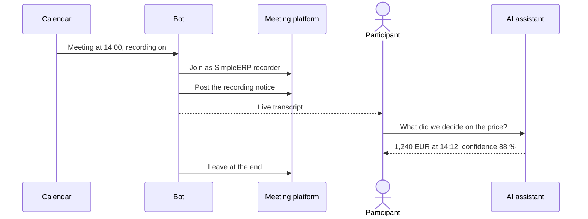

🏠 [Specs](../../../../README.md) › 🧩 [Functional capabilities](../../../README.md) › 🎙️ [F4 Meetings](../../README.md) ›
📝 [Use cases](../README.md) › 📝 [Use cases: FL-F4-01 Record an online meeting](README.md) ›
📝 UC-F4-01 Record an online meeting with the bot

# 📝 UC-F4-01 Record an online meeting with the bot

**Status:** ✅ specified

## Summary

The bot joins online meetings of connected calendars by default, announces itself, and produces a live transcript;
participants can ask the AI assistant about the meeting.

## Personas

- [U02 Manager](../../../../01-users/personas/u02-manager.md)
- [U03 Sales](../../../../01-users/personas/u03-sales.md)
- [U13 Owner](../../../../01-users/personas/u13-owner.md)
- Any internal participant (D218)

## Goal

No meeting is lost; nobody takes notes.

## Trigger

A calendar meeting starts; or a participant pastes a meeting link and starts the bot.

## Frequency

Several meetings a day per manager or sales person.

## Preconditions

The platform connection is set up (UC-F4-08); the user's Google Calendar or Microsoft 365 calendar is synchronised both
ways ([BR-F4-17](../../business-rules/br-f04-17-calendars-sync-both-ways.md)).

## Postconditions

A meeting record with its transcript, waiting for review (UC-F4-05).

## Main flow

1. A meeting from a connected calendar starts; recording is on by default
   ([BR-F4-06](../../business-rules/br-f04-06-the-bot-joins-calendar-meetings-by-default.md)), with the bot as source
   ([BR-F4-07](../../business-rules/br-f04-07-the-organiser-picks-the-source.md)).
2. The bot joins as "SimpleERP recorder" and posts its notice (BR-F4-01).
3. Participants with SimpleERP see the live transcript
   ([BR-F4-09](../../business-rules/br-f04-09-live-answers-need-70-confidence.md)).
4. At the end, the bot leaves; the meeting record holds the transcript, and the summary follows.

## Alternative flows

- 1a. **Started by a participant:** any internal participant pastes a link or starts the bot from the meeting record
  ([BR-F4-08](../../business-rules/br-f04-08-any-internal-participant-can-start.md)).
- 1b. **Switched off:** the meeting was switched off beforehand; nothing joins.
- 3a. **Ask the AI assistant:** a participant asks about the meeting; it answers only at 70 % confidence or more.
- 3b. **Mark a moment:** a participant marks a passage as a decision or an action.

## Error flows

- 2e. The bot is refused entry (waiting room, external tenant): the organiser is told, with "Let SimpleERP recorder in"
  (error message pattern, D122).
- 2e. A participant asks it to stop or leave: it stops (BR-F4-01).
- 4e. The connection drops: the bot rejoins after retries (BR-F3-32); a gap is marked in the transcript.

## Business rules

- [BR-F4-01 Every recording is announced](../../business-rules/br-f04-01-every-recording-is-announced.md)
- [BR-F4-06 The bot joins calendar meetings by default](../../business-rules/br-f04-06-the-bot-joins-calendar-meetings-by-default.md)
- [BR-F4-07 The organiser picks the source](../../business-rules/br-f04-07-the-organiser-picks-the-source.md)
- [BR-F4-08 Any internal participant can start](../../business-rules/br-f04-08-any-internal-participant-can-start.md)
- [BR-F4-09 Live answers need 70 % confidence](../../business-rules/br-f04-09-live-answers-need-70-confidence.md)

- [BR-F4-02 No voice prints](../../business-rules/br-f04-02-no-voice-prints.md)

## Entities

- [E-F4-01 Meeting](../../data/e-f04-01-meeting.md)
- [E-F4-02 Transcript](../../data/e-f04-02-transcript.md)
- [E-F4-18 Recording notice](../../data/e-f04-18-recording-notice.md)

## Permissions

Any internal participant starts; access as BR-F4-04.

## Notifications

Organiser: the bot refused entry; participants: the transcript ready for review.

## Audit events

Recording started (by whom), stopped (by whom), bot joined and left.

## AI involvement

Speech-to-text and summaries (F1 AI settings, D82), local by default; the live assistant at 70 % confidence.

## API, MCP and A2A exposure

The platforms' APIs through their connections (T6).

## Screens

- [S-F4-01 Meeting](../../screens/01-record-an-online-meeting/s-f04-01-meeting.md)
- [S-F4-02 Live transcript](../../screens/01-record-an-online-meeting/s-f04-02-live-transcript.md)

## Flowchart

See [FL-F4-01 Record an online meeting](../../flows/fl-f04-01-record-an-online-meeting.md#flowchart).

## Sequence diagram

## Acceptance criteria

1. **Given** Acme Bâtiment's weekly site meeting in Lyon synced from Google Calendar and not switched off **when** it
   starts at 08:30 **then** the bot "SimpleERP recorder" joins and posts its notice in the chat.
2. **Given** the same meeting switched off the day before **when** it starts **then** nothing joins.
3. **Given** Paul Morel, an internal participant, pastes a Teams link at 10:02 **when** he starts the bot **then** it
   joins within a minute.
4. **Given** a recorded meeting **when** the site's subcontractor says "stop recording" **then** recording stops and the
   transcript says so.
5. **Given** a live meeting **when** Lea opens it in SimpleERP **then** the transcript shows as spoken, within 3
   seconds.
6. **Given** a question about the meeting answered with 60 % confidence **when** Lea asks it **then** the AI assistant
   says it is not sure and shows the passages.

## Non-functional notes

Live transcript within 3 seconds of speech.

## Regulatory references

GDPR: information of participants (articles 13, 14); recording announced (BR-F4-01).

## Related use cases

UC-F4-02; UC-F4-05; UC-F4-08; UC-F3-06 (calendar connection).

- [UC-F4-22 Turn on live captions and translation](../11-insights-and-accessibility/uc-f04-22-turn-on-live-captions-and-translation.md)

## Open questions

None.

---

⬆️ [Up](README.md) · ➡️ [UC-F4-02 Import a platform's own transcript](uc-f04-02-import-a-platform-s-own-transcript.md)
