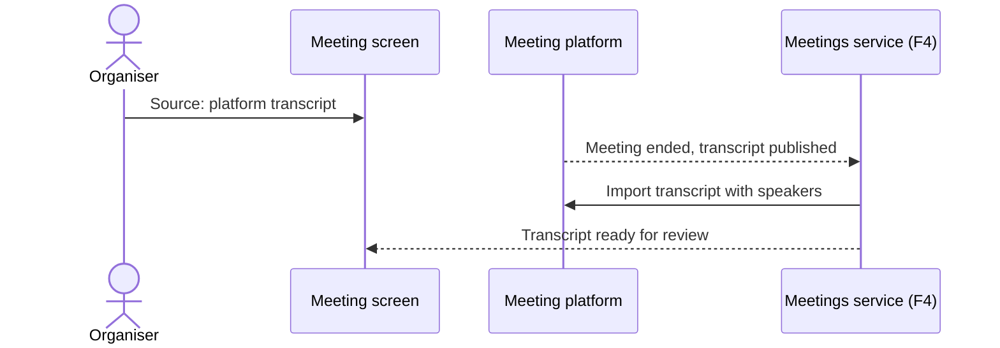

🏠 [Specs](../../../../README.md) › 🧩 [Functional capabilities](../../../README.md) › 🎙️ [F4 Meetings](../../README.md) ›
📝 [Use cases](../README.md) › 📝 [Use cases: FL-F4-01 Record an online meeting](README.md) ›
📝 UC-F4-02 Import a platform's own transcript

# 📝 UC-F4-02 Import a platform's own transcript

**Status:** 🔄 waiting for the owner

## Summary

When the organiser chose the platform's own transcript, SimpleERP imports it after the meeting instead of sending the
bot.

## Personas

- [U02 Manager](../../../../01-users/personas/u02-manager.md)
- [U03 Sales](../../../../01-users/personas/u03-sales.md)
- [U13 Owner](../../../../01-users/personas/u13-owner.md)
- Any internal participant (D218)

## Goal

Use the platform's transcript where it is good, with no bot in the call.

## Trigger

A recorded meeting ends on Teams, Meet or Zoom.

## Frequency

As UC-F4-01.

## Preconditions

The platform connection can read transcripts (UC-F4-08); the platform announced its recording (BR-F4-01).

## Postconditions

- **Succeeded:** the platform's transcript is in the meeting record, with speakers and times, waiting for review.
- **Failed:** no transcript is imported; the organiser is told and offered the bot next time.

## Main flow

1. The organiser chose "platform transcript" for the meeting
   ([BR-F4-07](../../business-rules/br-f04-07-the-organiser-picks-the-source.md)).
2. The meeting ends; the platform publishes its transcript.
3. SimpleERP imports it into the meeting record, with speakers and times.
4. The summary follows; review as UC-F4-05.

## Alternative flows

- 2a. **No live transcript:** with an imported transcript, the live transcript of BR-F4-09 is not available;
  the meeting record says so.

## Error flows

- 2e. No transcript published (transcription was off): the organiser is told, after retries (BR-F3-32), and
  offered the bot next time.
- 3e. The connection lacks the right to read transcripts: the administrator is told (UC-F4-08).

## Business rules

- [BR-F4-07 The organiser picks the source](../../business-rules/br-f04-07-the-organiser-picks-the-source.md)
- [BR-F4-01 Every recording is announced](../../business-rules/br-f04-01-every-recording-is-announced.md)

## Entities

- [E-F4-01 Meeting](../../data/e-f04-01-meeting.md)
- [E-F4-02 Transcript](../../data/e-f04-02-transcript.md)

## Permissions

Participants and the organiser, as [BR-F4-04](../../business-rules/br-f04-04-transcripts-stay-with-participants.md);
settings by administrators.

## Notifications

- The organiser: the transcript imported, or none published.
- The administrator: the connection lacks the right to read transcripts.

## Audit events

Transcript imported, with the platform and the meeting; import failures.

## AI involvement

Summaries by the summaries model (D82) once imported; nothing runs during the meeting.

## API, MCP and A2A exposure

Read from the platform's API through its connection (T6).

## Screens

- [S-F4-01 Meeting](../../screens/01-record-an-online-meeting/s-f04-01-meeting.md)

## Flowchart

See [FL-F4-01 Record an online meeting](../../flows/fl-f04-01-record-an-online-meeting.md#flowchart).

## Sequence diagram

## Acceptance criteria

1. **Given** a Teams meeting of Delorme Conseil set to "platform transcript" **when** it ends and Teams publishes its
   transcript **then** SimpleERP imports it with the speakers' names and times.
2. **Given** the same **when** it is imported **then** the meeting record says no live transcript was available.
3. **Given** transcription off in Teams **when** the meeting ends **then** after retries, the organiser is told and
   offered the bot next time.
4. **Given** a connection without the transcript right **when** the import runs **then** the administrator is told which
   right is missing.

## Non-functional notes

Imported within 10 minutes of the platform publishing it (Proposed).

## Regulatory references

GDPR information of participants (articles 13 and 14); recordings announced,
[CR-FR-059](../../../../10-country-packs/france/ai-and-recording/cr-fr-059-recordings-are-announced.md).

## Related use cases

UC-F4-01; UC-F4-05; UC-F4-08.

## Open questions

None.

---

⬅️ [UC-F4-01 Record an online meeting with the bot](uc-f04-01-record-an-online-meeting-with-the-bot.md) ·
⬆️ [Up](README.md) ·
➡️ [UC-F4-03 Record an in-person meeting](../02-record-in-person-or-by-phone/uc-f04-03-record-an-in-person-meeting.md)
