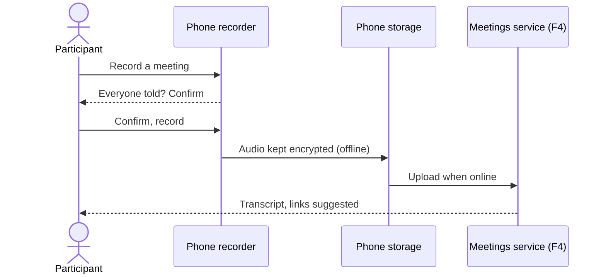

🏠 [Specs](../../../../README.md) › 🧩 [Functional capabilities](../../../README.md) › 🎙️ [F4 Meetings](../../README.md) ›
📝 [Use cases](../README.md) › 📝 [Use cases: FL-F4-02 Record in person or by phone](README.md) ›
📝 UC-F4-03 Record an in-person meeting

# 📝 UC-F4-03 Record an in-person meeting

**Status:** ✅ specified

## Summary

A participant records an in-person meeting with the phone app or a computer, online or offline.

## Personas

- [U03 Sales](../../../../01-users/personas/u03-sales.md)
- [U14 Field worker](../../../../01-users/personas/u14-field-worker.md)
- Any internal participant

## Goal

Site meetings and customer visits are kept like online ones.

## Trigger

A meeting in a room, on a site, at a customer's.

## Frequency

Weekly per field worker or sales person.

## Preconditions

The phone app or simple-ERP on a computer, with microphone access.

## Postconditions

A meeting with its transcript, links suggested, waiting for review.

## Main flow

1. The participant chooses "Record a meeting".
2. The app asks to confirm everyone was told
   ([BR-F4-01](../../business-rules/br-f04-01-every-recording-is-announced.md)), then shows "Recording".
3. At the end, they stop; the audio is uploaded and transcribed.
4. Links are suggested from the calendar event or the current task
   ([BR-F4-12](../../business-rules/br-f04-12-links-are-suggested-then-confirmed.md)); review as UC-F4-05.

## Alternative flows

- 3a. **Offline:** recorded and kept encrypted, uploaded later
  ([BR-F4-10](../../business-rules/br-f04-10-offline-recordings-upload-later.md)).
- 2a. **Someone asks to stop:** anyone can stop it.

## Error flows

- 1e. Microphone access refused: the app says how to allow it.
- 3e. Upload fails: retried (BR-F3-32), then flagged.
- 3e. Audio too noisy to transcribe: said at review, passages marked.

## Business rules

- [BR-F4-01](../../business-rules/br-f04-01-every-recording-is-announced.md)
- [BR-F4-10 Offline recordings upload later](../../business-rules/br-f04-10-offline-recordings-upload-later.md)
- [BR-F4-12 Links are suggested, then confirmed](../../business-rules/br-f04-12-links-are-suggested-then-confirmed.md)

## Entities

- [E-F4-01 Meeting](../../data/e-f04-01-meeting.md)
- [E-F4-02 Transcript](../../data/e-f04-02-transcript.md)

## Permissions

Any internal participant (BR-F4-08).

## Notifications

The user: upload done, or waiting after 7 days.

## Audit events

Recording started, stopped, uploaded.

## AI involvement

Speech-to-text and summaries, as UC-F4-01.

## API, MCP and A2A exposure

None.

## Screens

- [S-F4-03 Phone recorder](../../screens/02-record-in-person-or-by-phone/s-f04-03-phone-recorder.md)
- [S-F4-01 Meeting](../../screens/01-record-an-online-meeting/s-f04-01-meeting.md)

## Flowchart

See [FL-F4-02 Record in person or by phone](../../flows/fl-f04-02-record-in-person-or-by-phone.md#flowchart).

## Sequence diagram

## Acceptance criteria

1. **Given** a site manager of Acme Bâtiment in a basement with no network **when** she records the 30-minute site
   meeting **then** the audio is kept encrypted on the phone.
2. **Given** the network back **when** the phone syncs **then** the audio is uploaded, removed from the phone and
   transcribed.
3. **Given** the calendar event "Site Lyon 3, weekly" **when** the transcript is ready **then** the site Lyon 3 is
   suggested as link.
4. **Given** microphone access refused **when** she taps Record **then** the app says how to allow it.
5. **Given** a participant asks to stop **when** anyone taps Stop **then** recording stops.

## Non-functional notes

Up to 3 hours of audio per recording.

## Regulatory references

GDPR information (articles 13, 14); recording of private words without consent is an offence in France (Code pénal,
article 226-1): hence BR-F4-01.

## Related use cases

UC-F4-05; UC-F3-09 (phone app).

## Open questions

None.

---

⬅️ [UC-F4-02](../01-record-an-online-meeting/uc-f04-02-import-a-platform-s-own-transcript.md) · ⬆️ [Up](README.md) ·
➡️ [UC-F4-04 Record a phone call](uc-f04-04-record-a-phone-call.md)
