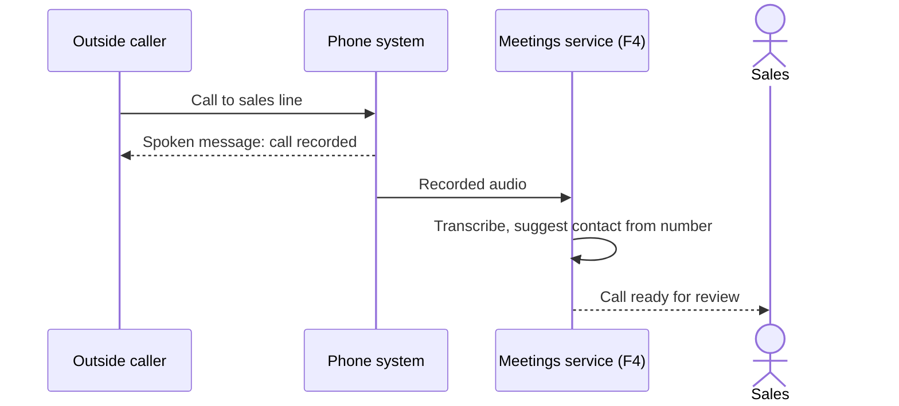

🏠 [Specs](../../../../README.md) › 🧩 [Functional capabilities](../../../README.md) › 🎙️ [F4 Meetings](../../README.md) ›
📝 [Use cases](../README.md) › 📝 [Use cases: FL-F4-02 Record in person or by phone](README.md) ›
📝 UC-F4-04 Record a phone call

# 📝 UC-F4-04 Record a phone call

**Status:** 🔄 waiting for the owner

## Summary

External business calls through the company phone system are recorded, announced, transcribed and linked to the contact.

## Personas

- [U03 Sales](../../../../01-users/personas/u03-sales.md)
- [U04 Purchasing](../../../../01-users/personas/u04-purchasing.md)
- Any user of the phone system

## Goal

What was agreed on the phone is kept.

## Trigger

An external call through the phone system.

## Frequency

Daily for sales and purchasing.

## Preconditions

The phone system is connected (UC-F4-08).

Call recording switched on by an administrator for a purpose of this team, the staff committee consulted
([D449](../../../../06-decisions/f04-meetings/d449-call-recording-off-by-default.md), BR-F4-11).

## Postconditions

A meeting of kind phone, with its transcript, linked by number, waiting for review.

## Main flow

1. An external call starts; the spoken message plays
   ([BR-F4-01](../../business-rules/br-f04-01-every-recording-is-announced.md)).
2. The call is recorded ([BR-F4-11](../../business-rules/br-f04-11-business-calls-are-recorded.md)).
3. At hang-up, it is transcribed; the contact is suggested from the number
   ([BR-F4-12](../../business-rules/br-f04-12-links-are-suggested-then-confirmed.md)).
4. Review as UC-F4-05.

## Alternative flows

- 2a. **Switched off** by the user during the call.
- 2b. **The other party asks to stop:** stopped.
- 1a. **Internal call:** not recorded.

## Error flows

- 1e. The phone system connection is down: calls go through, unrecorded; the administrator is told after retries.
- 3e. Unknown number: no suggestion.

## Business rules

- [BR-F4-01](../../business-rules/br-f04-01-every-recording-is-announced.md)
- [BR-F4-11 Business calls recorded only when switched on](../../business-rules/br-f04-11-business-calls-are-recorded.md)
- [BR-F4-12 Links are suggested, then confirmed](../../business-rules/br-f04-12-links-are-suggested-then-confirmed.md)

## Entities

- [E-F4-01 Meeting](../../data/e-f04-01-meeting.md)
- [E-F4-02 Transcript](../../data/e-f04-02-transcript.md)
- [E-F4-18 Recording notice](../../data/e-f04-18-recording-notice.md)

## Permissions

Any user whose calls go through the company phone system, once an administrator switched recording on for that team
([BR-F4-11](../../business-rules/br-f04-11-business-calls-are-recorded.md)).

## Notifications

Administrator: the phone system unreachable.

## Audit events

Call recorded, stopped, by whom.

## AI involvement

As UC-F4-01.

## API, MCP and A2A exposure

The phone system's API or SIP recording (T6).

## Screens

- [S-F4-04 Call](../../screens/02-record-in-person-or-by-phone/s-f04-04-call.md)
- [S-F4-01 Meeting](../../screens/01-record-an-online-meeting/s-f04-01-meeting.md)

## Flowchart

See [FL-F4-02 Record in person or by phone](../../flows/fl-f04-02-record-in-person-or-by-phone.md#flowchart).

## Sequence diagram

## Acceptance criteria

1. **Given** recording switched on for the sales team of Distribution Lemoine **when** a customer calls the sales line
   **then** the spoken message plays and the call is recorded.
2. **Given** the number 04 72 00 00 00 on the customer Brasserie du Parc **when** the call ends **then** Brasserie du
   Parc is suggested as link.
3. **Given** an internal call between two colleagues **when** it is answered **then** it is not recorded.
4. **Given** the other party asks to stop **when** the seller stops it **then** the rest of the call is not recorded.
5. **Given** the phone system connection down **when** a call is made **then** it goes through unrecorded and the
   administrator is told after retries.

## Non-functional notes

Transcribed within 5 minutes of hang-up (Proposed).

## Regulatory references

Recording of private words (Code pénal, article 226-1); GDPR information of the other party by the opening message;
staff committee consulted ([D449](../../../../06-decisions/f04-meetings/d449-call-recording-off-by-default.md)).

## Related use cases

UC-F4-05; UC-F4-08.

## Open questions

None.

---

⬅️ [UC-F4-03 Record an in-person meeting](uc-f04-03-record-an-in-person-meeting.md) · ⬆️ [Up](README.md) ·
➡️ [UC-F4-05 Review a meeting](../03-review-a-meeting/uc-f04-05-review-a-meeting.md)
