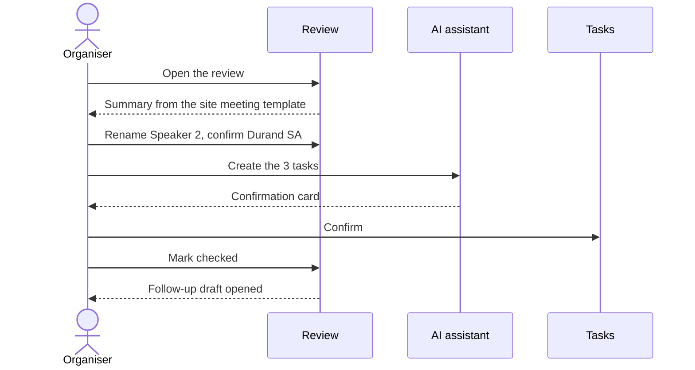

🏠 [Specs](../../../../README.md) › 🧩 [Functional capabilities](../../../README.md) › 🎙️ [F4 Meetings](../../README.md) ›
📝 [Use cases](../README.md) › 📝 [Use cases: FL-F4-03 Review a meeting](README.md) › 📝 UC-F4-05 Review a meeting

# 📝 UC-F4-05 Review a meeting

**Status:** ✅ specified

## Summary

The organiser checks the transcript and summary, names speakers, confirms links, turns actions into tasks and sends the
follow-up.

## Personas

- Organisers: [U02 Manager](../../../../01-users/personas/u02-manager.md),
  [U03 Sales](../../../../01-users/personas/u03-sales.md), [U13 Owner](../../../../01-users/personas/u13-owner.md),
  [U14 Field worker](../../../../01-users/personas/u14-field-worker.md)
- Participants

## Goal

A meeting's outcomes become work in the ERP.

## Trigger

The transcript is ready.

## Frequency

After every recorded meeting.

## Preconditions

A meeting waiting for review (UC-F4-01 to UC-F4-04).

## Postconditions

Checked: summary published, links confirmed, tasks created, audio deleted (BR-F4-03).

## Main flow

1. The organiser opens the meeting's review.
2. The summary follows the meeting kind's template
   ([BR-F4-13](../../business-rules/br-f04-13-summaries-follow-the-meeting-kind.md)); they correct it if needed.
3. They rename speakers (BR-F4-02) and confirm the suggested links (BR-F4-12).
4. Actions: colleagues' become tasks through the confirmation card; outsiders' go to the follow-up draft
   ([BR-F4-14](../../business-rules/br-f04-14-colleagues-get-tasks-outsiders-the-follow-up.md)).
5. They mark it checked; the follow-up draft opens to send.

## Alternative flows

- 1a. **Not reviewed:** reminded after 1 working day, published "not checked" after 3
  ([BR-F4-15](../../business-rules/br-f04-15-unreviewed-meetings-publish-as-not-checked.md)).
- 2a. **Change the kind:** another template is applied.
- 5a. **No follow-up:** the organiser skips it.

## Error flows

- 2e. Summary not produced (model unavailable): retries (BR-F3-32), then the error message pattern (D122), transcript
  still available.
- 4e. A task's owner left the company: the organiser picks another.

## Business rules

- [BR-F4-13 Summaries follow the meeting kind](../../business-rules/br-f04-13-summaries-follow-the-meeting-kind.md)
- [BR-F4-14 Colleagues get tasks, outsiders the follow-up](../../business-rules/br-f04-14-colleagues-get-tasks-outsiders-the-follow-up.md)
- [BR-F4-15 Unreviewed meetings publish as not checked](../../business-rules/br-f04-15-unreviewed-meetings-publish-as-not-checked.md)

- [BR-F4-02 No voice prints](../../business-rules/br-f04-02-no-voice-prints.md)

- [BR-F4-05 Summaries in the reader's language](../../business-rules/br-f04-05-summaries-in-the-reader-s-language.md)

## Entities

- [E-F4-03 Summary template](../../data/e-f04-03-summary-template.md)
- [E-F4-04 Action item](../../data/e-f04-04-action-item.md)
- [E-F4-01 Meeting](../../data/e-f04-01-meeting.md)
- [E-F4-17 Meeting summary](../../data/e-f04-17-meeting-summary.md)
- [E-F4-19 Follow-up email](../../data/e-f04-19-follow-up-email.md)

## Permissions

The organiser reviews; participants read; configurators manage templates.

## Notifications

Organiser: reminder; participants: summary published; task owners: new tasks.

## Audit events

Checked, links confirmed, tasks created, published not checked.

## AI involvement

Summary, decisions and actions extracted by the summaries model (D82).

## API, MCP and A2A exposure

Summaries readable through the API with the caller's rights.

## Screens

- [S-F4-05 Meeting review](../../screens/03-review-a-meeting/s-f04-05-meeting-review.md)

## Flowchart

See [FL-F4-03 Review a meeting](../../flows/fl-f04-03-review-a-meeting.md#flowchart).

## Sequence diagram

## Acceptance criteria

1. **Given** a site meeting of Acme Bâtiment **when** the organiser opens its review **then** the summary has the site
   minutes sections.
2. **Given** an action "order the scaffolding" for Paul Morel due 2026-12-03 **when** it is confirmed **then** a task
   exists for Paul with that date.
3. **Given** an action for the customer Durand SA **when** reviewing **then** it is in the follow-up draft.
4. **Given** no review 3 working days after the meeting of 2026-11-24 **when** 2026-11-27 passes **then** participants
   get the summary marked "not checked" and no task is created.
5. **Given** a checked meeting **when** it is marked checked **then** its audio is deleted.

## Non-functional notes

Summary ready within 5 minutes of the transcript.

## Regulatory references

GDPR: accuracy, the organiser corrects; data minimisation (BR-F4-03).

## Related use cases

UC-F4-01 to UC-F4-04; UC-F3-03; UC-F3-04.

- [UC-F4-23 Handle an outside speaker's objection or erasure](../13-outside-people-and-follow-up/uc-f04-23-handle-an-outside-speakers-objection-or-erasure.md)

- [UC-F4-26 Receive and confirm the agreed actions](../13-outside-people-and-follow-up/uc-f04-26-receive-and-confirm-the-agreed-actions.md)

- [UC-F4-27 Keep meeting actions in step with tasks](../13-outside-people-and-follow-up/uc-f04-27-keep-meeting-actions-in-step-with-tasks.md)

## Open questions

None.

---

⬅️ [UC-F4-04 Record a phone call](../02-record-in-person-or-by-phone/uc-f04-04-record-a-phone-call.md) ·
⬆️ [Up](README.md) ·
➡️ [UC-F4-06 Find and reuse past meetings](../04-find-and-reuse-meetings/uc-f04-06-find-and-reuse-past-meetings.md)
