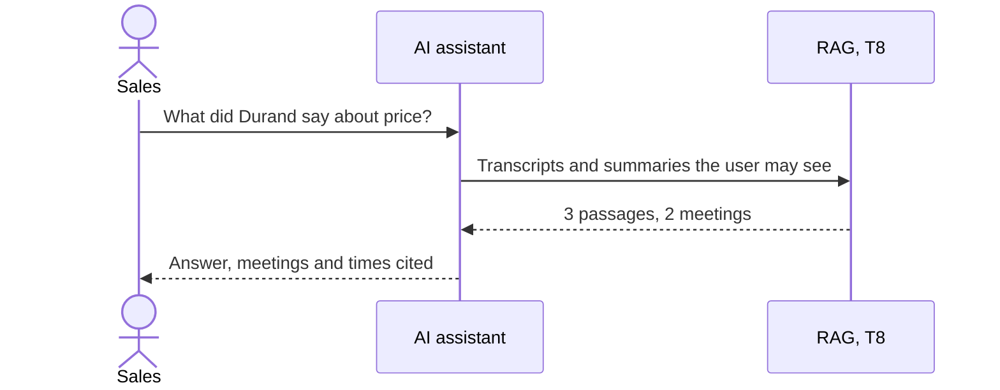

🏠 [Specs](../../../../README.md) › 🧩 [Functional capabilities](../../../README.md) › 🎙️ [F4 Meetings](../../README.md) ›
📝 [Use cases](../README.md) › 📝 [Use cases: FL-F4-04 Find and reuse meetings](README.md) ›
📝 UC-F4-06 Find and reuse past meetings

# 📝 UC-F4-06 Find and reuse past meetings

**Status:** ✅ specified

## Summary

Users find past meetings, ask the AI assistant about what was said, and recurring meetings start from a drafted agenda.

## Personas

- Every internal persona, for the meetings they may see (BR-F4-04)

## Goal

Find what was said and decided, and start recurring meetings prepared.

## Trigger

"What did Durand say about price?"; a recurring meeting coming up.

## Frequency

Weekly.

## Preconditions

Meetings the user may see (BR-F4-04).

## Postconditions

An answer with passages, or an agenda draft.

## Main flow

1. The user opens Meetings ([S-F4-06](../../screens/04-find-and-reuse-meetings/s-f04-06-meetings.md)) and searches by
   title, participant, linked record or words, or asks the AI assistant.
2. The AI assistant answers from the transcripts and summaries the user may see
   ([BR-F4-04](../../business-rules/br-f04-04-transcripts-stay-with-participants.md)), citing the meeting and the time
   ([BR-F3-01](../../../f03-assistant/business-rules/br-f03-01-answers-cite-their-sources.md)).
3. The user opens the passage in its meeting.
4. For a recurring meeting, its next agenda is drafted from open actions and points
   ([BR-F4-16](../../business-rules/br-f04-16-recurring-meetings-get-their-next-agenda.md)).

## Alternative flows

- 2a. **Summary only:** a reader of the linked record sees summaries, never transcripts.

## Error flows

- 2e. Nothing found: "not found" as [BR-F3-04](../../../f03-assistant/business-rules/br-f03-04-never-invent.md).

## Business rules

- [BR-F4-16 Recurring meetings get their next agenda](../../business-rules/br-f04-16-recurring-meetings-get-their-next-agenda.md)
- [BR-F4-04 Transcripts stay with participants](../../business-rules/br-f04-04-transcripts-stay-with-participants.md)

## Entities

- [E-F4-01 Meeting](../../data/e-f04-01-meeting.md)
- [E-F4-02 Transcript](../../data/e-f04-02-transcript.md)
- [E-F4-04 Action item](../../data/e-f04-04-action-item.md)
- [E-F4-17 Meeting summary](../../data/e-f04-17-meeting-summary.md)
- [E-F4-22 Meeting agenda](../../data/e-f04-22-meeting-agenda.md)

## Permissions

Every user, for the meetings they may see
([BR-F4-04](../../business-rules/br-f04-04-transcripts-stay-with-participants.md)); readers of a linked record see
summaries only.

## Notifications

None; a recurring meeting's agenda draft is shown in its prep brief.

## Audit events

Searches are not logged; opening a transcript is logged.

## AI involvement

The AI assistant answers from transcripts and summaries the user may see, citing meeting and time
([BR-F3-01](../../../f03-assistant/business-rules/br-f03-01-answers-cite-their-sources.md)).

## API, MCP and A2A exposure

T5 search of meetings; the MCP tool of F4 with the caller's rights.

## Screens

- [S-F4-06 Meetings](../../screens/04-find-and-reuse-meetings/s-f04-06-meetings.md)

## Flowchart

See [FL-F4-04 Find and reuse meetings](../../flows/fl-f04-04-find-and-reuse-meetings.md#flowchart).

## Sequence diagram

## Acceptance criteria

1. **Given** Lea took part in 12 meetings about Durand SA **when** she asks "what did we promise Durand on delivery"
   **then** the answer cites the meeting of 2026-10-14 at 10:12.
2. **Given** a reader of Durand SA who was not in the meetings **when** she searches **then** she sees summaries, never
   transcripts.
3. **Given** the recurring Monday sales meeting with 3 open actions **when** next Monday's brief is drafted **then** the
   agenda lists the 3 actions.
4. **Given** words found in no meeting she may see **when** she searches **then** "not found" as BR-F3-04.

## Non-functional notes

Search answers within 2 seconds over 2 years of meetings.

## Regulatory references

GDPR: transcripts kept only as [BR-F4-03](../../business-rules/br-f04-03-recordings-are-deleted-once-checked.md) says.

## Related use cases

UC-F3-01; UC-F4-05.

## Open questions

None.

---

⬅️ [UC-F4-05 Review a meeting](../03-review-a-meeting/uc-f04-05-review-a-meeting.md) · ⬆️ [Up](README.md) ·
➡️ [UC-F4-07 HR meeting](../05-hr-meeting/uc-f04-07-hr-meeting.md)
