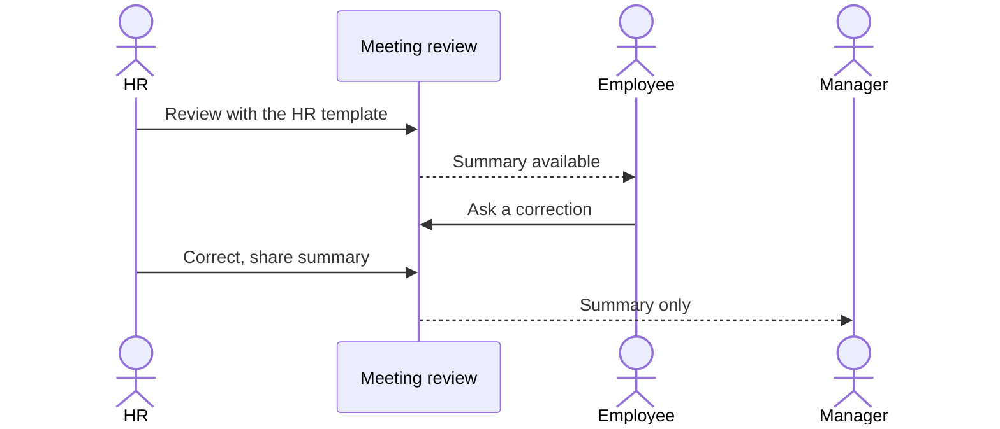

🏠 [Specs](../../../../README.md) › 🧩 [Functional capabilities](../../../README.md) › 🎙️ [F4 Meetings](../../README.md) ›
📝 [Use cases](../README.md) › 📝 [Use cases: FL-F4-05 HR meeting](README.md) › 📝 UC-F4-07 HR meeting

# 📝 UC-F4-07 HR meeting

**Status:** ✅ specified

## Summary

Interviews and reviews are recorded like other meetings, and stay between HR and the employee.

## Personas

- [U06 HR](../../../../01-users/personas/u06-hr.md)
- [U01 Employee](../../../../01-users/personas/u01-employee.md)
- [U02 Manager](../../../../01-users/personas/u02-manager.md)

## Goal

A faithful record of what was said, for both sides.

## Trigger

An HR meeting in the calendar (kind HR).

## Frequency

Yearly reviews; interviews as needed.

## Preconditions

The meeting's kind is HR (set by HR, or from its template).

## Postconditions

- **Succeeded:** the summary is checked, read by the employee, corrected if asked, shared only as HR chose.
- **Failed:** no recording: HR's notes are the record.

## Main flow

1. HR plans the meeting with the kind HR; when it starts, the recording is announced
   ([BR-F4-01](../../business-rules/br-f04-01-every-recording-is-announced.md)) on the meeting screen
   ([S-F4-01](../../screens/01-record-an-online-meeting/s-f04-01-meeting.md)).
2. At the end, HR reviews it ([S-F4-05](../../screens/03-review-a-meeting/s-f04-05-meeting-review.md)) with the HR
   summary template ([UC-F4-05](../03-review-a-meeting/uc-f04-05-review-a-meeting.md)).
3. The employee is told it is available and reads the summary on the meeting screen.
4. The employee asks a correction with a comment
   ([BR-F4-18](../../business-rules/br-f04-18-hr-meetings-are-recorded-for-hr-and-the-employee.md)); HR corrects or
   answers why not.
5. HR may share the summary, never the transcript, with the employee's manager.

## Alternative flows

- 1a. Anyone asks to stop: recording stops; HR takes notes instead
  ([BR-F4-01](../../business-rules/br-f04-01-every-recording-is-announced.md)).
- 5a. HR keeps the summary between HR and the employee: the manager sees nothing.

## Error flows

- 4e. HR refuses the correction: the employee's comment is kept beside the summary.
- 5e. The manager tries to open the transcript: refused
  ([BR-F4-18](../../business-rules/br-f04-18-hr-meetings-are-recorded-for-hr-and-the-employee.md)).
- 2e. Summary not produced: retried
  ([BR-F3-32](../../../f03-assistant/business-rules/br-f03-32-retry-before-an-error.md)), then HR writes it from the
  transcript.

## Business rules

- [BR-F4-18 HR meetings stay with HR and the employee](../../business-rules/br-f04-18-hr-meetings-are-recorded-for-hr-and-the-employee.md)
- [BR-F4-01](../../business-rules/br-f04-01-every-recording-is-announced.md)

## Entities

- [E-F4-01 Meeting](../../data/e-f04-01-meeting.md) (kind HR)
- [E-F4-17 Meeting summary](../../data/e-f04-17-meeting-summary.md)

## Permissions

HR and the employee; the manager only for a summary HR shares
([BR-F4-18](../../business-rules/br-f04-18-hr-meetings-are-recorded-for-hr-and-the-employee.md)).

## Notifications

- The employee: the summary is available; the answer to a correction.
- The manager: a summary shared with them.

## Audit events

Recorded, reviewed, read by the employee, correction asked and answered, shared.

## AI involvement

The HR summary template; no score and no evaluation from the model
([BR-F4-21](../../business-rules/br-f04-21-candidate-scoring-is-high-risk-ai.md)).

## API, MCP and A2A exposure

None: HR meetings are not exposed through the API or MCP tools.

## Screens

- [S-F4-05 Meeting review](../../screens/03-review-a-meeting/s-f04-05-meeting-review.md)
- [S-F4-01 Meeting](../../screens/01-record-an-online-meeting/s-f04-01-meeting.md)

## Flowchart

See [FL-F4-05 HR meeting](../../flows/fl-f04-05-hr-meeting.md#flowchart).

## Sequence diagram

## Acceptance criteria

1. **Given** Lea's yearly review on 2026-11-20 **when** HR checks it **then** Lea is told and reads the summary.
2. **Given** the summary says "no training wished" **when** Lea asks a correction "wished: Excel course" **then** HR is
   told and the comment is kept.
3. **Given** HR shares the summary with Pierre Martin, Lea's manager **when** he opens the meeting **then** he reads the
   summary and not the transcript.
4. **Given** Lea asks to stop recording at the start **when** she says it **then** recording stops and HR takes notes.

## Non-functional notes

As UC-F4-05.

## Regulatory references

GDPR: HR data; career-path interviews at most every 4 years and a review every 8 years
([CR-FR-039](../../../../10-country-packs/france/labour/cr-fr-039-professional-interviews.md)).

## Related use cases

UC-F4-05; F9 HR.

- [UC-F9-21 Schedule professional interviews and health visits](../../../f09-hr-and-projects/use-cases/08-hr-duties/uc-f09-21-schedule-professional-interviews-and-health-visits.md)

## Open questions

None.

---

⬅️ [UC-F4-06 Find and reuse past meetings](../04-find-and-reuse-meetings/uc-f04-06-find-and-reuse-past-meetings.md) ·
⬆️ [Up](README.md) ·
➡️ [UC-F4-08](../06-set-up-meetings-and-calendars/uc-f04-08-set-up-meeting-sources-calendars-and-retention.md)
