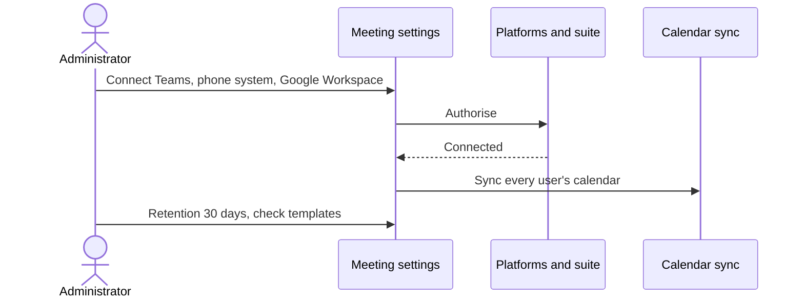

🏠 [Specs](../../../../README.md) › 🧩 [Functional capabilities](../../../README.md) › 🎙️ [F4 Meetings](../../README.md) ›
📝 [Use cases](../README.md) › 📝 [Use cases: FL-F4-06 Set up meetings and calendars](README.md) ›
📝 UC-F4-08 Set up meeting sources and calendars

# 📝 UC-F4-08 Set up meeting sources and calendars

**Status:** ✅ specified

## Summary

The administrator connects meeting platforms, the phone system and calendars, and sets the recording retention; users
connect their own calendar when there is no Workspace connection.

## Personas

- [U07 Administrator](../../../../01-users/personas/u07-administrator.md)
- Every internal persona (their own calendar)

## Goal

Meetings are captured from every source, in step with everyone's calendar.

## Trigger

First set-up; a new platform; a new user.

## Frequency

Rare.

## Preconditions

The administrator role.

## Postconditions

Sources and calendars connected; retention set.

## Main flow

1. The administrator opens Administration › Meetings.
2. They connect the platforms (Teams, Meet, Zoom, Jitsi, BigBlueButton) and the phone system (D208, D221).
3. They connect Google Workspace or Microsoft 365 once, domain-wide
   ([D229](../../../../06-decisions/f04-meetings/d229-calendar-connection.md)); every user's calendar syncs
   ([BR-F4-17](../../business-rules/br-f04-17-calendars-sync-both-ways.md)).
4. They set the recording retention (BR-F4-03) and check the summary templates (BR-F4-13).

## Alternative flows

- 3a. **No Workspace:** each user connects their own Google or Microsoft account in My connections (UC-F3-06).
- 2a. **Test:** a test meeting checks the bot can join.

## Error flows

- 2e. A platform refuses the connection: the error message pattern (D122), with what right is missing.
- 3e. A user's calendar stops syncing (token expired): the user is told to reconnect (BR-F3-19).

## Business rules

- [BR-F4-17 Calendars sync both ways](../../business-rules/br-f04-17-calendars-sync-both-ways.md)
- [BR-F4-03 Recordings are deleted once checked](../../business-rules/br-f04-03-recordings-are-deleted-once-checked.md)

## Entities

- [E-F4-05 Calendar sync](../../data/e-f04-05-calendar-sync.md)
- [E-F1-08 Agent connection](../../../f01-administration/data/e-f01-08-agent-connection.md)
- [E-F4-25 Meeting recording setting](../../data/e-f04-25-meeting-recording-setting.md)

## Permissions

Administrator; each user for their own calendar.

## Notifications

Users: calendar to reconnect; administrator: a source failing.

## Audit events

Connections added, removed; retention changed.

## AI involvement

None.

## API, MCP and A2A exposure

Google Calendar API, Microsoft Graph, the platforms' APIs (T6).

## Screens

- [S-F4-07 Meeting settings](../../screens/06-set-up-meetings-and-calendars/s-f04-07-meeting-settings.md)
- [S-F3-06 My connections](../../../f03-assistant/screens/06-use-an-outside-tool/s-f03-06-my-connections.md)

## Flowchart

See [FL-F4-06 Set up meetings and calendars](../../flows/fl-f04-06-set-up-meetings-and-calendars.md#flowchart).

## Sequence diagram

## Acceptance criteria

1. **Given** Acme Bâtiment with Google Workspace **when** the administrator connects it domain-wide **then** the 40
   users' calendars sync both ways.
2. **Given** Teams connected **when** the test meeting runs **then** the bot joins and the test says so.
3. **Given** a retention of 30 days set **when** a checked meeting is 31 days old **then** its recording is deleted.
4. **Given** no Workspace connection **when** Lea connects her own Google account **then** her calendar syncs.
5. **Given** Zoom refusing the connection **when** it is saved **then** the missing right is named.

## Non-functional notes

Sync lag under 1 minute; a full resync each night.

## Regulatory references

GDPR: the calendar data read is limited to work calendars; private events not read.

## Related use cases

UC-F1-07; UC-F3-06; UC-F4-01.

## Open questions

None.

---

⬅️ [UC-F4-07 HR meeting](../05-hr-meeting/uc-f04-07-hr-meeting.md) · ⬆️ [Up](README.md) ·
➡️ [UC-F4-09 Prepare a meeting](../07-prepare-and-capture-anywhere/uc-f04-09-prepare-a-meeting.md)
