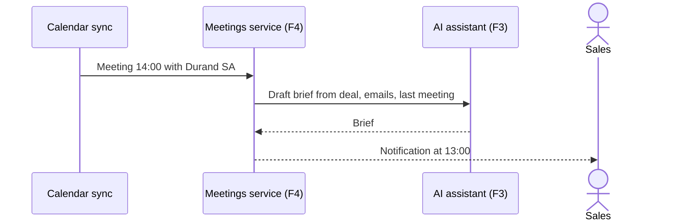

🏠 [Specs](../../../../README.md) › 🧩 [Functional capabilities](../../../README.md) › 🎙️ [F4 Meetings](../../README.md) ›
📝 [Use cases](../README.md) › 📝 [Use cases: FL-F4-07 Prepare and capture anywhere](README.md) ›
📝 UC-F4-09 Prepare a meeting

# 📝 UC-F4-09 Prepare a meeting

**Status:** ✅ specified

## Summary

Before a meeting, a prep brief gathers who comes, the records concerned, the last exchanges and the open points, so that
the organiser arrives prepared.

## Personas

- [U03 Sales](../../../../01-users/personas/u03-sales.md)
- [U02 Manager](../../../../01-users/personas/u02-manager.md)
- [U13 Owner](../../../../01-users/personas/u13-owner.md)
- Every internal persona with a calendar

## Goal

Arrive at every meeting knowing who comes, what is open and what was said last time.

## Trigger

A synced calendar meeting starts within the hour, or the user asks for the brief.

## Frequency

Before most external meetings.

## Preconditions

F4 set up (UC-F4-08).

## Postconditions

- **Succeeded:** the brief is in the meeting and sent as a notification.
- **Failed:** with nothing linked, the brief lists participants and past meetings only.

## Main flow

1. The meeting is synced from the calendar ([BR-F4-17](../../business-rules/br-f04-17-calendars-sync-both-ways.md)) and
   linked to its records ([BR-F4-12](../../business-rules/br-f04-12-links-are-suggested-then-confirmed.md)).
2. An hour before, the brief is drafted
   ([S-F4-08](../../screens/07-prepare-and-capture-anywhere/s-f04-08-meeting-prep-brief.md)): participants and their
   roles, the linked customer, deal or project, the last meetings and emails, open actions and points.
3. The organiser gets it as a notification and opens it from the meeting.
4. They add a point or remove one; the brief is kept with the meeting.

## Alternative flows

- 2a. On demand: "prepare my 14:00" in the AI assistant.
- 2b. A recurring meeting: its agenda draft
  ([BR-F4-16](../../business-rules/br-f04-16-recurring-meetings-get-their-next-agenda.md)) joins the brief.

## Error flows

- 2e. No linked record: the brief lists participants and past meetings only.
- 2e. The model is unavailable: retried
  ([BR-F3-32](../../../f03-assistant/business-rules/br-f03-32-retry-before-an-error.md)), then the brief shows the raw
  lists.

## Business rules

- [BR-F4-04 Transcripts stay with participants](../../business-rules/br-f04-04-transcripts-stay-with-participants.md)
- [BR-F3-02](../../../f03-assistant/business-rules/br-f03-02-answers-use-only-what-the-user-may-see.md)

## Entities

- [E-F4-01 Meeting](../../data/e-f04-01-meeting.md)
- [E-F4-24 Meeting prep brief](../../data/e-f04-24-meeting-prep-brief.md)
- [E-F4-26 Employee calendar](../../data/e-f04-26-employee-calendar.md): the participants' calendars,
  compared side by side to choose the time
  ([D519](../../../../06-decisions/ux/d519-view-cards-reviewed-list-pages-and-workspaces.md)).

## Permissions

The organiser and internal participants; the brief uses only what each may see
([BR-F3-02](../../../f03-assistant/business-rules/br-f03-02-answers-use-only-what-the-user-may-see.md)).

## Notifications

The organiser gets the brief an hour before.

## Audit events

Brief drafted and opened.

## AI involvement

The meetings model drafts the brief from records the user may see; it never sends it outside.

## API, MCP and A2A exposure

T5 read of the brief; the MCP tool of F4.

## Screens

- [S-F4-08](../../screens/07-prepare-and-capture-anywhere/s-f04-08-meeting-prep-brief.md)

## Flowchart

See [FL-F4-07 Prepare and capture anywhere](../../flows/fl-f04-07-prepare-and-capture-anywhere.md#flowchart).

## Sequence diagram

## Acceptance criteria

1. **Given** a meeting with Durand SA at 14:00 linked to the deal "Extension Lyon" **when** 13:00 comes **then** the
   seller gets a brief with the deal, the last meeting of 2026-11-02 and 2 open actions.
2. **Given** a meeting with no linked record **when** the brief is drafted **then** it lists the participants and past
   meetings only.
3. **Given** Lea asks "prepare my 14:00" **when** the AI assistant answers **then** the brief opens at once.
4. **Given** an email the seller may not see **when** the brief is drafted **then** it is not used.

## Non-functional notes

The brief is ready within a minute.

## Regulatory references

GDPR: data minimisation
([CR-FR-050](../../../../10-country-packs/france/data-protection/cr-fr-050-privacy-by-design.md)).

## Related use cases

UC-F4-01 to UC-F4-08.

- [UC-F4-21 Book a meeting room and equipment](../12-rooms-and-client-video/uc-f04-21-book-a-meeting-room-and-equipment.md)

## Open questions

None.

---

⬅️ [UC-F4-08](../06-set-up-meetings-and-calendars/uc-f04-08-set-up-meeting-sources-calendars-and-retention.md) ·
⬆️ [Up](README.md) ·
➡️ [UC-F4-10 Capture from the desktop, a file or dictation](uc-f04-10-capture-from-the-desktop-a-file-or-dictation.md)
