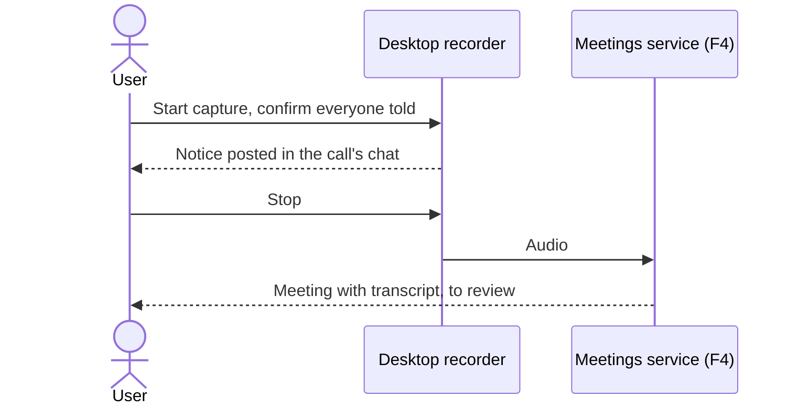

🏠 [Specs](../../../../README.md) › 🧩 [Functional capabilities](../../../README.md) › 🎙️ [F4 Meetings](../../README.md) ›
📝 [Use cases](../README.md) › 📝 [Use cases: FL-F4-07 Prepare and capture anywhere](README.md) ›
📝 UC-F4-10 Capture from the desktop, a file or dictation

# 📝 UC-F4-10 Capture from the desktop, a file or dictation

**Status:** 🔄 waiting for the owner

## Summary

Capture without a bot: the desktop app's audio in any call (Webex included), an uploaded audio or video file, or
dictation into any field.

## Personas

- Every internal persona who meets or calls

## Goal

Capture what is said anywhere, even without the bot.

## Trigger

A call on a platform the bot cannot join, a recording to upload, or dictation.

## Frequency

A few times a week per user.

## Preconditions

F4 set up (UC-F4-08).

## Postconditions

- **Succeeded:** a meeting with its transcript, or text in the field.
- **Failed:** nothing is captured; the user sees why.

## Main flow

1. The user starts desktop capture in the desktop recorder
   ([S-F4-09](../../screens/07-prepare-and-capture-anywhere/s-f04-09-desktop-recorder.md)).
2. They confirm everyone was told; the notice posts in the call's chat
   ([BR-F4-19](../../business-rules/br-f04-19-desktop-capture-is-announced-too.md)).
3. At the end, the audio is transcribed into a meeting and reviewed as any meeting
   ([UC-F4-05](../03-review-a-meeting/uc-f04-05-review-a-meeting.md)).
4. Or they upload an audio or video file, which becomes a meeting with its transcript.
5. Or they dictate into any text field; the model tidies the text on request.

## Alternative flows

- 4a. The company's recording mode is transcript only: no audio or video is stored.
- 1a. A Webex call: captured from the desktop app's audio.

## Error flows

- 4e. A file in an unknown format: refused, with the formats accepted.
- 4e. A file over 3 hours (Proposed): refused with the limit.
- 3e. Transcription fails: retried
  ([BR-F3-32](../../../f03-assistant/business-rules/br-f03-32-retry-before-an-error.md)), then the error message pattern
  (D122).

## Business rules

- [BR-F4-19 Desktop capture is announced too](../../business-rules/br-f04-19-desktop-capture-is-announced-too.md)
- [BR-F4-01 Every recording is announced](../../business-rules/br-f04-01-every-recording-is-announced.md)

## Entities

- [E-F4-01 Meeting](../../data/e-f04-01-meeting.md)
- [E-F4-02 Transcript](../../data/e-f04-02-transcript.md)
- [E-F4-18 Recording notice](../../data/e-f04-18-recording-notice.md)

## Permissions

Every user; the recording mode is set by administrators.

## Notifications

The user: the transcript is ready.

## Audit events

Capture started and stopped, file uploaded, mode used.

## AI involvement

Speech-to-text and the tidying model (D82), local by default.

## API, MCP and A2A exposure

T5 upload of a file as a meeting.

## Screens

- [S-F4-09](../../screens/07-prepare-and-capture-anywhere/s-f04-09-desktop-recorder.md)

## Flowchart

See [FL-F4-07 Prepare and capture anywhere](../../flows/fl-f04-07-prepare-and-capture-anywhere.md#flowchart).

## Sequence diagram

## Acceptance criteria

1. **Given** a Webex call of Nuvola Logiciels **when** Lea starts desktop capture and confirms **then** the notice posts
   in the call's chat.
2. **Given** a 45-minute MP4 file **when** it is uploaded **then** a meeting with its transcript is created.
3. **Given** a .xyz file **when** it is uploaded **then** it is refused with the formats accepted.
4. **Given** dictation in a task's description **when** Lea speaks and asks to tidy **then** the field holds the tidied
   text.

## Non-functional notes

Transcript of a one-hour file within 15 minutes (Proposed).

## Regulatory references

Recording of private words (Code pénal, article 226-1) and GDPR information:
[BR-F4-19](../../business-rules/br-f04-19-desktop-capture-is-announced-too.md).

## Related use cases

UC-F4-01 to UC-F4-08.

## Open questions

None.

---

⬅️ [UC-F4-09 Prepare a meeting](uc-f04-09-prepare-a-meeting.md) · ⬆️ [Up](README.md) ·
➡️ [UC-F4-11](../08-share-and-reuse-outside/uc-f04-11-share-export-and-clip-a-meeting.md)
