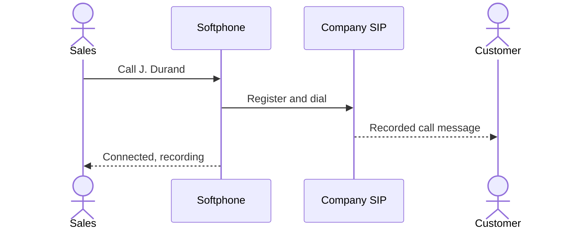

🏠 [Specs](../../../../README.md) › 🧩 [Functional capabilities](../../../README.md) › 🎙️ [F4 Meetings](../../README.md) ›
📝 [Use cases](../README.md) › 📝 [Use cases: FL-F4-07 Prepare and capture anywhere](README.md) ›
📝 UC-F4-16 Call from the softphone

# 📝 UC-F4-16 Call from the softphone

**Status:** ✅ specified

## Summary

A softphone in the web, desktop and mobile apps calls through the company's SIP phone system, with click-to-call from
records and inbound calls on mobile; calls are recorded as UC-F4-04.

## Personas

- [U03 Sales](../../../../01-users/personas/u03-sales.md)
- [U02 Manager](../../../../01-users/personas/u02-manager.md)
- [U13 Owner](../../../../01-users/personas/u13-owner.md)
- [U14 Field worker](../../../../01-users/personas/u14-field-worker.md)

## Goal

Call from the record with one click, recorded and linked like any call.

## Trigger

A user clicks a phone number, or an inbound call rings the app.

## Frequency

Daily for sales and field staff.

## Preconditions

F4 set up (UC-F4-08).

## Postconditions

- **Succeeded:** the call took place, recorded and linked as
  [UC-F4-04](../02-record-in-person-or-by-phone/uc-f04-04-record-a-phone-call.md).
- **Failed:** the call could not go through the softphone; the user is told.

## Main flow

1. The user clicks a phone number on a record; the softphone opens
   ([S-F4-13](../../screens/07-prepare-and-capture-anywhere/s-f04-13-softphone.md)).
2. It calls through the company's SIP phone system
   ([D236](../../../../06-decisions/f04-meetings/d236-softphone-over-sip.md)); the opening message plays
   ([BR-F4-01](../../business-rules/br-f04-01-every-recording-is-announced.md)).
3. The call is recorded where switched on ([BR-F4-11](../../business-rules/br-f04-11-business-calls-are-recorded.md))
   and linked to the record ([UC-F4-04](../02-record-in-person-or-by-phone/uc-f04-04-record-a-phone-call.md)).
4. At hang-up, the call's record opens for review.

## Alternative flows

- 1a. Inbound on mobile: the app rings and the caller's record shows.
- 1b. No SIP account for the user: click-to-call dials from their own phone, unrecorded.

## Error flows

- 2e. SIP registration fails: the error message pattern (D122), with the number to call meanwhile.

## Business rules

- [BR-F4-11 Business calls recorded only when switched on](../../business-rules/br-f04-11-business-calls-are-recorded.md)

## Entities

- [E-F4-01 Meeting](../../data/e-f04-01-meeting.md)

## Permissions

Users with a SIP account; recording only where switched on
([BR-F4-11](../../business-rules/br-f04-11-business-calls-are-recorded.md)).

## Notifications

Missed inbound calls; voicemail transcribed ([UC-F4-19](../10-benchmark-additions/uc-f04-19-route-incoming-calls.md)).

## Audit events

Call made or received, recorded or not.

## AI involvement

Transcription and the contact suggestion, as
[UC-F4-04](../02-record-in-person-or-by-phone/uc-f04-04-record-a-phone-call.md).

## API, MCP and A2A exposure

T5 click-to-call operation.

## Screens

- [S-F4-13](../../screens/07-prepare-and-capture-anywhere/s-f04-13-softphone.md)

## Flowchart

See [FL-F4-07 Prepare and capture anywhere](../../flows/fl-f04-07-prepare-and-capture-anywhere.md#flowchart).

## Sequence diagram

## Acceptance criteria

1. **Given** the customer Brasserie du Parc with 04 72 00 00 00 **when** the seller clicks the number **then** the
   softphone calls through the company's SIP system.
2. **Given** an inbound call on the mobile app **when** it rings **then** the caller's record shows.
3. **Given** no SIP account for the user **when** she clicks a number **then** her own phone dials and the call is not
   recorded.
4. **Given** SIP registration failing **when** she clicks a number **then** the message gives the number to call
   meanwhile.

## Non-functional notes

Ringing within 2 seconds of the click.

## Regulatory references

As [UC-F4-04](../02-record-in-person-or-by-phone/uc-f04-04-record-a-phone-call.md).

## Related use cases

UC-F4-01 to UC-F4-08.

## Open questions

None.

---

⬅️ [UC-F4-15 Schedule recurring digests](../08-share-and-reuse-outside/uc-f04-15-schedule-recurring-digests.md) ·
⬆️ [Up](README.md) · ➡️ [UC-F4-17 Chat with colleagues](../10-benchmark-additions/uc-f04-17-chat-with-colleagues.md)
