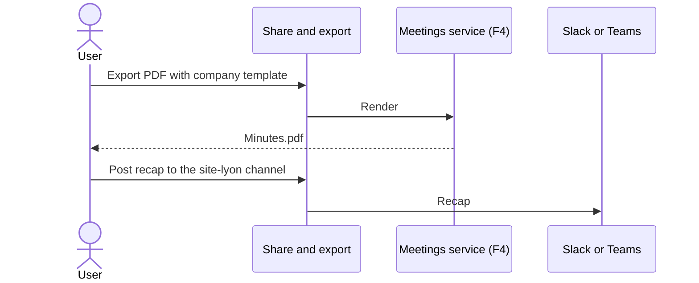

🏠 [Specs](../../../../README.md) › 🧩 [Functional capabilities](../../../README.md) › 🎙️ [F4 Meetings](../../README.md) ›
📝 [Use cases](../README.md) › 📝 [Use cases: FL-F4-08 Share and reuse outside](README.md) ›
📝 UC-F4-11 Share, export and clip a meeting

# 📝 UC-F4-11 Share, export and clip a meeting

**Status:** ✅ specified

## Summary

Share and export a meeting: a link, PDF, Word or text; slides from the meeting; key moments and clips; chapters; a recap
posted to Slack or Teams.

## Personas

- Every internal persona who meets or calls

## Goal

Pass a meeting's content on in the form each reader needs.

## Trigger

A user chooses Share or Export on a meeting.

## Frequency

After important meetings.

## Preconditions

F4 set up (UC-F4-08).

## Postconditions

- **Succeeded:** the export is made or the link shared, within the meeting's rights.
- **Failed:** nothing leaves.

## Main flow

1. From the meeting, the user chooses Share or Export
   ([S-F4-10](../../screens/08-share-and-reuse-outside/s-f04-10-share-and-export.md)).
2. Export: PDF, Word or text with the company's template and style, or 5 slides drafted from the meeting.
3. Share: a link for colleagues allowed by
   [BR-F4-04](../../business-rules/br-f04-04-transcripts-stay-with-participants.md), or a recap posted to a Slack or
   Teams channel ([BR-F4-22](../../business-rules/br-f04-22-only-chosen-content-leaves.md)).
4. They mark key moments and share a clip of up to 2 minutes, or the chapters.

## Alternative flows

- 4a. Chapters: the transcript is cut into titled chapters.
- 3a. Only the summary is shared with readers of the linked record.

## Error flows

- 4e. A clip asked after the audio was deleted: "The recording was deleted on 2026-11-30; only the transcript remains."
- 3e. The channel refuses the post: retried, then the user is told.

## Business rules

- [BR-F4-22 Only chosen content leaves](../../business-rules/br-f04-22-only-chosen-content-leaves.md)
- [BR-F4-03 Recordings are deleted once checked](../../business-rules/br-f04-03-recordings-are-deleted-once-checked.md)

## Entities

- [E-F4-08 Key moment](../../data/e-f04-08-key-moment.md)

## Permissions

Participants and the organiser, as [BR-F4-04](../../business-rules/br-f04-04-transcripts-stay-with-participants.md);
settings by administrators.

## Notifications

The colleagues the link is shared with.

## Audit events

Exported, shared, clipped, with what left and where.

## AI involvement

Slides and chapters drafted by the meetings model (D82).

## API, MCP and A2A exposure

T5 export operations; webhooks of [UC-F4-14](uc-f04-14-use-meetings-from-outside-tools.md).

## Screens

- [S-F4-10](../../screens/08-share-and-reuse-outside/s-f04-10-share-and-export.md)

## Flowchart

See [FL-F4-08 Share and reuse outside](../../flows/fl-f04-08-share-and-reuse-outside.md#flowchart).

## Sequence diagram

## Acceptance criteria

1. **Given** Acme Bâtiment's site meeting of 2026-11-24 **when** the PDF is exported **then** it uses the company's
   template and style.
2. **Given** the same **when** the recap is posted to #site-lyon **then** the channel shows the summary and the actions.
3. **Given** a key moment at 12:40 **when** a clip is shared **then** the clip lasts at most 2 minutes.
4. **Given** the audio deleted on 2026-11-30 **when** a clip is asked **then** the message says only the transcript
   remains.

## Non-functional notes

Export within 30 seconds.

## Regulatory references

Only chosen content leaves ([BR-F4-22](../../business-rules/br-f04-22-only-chosen-content-leaves.md)).

## Related use cases

UC-F4-01 to UC-F4-08.

## Open questions

None.

---

⬅️ [UC-F4-10](../07-prepare-and-capture-anywhere/uc-f04-10-capture-from-the-desktop-a-file-or-dictation.md) ·
⬆️ [Up](README.md) ·
➡️ [UC-F4-12 Score a sales call](../09-score-calls-and-interviews/uc-f04-12-score-a-sales-call.md)
