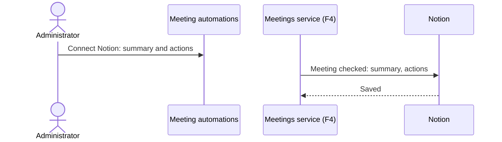

🏠 [Specs](../../../../README.md) › 🧩 [Functional capabilities](../../../README.md) › 🎙️ [F4 Meetings](../../README.md) ›
📝 [Use cases](../README.md) › 📝 [Use cases: FL-F4-08 Share and reuse outside](README.md) ›
📝 UC-F4-14 Use meetings from outside tools

# 📝 UC-F4-14 Use meetings from outside tools

**Status:** 🔄 waiting for the owner

## Summary

Meetings reach the company's other tools: an MCP server with read-only meeting tools, webhooks for Zapier, Make and n8n,
reports saved to Notion, Google Drive, OneDrive or SharePoint, actions synced both ways with Jira, Linear, Trello or
ClickUp.

## Personas

- [U07 Administrator](../../../../01-users/personas/u07-administrator.md)
- Every internal persona using outside tools

## Goal

Meetings reach the tools the company already uses, with only the content allowed.

## Trigger

An administrator connects a tool; then each checked meeting.

## Frequency

Set once; then per meeting.

## Preconditions

F4 set up (UC-F4-08).

## Postconditions

- **Succeeded:** the chosen content is in the outside tool; actions stay in step.
- **Failed:** nothing leaves; the administrator is told.

## Main flow

1. The administrator opens Meeting automations
   ([S-F4-14](../../screens/08-share-and-reuse-outside/s-f04-14-meeting-automations.md)) and connects a tool: an MCP
   client, a webhook (Zapier, Make, n8n), a document store or a task tool.
2. They choose what may leave: summary, transcript, actions, recording
   ([BR-F4-22](../../business-rules/br-f04-22-only-chosen-content-leaves.md)).
3. When a meeting is checked, the chosen content is sent within 5 minutes (Proposed).
4. Actions synced to a task tool stay in step both ways.

## Alternative flows

- 1a. MCP: outside AI clients search meetings and read transcripts with the user's own rights (T6).

## Error flows

- 3e. A tool refuses the content: retried, then the administrator is told.
- 2e. The transcript chosen for a tool outside the EU: warned
  ([CR-FR-049](../../../../10-country-packs/france/data-protection/cr-fr-049-processors-and-transfers.md)).

## Business rules

- [BR-F4-22 Only chosen content leaves](../../business-rules/br-f04-22-only-chosen-content-leaves.md)

## Entities

- [E-F1-08 Agent connection](../../../f01-administration/data/e-f01-08-agent-connection.md)

## Permissions

Administrators connect; outside calls carry the user's rights.

## Notifications

The administrator: a failing tool.

## Audit events

Tool connected, content allowed, each sending.

## AI involvement

None beyond the summaries sent.

## API, MCP and A2A exposure

This use case is the exposure: T6 MCP tools and T5 webhooks.

## Screens

- [S-F4-14](../../screens/08-share-and-reuse-outside/s-f04-14-meeting-automations.md)

## Flowchart

See [FL-F4-08 Share and reuse outside](../../flows/fl-f04-08-share-and-reuse-outside.md#flowchart).

## Sequence diagram

## Acceptance criteria

1. **Given** Notion connected with summary and actions **when** a meeting is checked **then** its summary and actions
   reach Notion within 5 minutes.
2. **Given** the transcript not allowed for Notion **when** a meeting is checked **then** no transcript is sent.
3. **Given** a webhook returning errors **when** it fails 3 times **then** the administrator is told.

## Non-functional notes

None.

## Regulatory references

Transfers outside the EU
([CR-FR-049](../../../../10-country-packs/france/data-protection/cr-fr-049-processors-and-transfers.md)).

## Related use cases

UC-F4-01 to UC-F4-08.

## Open questions

None.

---

⬅️ [UC-F4-13 Interview a candidate](../09-score-calls-and-interviews/uc-f04-13-interview-a-candidate.md) ·
⬆️ [Up](README.md) · ➡️ [UC-F4-15 Schedule recurring digests](uc-f04-15-schedule-recurring-digests.md)
