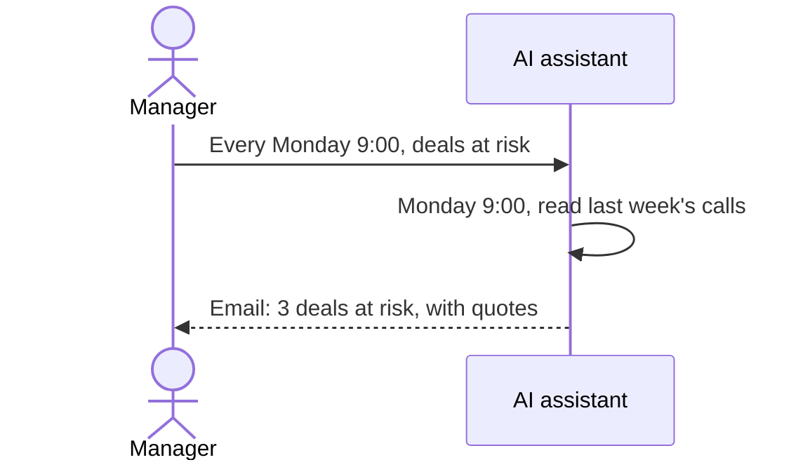

🏠 [Specs](../../../../README.md) › 🧩 [Functional capabilities](../../../README.md) › 🎙️ [F4 Meetings](../../README.md) ›
📝 [Use cases](../README.md) › 📝 [Use cases: FL-F4-08 Share and reuse outside](README.md) ›
📝 UC-F4-15 Schedule recurring digests

# 📝 UC-F4-15 Schedule recurring digests

**Status:** ✅ specified

## Summary

A user describes a recurring digest in one sentence ("every Monday at 9, the deals at risk from last week's calls"); the
AI assistant runs it on schedule and sends the result.

## Personas

- [U03 Sales](../../../../01-users/personas/u03-sales.md)
- [U02 Manager](../../../../01-users/personas/u02-manager.md)
- [U13 Owner](../../../../01-users/personas/u13-owner.md)
- [U06 HR](../../../../01-users/personas/u06-hr.md)

## Goal

Know what matters from meetings without searching each week.

## Trigger

The digest's schedule.

## Frequency

Weekly per user.

## Preconditions

F4 set up (UC-F4-08).

## Postconditions

- **Succeeded:** the digest arrives on schedule.
- **Failed:** a failed run is retried and reported.

## Main flow

1. In the AI assistant, the user writes the digest and its schedule in one sentence; it is saved on Meeting automations
   ([S-F4-14](../../screens/08-share-and-reuse-outside/s-f04-14-meeting-automations.md)).
2. At each run, the AI assistant answers from the meetings and records the user may see
   ([BR-F3-02](../../../f03-assistant/business-rules/br-f03-02-answers-use-only-what-the-user-may-see.md)).
3. The result is sent by email or in-app ([BR-F4-22](../../business-rules/br-f04-22-only-chosen-content-leaves.md)).
4. The user pauses, changes or deletes the digest.

## Alternative flows

- 2a. A shared digest for a team: each member's own rights apply.

## Error flows

- 2e. Nothing to report: "Nothing this week" is sent, or skipped (the user's choice).
- 3e. Sending fails: retried ([BR-F3-32](../../../f03-assistant/business-rules/br-f03-32-retry-before-an-error.md)),
  then the user is told.

## Business rules

- [BR-F4-22 Only chosen content leaves](../../business-rules/br-f04-22-only-chosen-content-leaves.md)

## Entities

- [E-F4-09 Scheduled digest](../../data/e-f04-09-scheduled-digest.md)

## Permissions

Every user for their own digests; managers for team digests.

## Notifications

The digest itself.

## Audit events

Digests created, run, changed.

## AI involvement

The AI assistant writes the digest from what the user may see.

## API, MCP and A2A exposure

T5 digest operations.

## Screens

- [S-F4-14](../../screens/08-share-and-reuse-outside/s-f04-14-meeting-automations.md)

## Flowchart

See [FL-F4-08 Share and reuse outside](../../flows/fl-f04-08-share-and-reuse-outside.md#flowchart).

## Sequence diagram

## Acceptance criteria

1. **Given** Pierre writes "every Monday at 9, the deals at risk from last week's calls" **when** Monday 09:00 comes
   **then** he gets the list from the calls he may see.
2. **Given** nothing at risk this week and "skip if empty" **when** Monday comes **then** no digest is sent.
3. **Given** a digest shared with the Lyon team **when** it runs **then** each member gets it with their own rights.

## Non-functional notes

As UC-F4-01.

## Regulatory references

As UC-F4-01.

## Related use cases

UC-F4-01 to UC-F4-08.

- [UC-F4-20 Analyse topics and trends across calls](../11-insights-and-accessibility/uc-f04-20-analyse-topics-and-trends-across-calls.md)

## Open questions

None.

---

⬅️ [UC-F4-14 Use meetings from outside tools](uc-f04-14-use-meetings-from-outside-tools.md) · ⬆️ [Up](README.md) ·
➡️ [UC-F4-16 Call from the softphone](../07-prepare-and-capture-anywhere/uc-f04-16-call-from-the-softphone.md)
