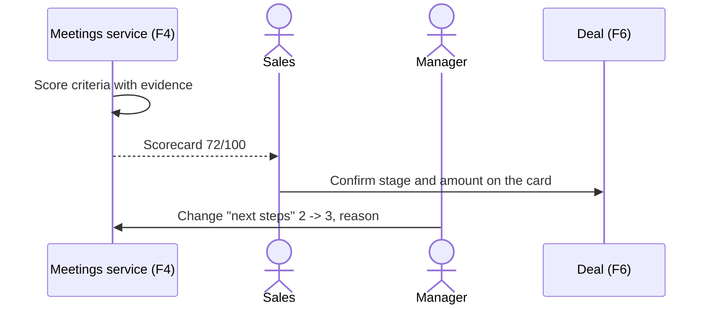

🏠 [Specs](../../../../README.md) › 🧩 [Functional capabilities](../../../README.md) › 🎙️ [F4 Meetings](../../README.md) ›
📝 [Use cases](../README.md) › 📝 [Use cases: FL-F4-09 Score calls and interviews](README.md) ›
📝 UC-F4-12 Score a sales call

# 📝 UC-F4-12 Score a sales call

**Status:** 🔄 waiting for the owner

## Summary

A sales call gets a scorecard (criteria out of 5, total out of 100), talk-time per speaker, and the deal's fields filled
from what was said, after confirmation.

## Personas

- [U03 Sales](../../../../01-users/personas/u03-sales.md)
- [U02 Manager](../../../../01-users/personas/u02-manager.md)
- [U13 Owner](../../../../01-users/personas/u13-owner.md)

## Goal

Coach sales people and keep deals current.

## Trigger

A sales call or meeting checked (kind: sales call).

## Frequency

Weekly or more.

## Preconditions

F4 set up (UC-F4-08).

Call scoring switched on knowingly by an administrator, the staff committee consulted and the employees told; off by
default ([D449](../../../../06-decisions/f04-meetings/d449-call-recording-off-by-default.md)).

## Postconditions

- **Succeeded:** the call has its scorecard, talk-time and confirmed deal fields; a manager's change is kept beside the
  original.
- **Failed:** with scoring off, no scorecard.

## Main flow

1. The sales call is checked ([UC-F4-05](../03-review-a-meeting/uc-f04-05-review-a-meeting.md)); it is scored against
   the company's criteria (discovery, need, next steps, objection handling), each with quoted evidence
   ([BR-F4-20](../../business-rules/br-f04-20-scores-come-with-their-evidence.md)), on the scorecard
   ([S-F4-11](../../screens/09-score-calls-and-interviews/s-f04-11-call-scorecard.md)).
2. Talk-time per speaker is shown.
3. Deal fields (stage, amount, close date, next step, competitors cited) are proposed from what was said and filled
   through the confirmation card,
   [UC-F3-03](../../../f03-assistant/use-cases/03-act-through-the-assistant/uc-f03-03-have-the-assistant-create-or-change-records.md).
4. The seller reads the scorecard; the manager reviews the team's scorecards and changes a score with a reason, kept
   beside the original.

## Alternative flows

- A manager reviews scorecards of their team and changes a score, kept beside the original.
- A weekly digest of deals at risk (UC-F4-15).

## Error flows

- A field not stated in the call: left unchanged ("only if stated").
- Calls failing are retried before any error (BR-F3-32); errors follow the pattern (D122).

## Business rules

- [BR-F4-20 Scores come with their evidence](../../business-rules/br-f04-20-scores-come-with-their-evidence.md)

## Entities

- [E-F4-06 Scorecard](../../data/e-f04-06-scorecard.md)
- [E-F4-20 Human review request](../../data/e-f04-20-human-review-request.md)

## Permissions

The seller for their calls; their manager; settings by administrators, once scoring is switched on
([D449](../../../../06-decisions/f04-meetings/d449-call-recording-off-by-default.md)).

## Notifications

- The seller: scorecard ready.
- The manager: weekly digest of deals at risk
  ([UC-F4-15](../08-share-and-reuse-outside/uc-f04-15-schedule-recurring-digests.md)).

## Audit events

Scorecard produced, score changed with reason, deal fields confirmed.

## AI involvement

The meetings models (D82), local by default. High-risk use (worker evaluation, AI Act Annex III point 4): the manager
oversees and changes every score,
[CR-FR-057](../../../../10-country-packs/france/ai-and-recording/cr-fr-057-human-oversight.md),
[CR-FR-058](../../../../10-country-packs/france/ai-and-recording/cr-fr-058-high-risk-ai-in-employment.md).

## API, MCP and A2A exposure

T5 read of scorecards with the caller's rights.

## Screens

- [S-F4-11](../../screens/09-score-calls-and-interviews/s-f04-11-call-scorecard.md)

## Flowchart

See [FL-F4-09 Score calls and interviews](../../flows/fl-f04-09-score-calls-and-interviews.md#flowchart).

## Sequence diagram

## Acceptance criteria

1. **Given** a checked call of Nuvola Logiciels with scoring on **when** it is scored **then** each criterion has a
   score out of 5 with quoted evidence and the total is out of 100.
2. **Given** the customer said "we sign before 15 December" **when** deal fields are proposed **then** the close date
   2026-12-15 is proposed.
3. **Given** an amount never stated **when** fields are proposed **then** the amount is left unchanged.
4. **Given** the manager changes "next steps" from 2 to 3 **when** he saves with a reason **then** the original 2 stays
   visible.

## Non-functional notes

Scorecard within 5 minutes of the check (Proposed).

## Regulatory references

Employees told calls are analysed; scorecards for coaching, not as the sole basis for HR decisions,
[CR-FR-058](../../../../10-country-packs/france/ai-and-recording/cr-fr-058-high-risk-ai-in-employment.md).

## Related use cases

UC-F4-01 to UC-F4-08.

- [UC-F4-20 Analyse topics and trends across calls](../11-insights-and-accessibility/uc-f04-20-analyse-topics-and-trends-across-calls.md)

## Open questions

None.

---

⬅️ [UC-F4-11](../08-share-and-reuse-outside/uc-f04-11-share-export-and-clip-a-meeting.md) · ⬆️ [Up](README.md) ·
➡️ [UC-F4-13 Interview a candidate](uc-f04-13-interview-a-candidate.md)
