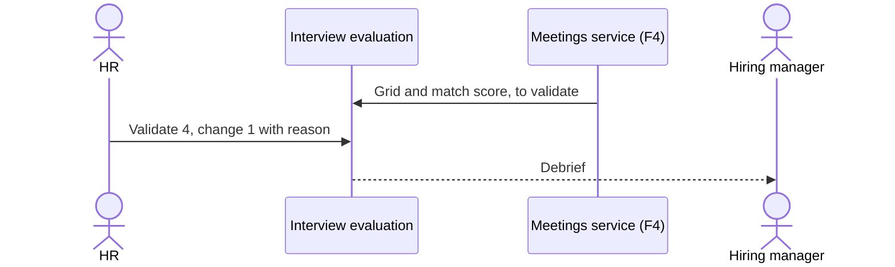

🏠 [Specs](../../../../README.md) › 🧩 [Functional capabilities](../../../README.md) › 🎙️ [F4 Meetings](../../README.md) ›
📝 [Use cases](../README.md) › 📝 [Use cases: FL-F4-09 Score calls and interviews](README.md) ›
📝 UC-F4-13 Interview a candidate

# 📝 UC-F4-13 Interview a candidate

**Status:** ✅ specified

## Summary

A job interview, online, by phone or in person, gets a candidate report on the company's template, an evaluation grid
with scores, a match score against the job's criteria, and a debrief for the hiring manager.

## Personas

- [U06 HR](../../../../01-users/personas/u06-hr.md)
- [U02 Manager](../../../../01-users/personas/u02-manager.md) (hiring manager)

## Goal

Fair, documented interviews.

## Trigger

An interview with a candidate (meeting kind: interview).

## Frequency

Weekly or more.

## Preconditions

F4 set up (UC-F4-08).

## Postconditions

- **Succeeded:** the report, the validated grid and the debrief are on the applicant; every score was validated or
  changed by a person.
- **Failed:** with scoring off, report and answers only.

## Main flow

1. The interview is recorded and announced to the candidate
   ([BR-F4-01](../../business-rules/br-f04-01-every-recording-is-announced.md)), with the AI use explained
   ([BR-F4-21](../../business-rules/br-f04-21-candidate-scoring-is-high-risk-ai.md)).
2. Answers are extracted with their times: notice period, salary expectation, availability.
3. The evaluation grid ([S-F4-12](../../screens/09-score-calls-and-interviews/s-f04-12-interview-evaluation.md)) is
   filled with a score per criterion and a match score, each with evidence
   ([BR-F4-20](../../business-rules/br-f04-20-scores-come-with-their-evidence.md)), marked "to validate".
4. The recruiter validates or changes each score with a reason.
5. The debrief goes to the hiring manager with the validated grid.

## Alternative flows

- Scoring off for the company: report and grid answers only, no scores.
- Sourcing, campaigns and AI voice pre-screening: F9 (D235).

## Error flows

- The candidate refuses recording: notes typed by the recruiter only.
- A candidate asks for an explanation or a human review: given, logged.
- Calls failing are retried before any error (BR-F3-32); errors follow the pattern (D122).

## Business rules

- [BR-F4-21 Candidate scoring is high-risk AI](../../business-rules/br-f04-21-candidate-scoring-is-high-risk-ai.md)
- [BR-F4-20 Scores come with their evidence](../../business-rules/br-f04-20-scores-come-with-their-evidence.md)
- [BR-F4-18 HR meetings stay with HR and the employee](../../business-rules/br-f04-18-hr-meetings-are-recorded-for-hr-and-the-employee.md)

## Entities

- [E-F4-07 Evaluation grid](../../data/e-f04-07-evaluation-grid.md)
- [E-F4-21 Interview debrief](../../data/e-f04-21-interview-debrief.md)

## Permissions

HR and the hiring manager for their job positions
([BR-F4-04](../../business-rules/br-f04-04-transcripts-stay-with-participants.md)).

## Notifications

- The hiring manager: the debrief.
- The candidate: the AI use explained before the interview.

## Audit events

Interview recorded, scores validated or changed with reason, debrief sent, human review asked.

## AI involvement

High-risk AI, [CR-FR-058](../../../../10-country-packs/france/ai-and-recording/cr-fr-058-high-risk-ai-in-employment.md),
scores are proposals; a person validates each one
([CR-FR-057](../../../../10-country-packs/france/ai-and-recording/cr-fr-057-human-oversight.md)).

## API, MCP and A2A exposure

None: candidate evaluations are not exposed.

## Screens

- [S-F4-12](../../screens/09-score-calls-and-interviews/s-f04-12-interview-evaluation.md)

## Flowchart

See [FL-F4-09 Score calls and interviews](../../flows/fl-f04-09-score-calls-and-interviews.md#flowchart).

## Sequence diagram

## Acceptance criteria

1. **Given** an interview for a developer job at Nuvola Logiciels **when** it is checked **then** the grid shows scores
   per criterion with evidence, marked to validate.
2. **Given** the candidate said "notice period 2 months" **when** answers are extracted **then** 2 months is shown with
   its time.
3. **Given** HR changes "teamwork" from 3 to 4 with a reason **when** she saves **then** the debrief shows 4 and the
   change is logged.
4. **Given** the candidate refuses recording **when** the interview starts **then** only the recruiter's notes are kept.

## Non-functional notes

As UC-F4-12.

## Regulatory references

EU AI Act high-risk,
[CR-FR-058](../../../../10-country-packs/france/ai-and-recording/cr-fr-058-high-risk-ai-in-employment.md); GDPR article
22, no solely automated decision.

## Related use cases

UC-F4-01 to UC-F4-08.

## Open questions

None.

---

⬅️ [UC-F4-12 Score a sales call](uc-f04-12-score-a-sales-call.md) · ⬆️ [Up](README.md) ·
➡️ [UC-F4-14](../08-share-and-reuse-outside/uc-f04-14-use-meetings-from-outside-tools.md)
