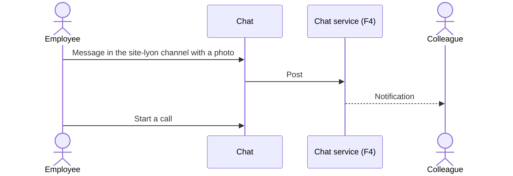

🏠 [Specs](../../../../README.md) › 🧩 [Functional capabilities](../../../README.md) › 🎙️ [F4 Meetings](../../README.md) ›
📝 [Use cases](../README.md) › 📝 [Use cases: FL-F4-10 Benchmark additions](README.md) › 📝 UC-F4-17 Chat with colleagues

# 📝 UC-F4-17 Chat with colleagues

**Status:** ✅ specified

## Summary

Employees chat in channels and direct messages, with polls, voice messages, files and guests, and start a call from a
conversation.

## Personas

- [U01 Employee](../../../../01-users/personas/u01-employee.md)
- [U02 Manager](../../../../01-users/personas/u02-manager.md)

## Goal

Talk with colleagues next to the work, without another chat tool.

## Trigger

A user needs to reach colleagues.

## Frequency

All day long.

## Preconditions

- Chat is on for the company.

## Postconditions

- **Succeeded:** messages are delivered to the channel's members.
- **Failed:** a message not sent is marked and can be resent.

## Main flow

1. The employee opens Chat ([S-F4-15](../../screens/10-benchmark-additions/s-f04-15-chat.md)) and a channel or a direct
   message.
2. They write, share a file or a voice message, or start a poll.
3. Members are notified as their settings say; mentions always notify.
4. They start a call from the conversation
   ([UC-F4-01](../01-record-an-online-meeting/uc-f04-01-record-an-online-meeting-with-the-bot.md)).
5. They invite a guest from outside to a channel with a link.

## Alternative flows

- 5a. A guest sees only that channel.
- 2a. A record is mentioned: its card shows in the message.

## Error flows

- 5e. The guest link expired: the guest asks again.
- 2e. A file over the size limit: refused with the limit.

## Business rules

- See F4's rules.

## Entities

- [E-F4-10 Chat channel](../../data/e-f04-10-chat-channel.md)

## Permissions

Every employee; guests in their channel only.

## Notifications

Mentions and direct messages.

## Audit events

Channel created, member added or removed, guest invited.

## AI involvement

The AI assistant answers about it within the user's rights
([BR-F3-02](../../../f03-assistant/business-rules/br-f03-02-answers-use-only-what-the-user-may-see.md)) and never
changes a record without the confirmation card
([BR-F3-07](../../../f03-assistant/business-rules/br-f03-07-no-deletes-no-irreversible-acts.md)).

## API, MCP and A2A exposure

T5 message operations; the MCP tool of F4.

## Screens

- [S-F4-15](../../screens/10-benchmark-additions/s-f04-15-chat.md)

## Flowchart

See [FL-F4-10 Benchmark additions](../../flows/fl-f04-10-benchmark-additions.md#flowchart).

## Sequence diagram

## Acceptance criteria

1. **Given** the channel #site-lyon of Acme Bâtiment with 8 members **when** Paul posts a photo **then** the 8 members
   see it.
2. **Given** a poll "site visit Tuesday or Wednesday" **when** 6 members vote **then** the result shows 4 to 2.
3. **Given** a guest link expired **when** the subcontractor opens it **then** he is told to ask again.
4. **Given** a mention of @Lea **when** it is posted **then** Lea is notified.

## Non-functional notes

Messages delivered within a second.

## Regulatory references

None.

## Related use cases

See [FL-F4-10](../../flows/fl-f04-10-benchmark-additions.md).

## Open questions

None.

---

⬅️ [UC-F4-16 Call from the softphone](../07-prepare-and-capture-anywhere/uc-f04-16-call-from-the-softphone.md) ·
⬆️ [Up](README.md) · ➡️ [UC-F4-18 Let customers book appointments](uc-f04-18-let-customers-book-appointments.md)
