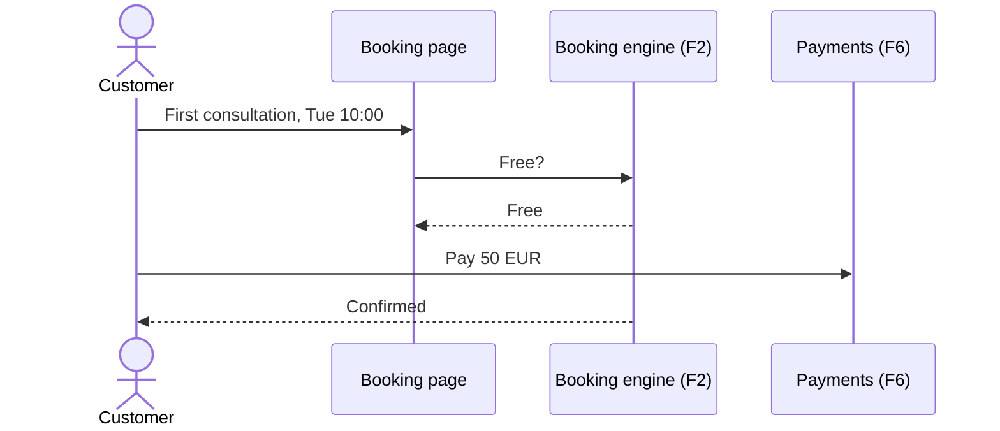

🏠 [Specs](../../../../README.md) › 🧩 [Functional capabilities](../../../README.md) › 🎙️ [F4 Meetings](../../README.md) ›
📝 [Use cases](../README.md) › 📝 [Use cases: FL-F4-10 Benchmark additions](README.md) ›
📝 UC-F4-18 Let customers book appointments

# 📝 UC-F4-18 Let customers book appointments

**Status:** 🔄 waiting for the owner

## Summary

Customers book an appointment with a person or a resource online, pay up front if asked, get reminders and reschedule
themselves.

## Personas

- [U09 Customer](../../../../01-users/personas/u09-customer.md)
- [U03 Sales](../../../../01-users/personas/u03-sales.md)
- [U14 Field worker](../../../../01-users/personas/u14-field-worker.md)

## Goal

Customers book without calling, and the calendar stays right.

## Trigger

A customer opens the booking page.

## Frequency

Daily in practices and service companies.

## Preconditions

- Appointment types are set ([E-F4-11](../../data/e-f04-11-appointment-type.md)).

## Postconditions

- **Succeeded:** the appointment is in the person's calendar and the customer has a confirmation.
- **Failed:** no booking; the customer sees why.

## Main flow

1. The customer opens the booking page ([S-F4-16](../../screens/10-benchmark-additions/s-f04-16-booking-page.md)) and
   picks an appointment type.
2. They pick a free slot with a person or a resource
   ([BR-F4-23](../../business-rules/br-f04-23-bookings-never-overlap.md)); the shared booking engine checks it,
   [UC-F2-19](../../../f02-no-code-configuration/use-cases/08-views-and-bookings/uc-f02-19-book-a-resource.md).
3. They give their details and pay up front if the type asks it.
4. They get the confirmation and a reminder the day before (Proposed); the person sees it in their calendar.
5. They reschedule or cancel from the link within the rules.

## Alternative flows

- 2a. Team booking: the slot is assigned to whoever is free.
- 1a. A video appointment: the link of [UC-F4-25](../12-rooms-and-client-video/uc-f04-25-hold-a-client-video-meeting.md)
  is sent.

## Error flows

- 2e. The slot was taken meanwhile: refused, the next slots shown
  ([BR-F4-23](../../business-rules/br-f04-23-bookings-never-overlap.md)).
- 3e. The payment fails: the slot is held 10 minutes (Proposed), then freed.

## Business rules

- [BR-F4-23 Bookings never overlap](../../business-rules/br-f04-23-bookings-never-overlap.md)

## Entities

- [E-F4-11 Appointment type](../../data/e-f04-11-appointment-type.md)

## Permissions

The public or portal users for the types offered; staff manage the types.

## Notifications

- The customer: confirmation, reminder, changes.
- The person booked: the appointment.

## Audit events

Booked, paid, rescheduled, cancelled.

## AI involvement

The AI assistant answers about it within the user's rights
([BR-F3-02](../../../f03-assistant/business-rules/br-f03-02-answers-use-only-what-the-user-may-see.md)) and never
changes a record without the confirmation card
([BR-F3-07](../../../f03-assistant/business-rules/br-f03-07-no-deletes-no-irreversible-acts.md)).

## API, MCP and A2A exposure

T5 availability and booking operations.

## Screens

- [S-F4-16](../../screens/10-benchmark-additions/s-f04-16-booking-page.md)

## Flowchart

See [FL-F4-10 Benchmark additions](../../flows/fl-f04-10-benchmark-additions.md#flowchart).

## Sequence diagram

## Acceptance criteria

1. **Given** a first consultation of 30 minutes at Delorme Conseil priced 50 EUR **when** a client books Tuesday 10:00
   and pays **then** it is confirmed and in the lawyer's calendar.
2. **Given** 10:00 taken meanwhile **when** she confirms **then** it is refused and 10:30 is offered.
3. **Given** a cancellation limit of 24 hours **when** she cancels 2 days before **then** the slot is freed.
4. **Given** team booking on **when** she books **then** the first free lawyer gets it.

## Non-functional notes

As the booking engine.

## Regulatory references

Online payment and consumer information
([CR-FR-065](../../../../10-country-packs/france/consumer/cr-fr-065-online-pre-contract-information.md)).

## Related use cases

See [FL-F4-10](../../flows/fl-f04-10-benchmark-additions.md).

- [UC-F2-19 Book a resource](../../../f02-no-code-configuration/use-cases/08-views-and-bookings/uc-f02-19-book-a-resource.md)

- [UC-F4-25 Hold a client video meeting](../12-rooms-and-client-video/uc-f04-25-hold-a-client-video-meeting.md)

## Open questions

None.

---

⬅️ [UC-F4-17 Chat with colleagues](uc-f04-17-chat-with-colleagues.md) · ⬆️ [Up](README.md) ·
➡️ [UC-F4-19 Route incoming calls](uc-f04-19-route-incoming-calls.md)
