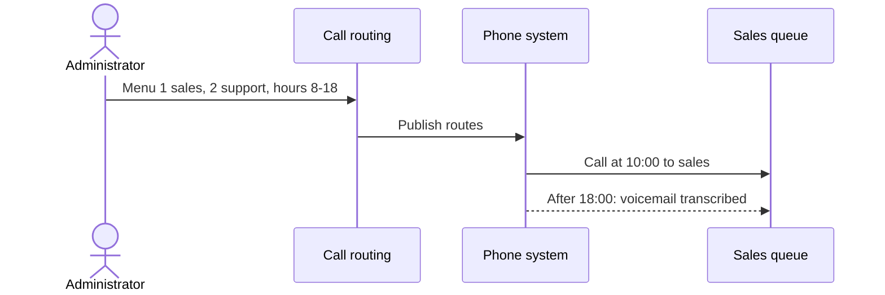

🏠 [Specs](../../../../README.md) › 🧩 [Functional capabilities](../../../README.md) › 🎙️ [F4 Meetings](../../README.md) ›
📝 [Use cases](../README.md) › 📝 [Use cases: FL-F4-10 Benchmark additions](README.md) › 📝 UC-F4-19 Route incoming calls

# 📝 UC-F4-19 Route incoming calls

**Status:** ✅ specified

## Summary

The administrator sets the company's numbers, opening hours, voice menu and queues so that every incoming call reaches
the right team.

## Personas

- [U07 Administrator](../../../../01-users/personas/u07-administrator.md)
- [U03 Sales](../../../../01-users/personas/u03-sales.md)

## Goal

Callers reach the right person quickly, even after hours.

## Trigger

Setting up the phone system, or a change of team or hours.

## Frequency

At setup, then a few times a year.

## Preconditions

- The phone system is connected,
  [UC-F4-08](../06-set-up-meetings-and-calendars/uc-f04-08-set-up-meeting-sources-calendars-and-retention.md).

## Postconditions

- **Succeeded:** calls follow the routes.
- **Failed:** calls keep the previous routes.

## Main flow

1. The administrator opens Call routing ([S-F4-17](../../screens/10-benchmark-additions/s-f04-17-call-routing.md)) and
   sets the numbers and opening hours.
2. They build the voice menu (1 for sales, 2 for support) and the queues with their members.
3. They test the routes; calls reach the softphones of the queue's members
   ([UC-F4-16](../07-prepare-and-capture-anywhere/uc-f04-16-call-from-the-softphone.md)).
4. After hours, calls go to voicemail, transcribed and assigned to the team.

## Alternative flows

- 4a. A holiday closes the company: the holiday message plays.

## Error flows

- 3e. Nobody free in the queue: a callback is offered.
- 1e. A number not owned by the company: refused by the phone system, with its message.

## Business rules

- See F4's rules.

## Entities

- [E-F4-12 Call route](../../data/e-f04-12-call-route.md)

## Permissions

Administrators.

## Notifications

The team: voicemails and callbacks.

## Audit events

Routes changed.

## AI involvement

Voicemail transcribed (D82).

## API, MCP and A2A exposure

None.

## Screens

- [S-F4-17](../../screens/10-benchmark-additions/s-f04-17-call-routing.md)

## Flowchart

See [FL-F4-10 Benchmark additions](../../flows/fl-f04-10-benchmark-additions.md#flowchart).

## Sequence diagram

## Acceptance criteria

1. **Given** hours 08:00 to 18:00 and menu 1 for sales **when** a caller presses 1 at 10:00 **then** the sales queue
   rings.
2. **Given** the sales queue all busy **when** a caller waits **then** a callback is offered.
3. **Given** a call at 19:30 **when** the caller leaves a message **then** the transcribed voicemail is assigned to
   sales.

## Non-functional notes

None.

## Regulatory references

Recording announcements as [BR-F4-01](../../business-rules/br-f04-01-every-recording-is-announced.md).

## Related use cases

See [FL-F4-10](../../flows/fl-f04-10-benchmark-additions.md).

## Open questions

None.

---

⬅️ [UC-F4-18 Let customers book appointments](uc-f04-18-let-customers-book-appointments.md) · ⬆️ [Up](README.md) ·
➡️ [UC-F4-20](../11-insights-and-accessibility/uc-f04-20-analyse-topics-and-trends-across-calls.md)
