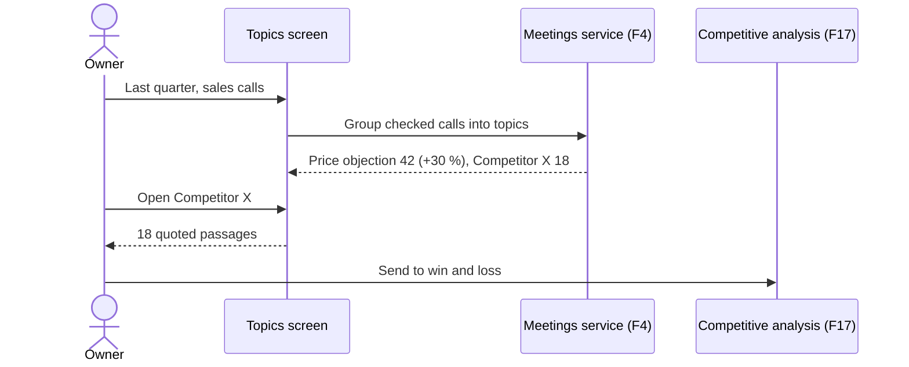

🏠 [Specs](../../../../README.md) › 🧩 [Functional capabilities](../../../README.md) › 🎙️ [F4 Meetings](../../README.md) ›
📝 [Use cases](../README.md) › 📝 [Use cases: FL-F4-11 Insights and accessibility](README.md) ›
📝 UC-F4-20 Analyse topics and trends across calls

# 📝 UC-F4-20 Analyse topics and trends across calls

**Status:** 🔄 waiting for the owner

## Summary

The owner and sales managers see what many calls and meetings say together: objections, competitors named, feature
requests and themes, with their trend over time and quoted examples.

## Personas

- [U13 Owner](../../../../01-users/personas/u13-owner.md)
- [U02 Manager](../../../../01-users/personas/u02-manager.md)
- [U03 Sales](../../../../01-users/personas/u03-sales.md)

## Goal

Know what customers keep saying, without listening to every call.

## Trigger

The owner opens the trends, or a weekly digest arrives.

## Frequency

Weekly for managers; monthly for the owner.

## Preconditions

- Checked meetings the reader may see
  ([BR-F4-04](../../business-rules/br-f04-04-transcripts-stay-with-participants.md)).

## Postconditions

- **Succeeded:** the topics and their trend are shown; competitor mentions feed F17 and requests F25.
- **Failed:** with too few meetings, the screen says so and shows no trend.

## Main flow

1. The owner opens Meetings › Topics ([S-F4-18](../../screens/11-insights-and-accessibility/s-f04-18-topics.md)) for the
   last quarter.
2. simple-ERP groups what was said in checked calls into topics: objections (price, delay), competitors named, requests,
   themes, each with its count and trend
   ([BR-F4-24](../../business-rules/br-f04-24-trends-count-only-what-the-reader-may-see-quoted.md)).
3. She opens a topic: the quoted passages, each linked to its meeting and time.
4. She sends the competitor mentions to F17's win and loss analysis, or a request to the feature requests of F25.
5. She saves the view as a weekly digest
   ([UC-F4-15](../08-share-and-reuse-outside/uc-f04-15-schedule-recurring-digests.md)).

## Alternative flows

- 2a. A manager sees only their team's calls.
- 3a. She narrows to a customer, a product or a rep.

## Error flows

- 2e. Fewer than 10 checked calls in the period (Proposed): no trend, the screen says so.
- 3e. A passage of a meeting she may not read: counted but not quoted.

## Business rules

- [BR-F4-24 Trends count only what the reader may see quoted](../../business-rules/br-f04-24-trends-count-only-what-the-reader-may-see-quoted.md)
- [BR-F4-04 Transcripts stay with participants](../../business-rules/br-f04-04-transcripts-stay-with-participants.md)

## Entities

- [E-F4-13 Call topic](../../data/e-f04-13-call-topic.md)
- [E-F4-01 Meeting](../../data/e-f04-01-meeting.md)

## Permissions

The owner; managers for their team's meetings; record rules apply to quotes.

## Notifications

The weekly digest, if saved.

## Audit events

Topics read and exported; items sent to F17 or F25.

## AI involvement

The meetings model groups passages into topics; counts come from queries
([BR-F3-03](../../../f03-assistant/business-rules/br-f03-03-figures-come-from-queries.md)).

## API, MCP and A2A exposure

T5 read of topics with the caller's rights; the MCP tool of F4.

## Screens

- [S-F4-18 Topics](../../screens/11-insights-and-accessibility/s-f04-18-topics.md)

## Flowchart

See [FL-F4-11 Insights and accessibility](../../flows/fl-f04-11-insights-and-accessibility.md#flowchart).

## Sequence diagram

## Acceptance criteria

1. **Given** Nuvola Logiciels with 160 checked sales calls in Q3 2026 **when** the owner opens Topics **then** "price
   objection" shows 42 calls, up 30 % on Q2.
2. **Given** the topic "Competitor X" **when** she opens it **then** 18 passages show, each with its meeting and time.
3. **Given** a manager of the Lyon team **when** he opens Topics **then** only his team's calls are counted.
4. **Given** 6 checked calls in the period **when** Topics opens **then** no trend shows and the screen says so.

## Non-functional notes

Topics of 1,000 calls within 10 seconds (Proposed).

## Regulatory references

Employees are told calls are analysed,
[CR-FR-058](../../../../10-country-packs/france/ai-and-recording/cr-fr-058-high-risk-ai-in-employment.md).

## Related use cases

- [UC-F4-12 Score a sales call](../09-score-calls-and-interviews/uc-f04-12-score-a-sales-call.md)
- [UC-F4-15 Schedule recurring digests](../08-share-and-reuse-outside/uc-f04-15-schedule-recurring-digests.md)
- [UC-F17-24 Feed battle cards from call topics](../../../f17-competitive-analysis/use-cases/07-sales-enablement/uc-f17-24-feed-battle-cards-from-call-topics.md)

## Open questions

None.

---

⬅️ [UC-F4-19 Route incoming calls](../10-benchmark-additions/uc-f04-19-route-incoming-calls.md) · ⬆️ [Up](README.md) ·
➡️ [UC-F4-21](../12-rooms-and-client-video/uc-f04-21-book-a-meeting-room-and-equipment.md)
