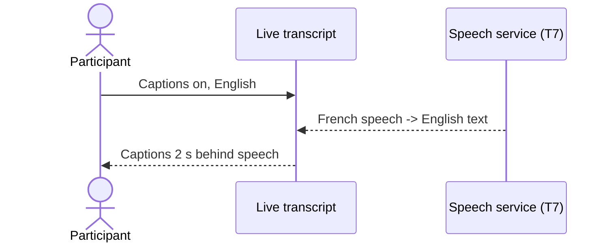

🏠 [Specs](../../../../README.md) › 🧩 [Functional capabilities](../../../README.md) › 🎙️ [F4 Meetings](../../README.md) ›
📝 [Use cases](../README.md) › 📝 [Use cases: FL-F4-11 Insights and accessibility](README.md) ›
📝 UC-F4-22 Turn on live captions and translation

# 📝 UC-F4-22 Turn on live captions and translation

**Status:** 🔄 waiting for the owner

## Summary

During a live meeting, a participant turns on captions, in the spoken language or translated into theirs.

## Personas

- [U01 Employee](../../../../01-users/personas/u01-employee.md)
- [U03 Sales](../../../../01-users/personas/u03-sales.md)

## Goal

Everyone follows the meeting: deaf and hard-of-hearing colleagues, foreign customers.

## Trigger

A participant needs captions or a translation.

## Frequency

A few meetings a week where needed.

## Preconditions

- The meeting is recorded live by the bot or the desktop app,
  [UC-F4-01](../01-record-an-online-meeting/uc-f04-01-record-an-online-meeting-with-the-bot.md),
  [UC-F4-10](../07-prepare-and-capture-anywhere/uc-f04-10-capture-from-the-desktop-a-file-or-dictation.md).

## Postconditions

- **Succeeded:** captions show for that participant; nothing more is stored than the transcript
  ([BR-F4-25](../../business-rules/br-f04-25-captions-store-nothing-more-than-the-transcript.md)).
- **Failed:** captions stay off; the meeting goes on.

## Main flow

1. A participant opens the live transcript
   ([S-F4-02](../../screens/01-record-an-online-meeting/s-f04-02-live-transcript.md)) and turns on Captions.
2. They choose the language: as spoken, or translated (English, Spanish, German...).
3. Captions show under the video or in the panel, a few seconds behind speech.
4. They turn them off at any time; others' captions are not affected.

## Alternative flows

- 1a. The organiser turns captions on for everyone, each picking a language.
- 2a. A language without a translation model: captions in the spoken language only.

## Error flows

- 3e. The model falls behind: captions say "delayed" and catch up.
- 1e. Recording was refused: no captions, as they come from the transcript.

## Business rules

- [BR-F4-25 Captions store nothing more than the transcript](../../business-rules/br-f04-25-captions-store-nothing-more-than-the-transcript.md)
- [BR-F4-05 Summaries in the reader's language](../../business-rules/br-f04-05-summaries-in-the-reader-s-language.md)

## Entities

- [E-F4-02 Transcript](../../data/e-f04-02-transcript.md)

## Permissions

Every participant who sees the live transcript
([BR-F4-09](../../business-rules/br-f04-09-live-answers-need-70-confidence.md)).

## Notifications

None.

## Audit events

Captions turned on and off, with the language.

## AI involvement

Speech-to-text and translation models (D82), local by default.

## API, MCP and A2A exposure

None.

## Screens

- [S-F4-02 Live transcript](../../screens/01-record-an-online-meeting/s-f04-02-live-transcript.md)

## Flowchart

See [FL-F4-11 Insights and accessibility](../../flows/fl-f04-11-insights-and-accessibility.md#flowchart).

## Sequence diagram

## Acceptance criteria

1. **Given** a meeting held in French **when** a participant turns on English captions **then** he reads English
   captions within a few seconds of speech.
2. **Given** captions on for one participant **when** another opens the meeting **then** she has no captions until she
   turns them on.
3. **Given** a language with no translation model **when** it is chosen **then** captions show in French with a note.

## Non-functional notes

Captions within 3 seconds of speech, as the live transcript (Proposed).

## Regulatory references

(Proposed) to read: the European Accessibility Act for services.

## Related use cases

- [UC-F4-01 Record an online meeting with the bot](../01-record-an-online-meeting/uc-f04-01-record-an-online-meeting-with-the-bot.md)
- [UC-F4-24 Track transcription accuracy per language and model](uc-f04-24-track-transcription-accuracy-per-language-and-model.md)

## Open questions

None.

---

⬅️ [UC-F4-21](../12-rooms-and-client-video/uc-f04-21-book-a-meeting-room-and-equipment.md) · ⬆️ [Up](README.md) ·
➡️ [UC-F4-23](../13-outside-people-and-follow-up/uc-f04-23-handle-an-outside-speakers-objection-or-erasure.md)
