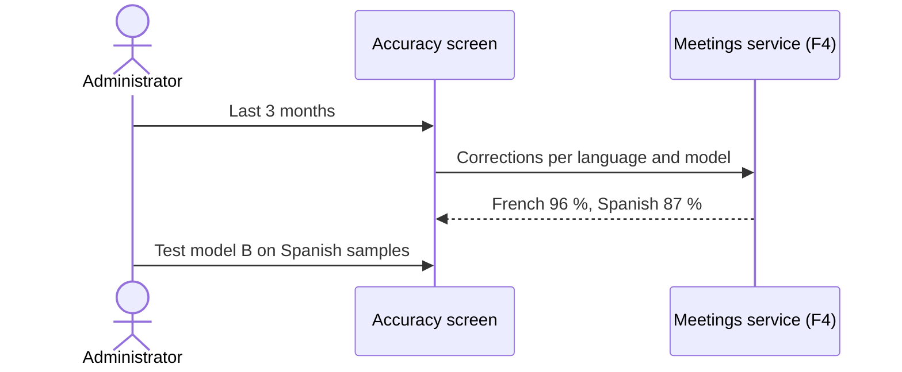

🏠 [Specs](../../../../README.md) › 🧩 [Functional capabilities](../../../README.md) › 🎙️ [F4 Meetings](../../README.md) ›
📝 [Use cases](../README.md) › 📝 [Use cases: FL-F4-11 Insights and accessibility](README.md) ›
📝 UC-F4-24 Track transcription accuracy per language and model

# 📝 UC-F4-24 Track transcription accuracy per language and model

**Status:** ✅ specified

## Summary

The administrator sees how accurate transcription is per language and model, measured on the corrections reviewers make,
and changes the model where it is poor.

## Personas

- [U07 Administrator](../../../../01-users/personas/u07-administrator.md)

## Goal

Choose the model that transcribes the company's languages best.

## Trigger

A monthly check, or complaints about transcripts.

## Frequency

Monthly.

## Preconditions

- Reviewed meetings with corrections ([UC-F4-05](../03-review-a-meeting/uc-f04-05-review-a-meeting.md)).

## Postconditions

- **Succeeded:** the accuracy per language and model is shown; a model change goes through the evaluation set.
- **Failed:** with too few corrections, no figure is shown.

## Main flow

1. The administrator opens Meetings settings › Accuracy
   ([S-F4-20](../../screens/11-insights-and-accessibility/s-f04-20-transcription-accuracy.md)).
2. Per language and model: the share of words corrected at review, the number of meetings and the trend
   ([BR-F4-27](../../business-rules/br-f04-27-accuracy-is-measured-on-reviewers-corrections.md)).
3. They compare models on the same language, and test another model on sample meetings.
4. They change the language's model in the AI settings,
   [UC-F1-08](../../../f01-administration/use-cases/06-choose-an-ai-provider/uc-f01-08-choose-the-ai-provider-of-a-feature.md);
   the evaluation set runs,
   [UC-F3-14](../../../f03-assistant/use-cases/11-trust-the-answers/uc-f03-14-run-the-quality-evaluation-set.md).

## Alternative flows

- 2a. Per meeting kind (calls, site meetings) where noise differs.

## Error flows

- 2e. Fewer than 20 reviewed meetings for a language: "not enough data".

## Business rules

- [BR-F4-27 Accuracy is measured on reviewers' corrections](../../business-rules/br-f04-27-accuracy-is-measured-on-reviewers-corrections.md)

## Entities

- [E-F4-15 Accuracy measure](../../data/e-f04-15-accuracy-measure.md)

## Permissions

Administrators.

## Notifications

The administrator is told when a language drops below the bar (default: 90 % of words right).

## Audit events

Model changes, as F1.

## AI involvement

Measures the models; never changes them by itself.

## API, MCP and A2A exposure

None.

## Screens

- [S-F4-20 Transcription accuracy](../../screens/11-insights-and-accessibility/s-f04-20-transcription-accuracy.md)

## Flowchart

See [FL-F4-11 Insights and accessibility](../../flows/fl-f04-11-insights-and-accessibility.md#flowchart).

## Sequence diagram

## Acceptance criteria

1. **Given** 120 French meetings reviewed with 4 % of words corrected **when** the screen opens **then** French shows 96
   %.
2. **Given** Spanish at 87 % and a bar of 90 % **when** the month ends **then** the administrator is told.
3. **Given** 8 reviewed German meetings **when** the screen opens **then** German shows "not enough data".

## Non-functional notes

None.

## Regulatory references

None.

## Related use cases

- [UC-F1-08 Choose the AI provider of a feature](../../../f01-administration/use-cases/06-choose-an-ai-provider/uc-f01-08-choose-the-ai-provider-of-a-feature.md)
- [UC-F3-14 Run the quality evaluation set](../../../f03-assistant/use-cases/11-trust-the-answers/uc-f03-14-run-the-quality-evaluation-set.md)

## Open questions

None.

---

⬅️ [UC-F4-23](../13-outside-people-and-follow-up/uc-f04-23-handle-an-outside-speakers-objection-or-erasure.md) ·
⬆️ [Up](README.md) ·
➡️ [UC-F4-25 Hold a client video meeting](../12-rooms-and-client-video/uc-f04-25-hold-a-client-video-meeting.md)
