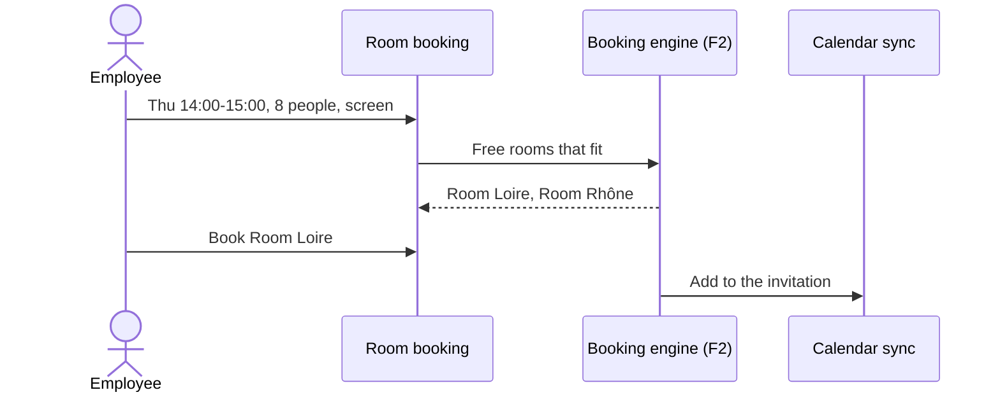

🏠 [Specs](../../../../README.md) › 🧩 [Functional capabilities](../../../README.md) › 🎙️ [F4 Meetings](../../README.md) ›
📝 [Use cases](../README.md) › 📝 [Use cases: FL-F4-12 Rooms and client video](README.md) ›
📝 UC-F4-21 Book a meeting room and equipment

# 📝 UC-F4-21 Book a meeting room and equipment

**Status:** ✅ specified

## Summary

An employee books a meeting room and its equipment (screen, video kit) for a meeting through the shared booking engine;
the room is added to the calendar invitation.

## Personas

- [U01 Employee](../../../../01-users/personas/u01-employee.md)
- [U02 Manager](../../../../01-users/personas/u02-manager.md)

## Goal

A free room with what the meeting needs, without double booking.

## Trigger

An employee plans a meeting on site.

## Frequency

Several times a week per office.

## Preconditions

- Meeting rooms are a bookable record type,
  [UC-F2-18](../../../f02-no-code-configuration/use-cases/08-views-and-bookings/uc-f02-18-make-a-record-type-bookable.md).

## Postconditions

- **Succeeded:** the room and equipment are booked and in the invitation.
- **Failed:** nothing is booked; other rooms and times are offered.

## Main flow

1. The employee plans a meeting and chooses Book a room
   ([S-F4-19](../../screens/12-rooms-and-client-video/s-f04-19-room-booking.md)).
2. They give the time, the number of people and what is needed (screen, video kit).
3. The booking engine shows the free rooms that fit,
   [UC-F2-19](../../../f02-no-code-configuration/use-cases/08-views-and-bookings/uc-f02-19-book-a-resource.md).
4. They pick one; it is booked and added to the calendar invitation
   ([BR-F4-17](../../business-rules/br-f04-17-calendars-sync-both-ways.md)).
5. When the meeting moves or is cancelled in the calendar, the booking follows.

## Alternative flows

- 3a. No room fits: the nearest free times and the rooms of another site are offered.
- 5a. Nobody checked in 15 minutes after the start: the room is freed.

## Error flows

- 4e. The room was taken meanwhile: refused, the next free rooms offered,
  [BR-F2-18](../../../f02-no-code-configuration/business-rules/br-f02-18-one-booking-per-resource-and-slot.md).
- 5e. The calendar update fails: the booking stays and the organiser is told.

## Business rules

- [BR-F2-18 One booking per resource and slot](../../../f02-no-code-configuration/business-rules/br-f02-18-one-booking-per-resource-and-slot.md)
- [BR-F2-19 Booking rules decide who books what and when](../../../f02-no-code-configuration/business-rules/br-f02-19-booking-rules-decide-who-books-what-and-when.md)
- [BR-F4-17 Calendars sync both ways](../../business-rules/br-f04-17-calendars-sync-both-ways.md)

## Entities

- [E-F2-18 Resource booking](../../../f02-no-code-configuration/data/e-f02-18-resource-booking.md)
- [E-F4-01 Meeting](../../data/e-f04-01-meeting.md)

## Permissions

Every employee for the rooms of their sites.

## Notifications

The organiser gets the booking in the invitation and a reminder.

## Audit events

Room booked, moved, freed.

## AI involvement

The AI assistant answers about it within the user's rights
([BR-F3-02](../../../f03-assistant/business-rules/br-f03-02-answers-use-only-what-the-user-may-see.md)) and never
changes a record without the confirmation card
([BR-F3-07](../../../f03-assistant/business-rules/br-f03-07-no-deletes-no-irreversible-acts.md)).

## API, MCP and A2A exposure

T5 booking operations; the MCP tool of F2.

## Screens

- [S-F4-19 Room booking](../../screens/12-rooms-and-client-video/s-f04-19-room-booking.md)
- [S-F2-19 Booking calendar](../../../f02-no-code-configuration/screens/08-views-and-bookings/s-f02-19-booking-calendar.md)

## Flowchart

See [FL-F4-12 Rooms and client video](../../flows/fl-f04-12-rooms-and-client-video.md#flowchart).

## Sequence diagram

## Acceptance criteria

1. **Given** Room Loire (10 seats, screen) free on Thursday 14:00 **when** an employee books it for 8 people **then** it
   is booked and in the invitation.
2. **Given** Room Loire booked 14:00-15:00 **when** another booking for 14:30 is tried **then** it is refused and Room
   Rhône is offered.
3. **Given** the meeting moved to 16:00 in the calendar **when** the calendar syncs **then** the booking moves to 16:00
   if the room is free.

## Non-functional notes

As the booking engine.

## Regulatory references

None.

## Related use cases

- [UC-F2-19 Book a resource](../../../f02-no-code-configuration/use-cases/08-views-and-bookings/uc-f02-19-book-a-resource.md)
- [UC-F4-09 Prepare a meeting](../07-prepare-and-capture-anywhere/uc-f04-09-prepare-a-meeting.md)

## Open questions

None.

---

⬅️ [UC-F4-20](../11-insights-and-accessibility/uc-f04-20-analyse-topics-and-trends-across-calls.md) ·
⬆️ [Up](README.md) ·
➡️ [UC-F4-22](../11-insights-and-accessibility/uc-f04-22-turn-on-live-captions-and-translation.md)
