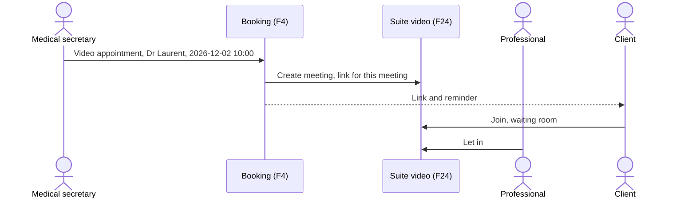

🏠 [Specs](../../../../README.md) › 🧩 [Functional capabilities](../../../README.md) › 🎙️ [F4 Meetings](../../README.md) ›
📝 [Use cases](../README.md) › 📝 [Use cases: FL-F4-12 Rooms and client video](README.md) ›
📝 UC-F4-25 Hold a client video meeting

# 📝 UC-F4-25 Hold a client video meeting

**Status:** ✅ specified

## Summary

A professional (lawyer, accountant, doctor) holds a video meeting with a client from simple-ERP, through the connected
suite's video, with a link per meeting and a waiting room.

## Personas

- [U36 Professional](../../../../01-users/personas/u36-professional.md)
- [U09 Customer](../../../../01-users/personas/u09-customer.md)
- [U33 Medical secretary](../../../../01-users/personas/u33-medical-secretary.md)

## Goal

Meet clients by video without another tool, linked to their record.

## Trigger

A booked appointment or meeting with a client set as video.

## Frequency

Daily in health practices and professional firms.

## Preconditions

- The suite's video is connected,
  [UC-F24-07](../../../f24-integrations-hub/use-cases/02-office-suites/uc-f24-07-start-meetings-from-the-suite-s-video.md).

## Postconditions

- **Succeeded:** the meeting took place, linked to the client's record; recorded only with consent.
- **Failed:** the client could not join; the professional is told and can call instead.

## Main flow

1. The medical secretary books a video appointment
   ([UC-F4-18](../10-benchmark-additions/uc-f04-18-let-customers-book-appointments.md)); the client gets a link valid
   for that meeting only ([BR-F4-28](../../business-rules/br-f04-28-a-client-video-link-works-for-one-meeting.md)).
2. At the time, the professional opens the meeting from the client's record
   ([S-F4-21](../../screens/12-rooms-and-client-video/s-f04-21-client-video-meeting.md)).
3. The client joins from the email or the portal and waits in the waiting room until let in.
4. The meeting runs; recording or transcription starts only if the client consents.
5. At the end, notes or the summary are linked to the client's record.

## Alternative flows

- 4a. Teleconsultation: the rules of
  [CR-FR-138](../../../../10-country-packs/france/health-practice/cr-fr-138-teleconsultation.md) apply (consent, secure
  link).
- 3a. The client cannot join: the professional calls by phone
  ([UC-F4-16](../07-prepare-and-capture-anywhere/uc-f04-16-call-from-the-softphone.md)).

## Error flows

- 3e. The link expired or was used: the client is told to ask for a new one.
- 1e. The suite's video is not connected: the option is not offered.

## Business rules

- [BR-F4-28 A client video link works for one meeting](../../business-rules/br-f04-28-a-client-video-link-works-for-one-meeting.md)
- [BR-F4-01 Every recording is announced](../../business-rules/br-f04-01-every-recording-is-announced.md)

## Entities

- [E-F4-16 Client video meeting](../../data/e-f04-16-client-video-meeting.md)
- [E-F4-01 Meeting](../../data/e-f04-01-meeting.md)

## Permissions

Professionals and their assistants for their clients.

## Notifications

The client gets the link and a reminder.

## Audit events

Meeting started, client admitted, consent given or refused, ended.

## AI involvement

Summary only with consent; health data never leaves to an outside model
([CR-FR-055](../../../../10-country-packs/france/data-protection/cr-fr-055-health-data-hosting.md)).

## API, MCP and A2A exposure

Through the suite's API,
[UC-F24-07](../../../f24-integrations-hub/use-cases/02-office-suites/uc-f24-07-start-meetings-from-the-suite-s-video.md).

## Screens

- [S-F4-21 Client video meeting](../../screens/12-rooms-and-client-video/s-f04-21-client-video-meeting.md)

## Flowchart

See [FL-F4-12 Rooms and client video](../../flows/fl-f04-12-rooms-and-client-video.md#flowchart).

## Sequence diagram

## Acceptance criteria

1. **Given** a video appointment at the Maison de santé des Coteaux on 2026-12-02 10:00 **when** it is booked **then**
   the patient gets a link valid for that meeting only.
2. **Given** the patient in the waiting room **when** Dr Laurent lets her in **then** the meeting starts and is linked
   to her record.
3. **Given** the patient refuses recording **when** the meeting runs **then** nothing is recorded.
4. **Given** a link used for a past meeting **when** it is opened **then** it is refused.

## Non-functional notes

Video quality depends on the suite.

## Regulatory references

[CR-FR-138](../../../../10-country-packs/france/health-practice/cr-fr-138-teleconsultation.md);
[CR-FR-137](../../../../10-country-packs/france/health-practice/cr-fr-137-medical-secrecy.md);
[CR-FR-154](../../../../10-country-packs/france/professional-firms/cr-fr-154-lawyer-secrecy.md).

## Related use cases

- [UC-F4-18 Let customers book appointments](../10-benchmark-additions/uc-f04-18-let-customers-book-appointments.md)
- [UC-F24-07 Start meetings from the suite's video](../../../f24-integrations-hub/use-cases/02-office-suites/uc-f24-07-start-meetings-from-the-suite-s-video.md)

## Open questions

None.

---

⬅️ [UC-F4-24](../11-insights-and-accessibility/uc-f04-24-track-transcription-accuracy-per-language-and-model.md) ·
⬆️ [Up](README.md) ·
➡️ [UC-F4-26](../13-outside-people-and-follow-up/uc-f04-26-receive-and-confirm-the-agreed-actions.md)
