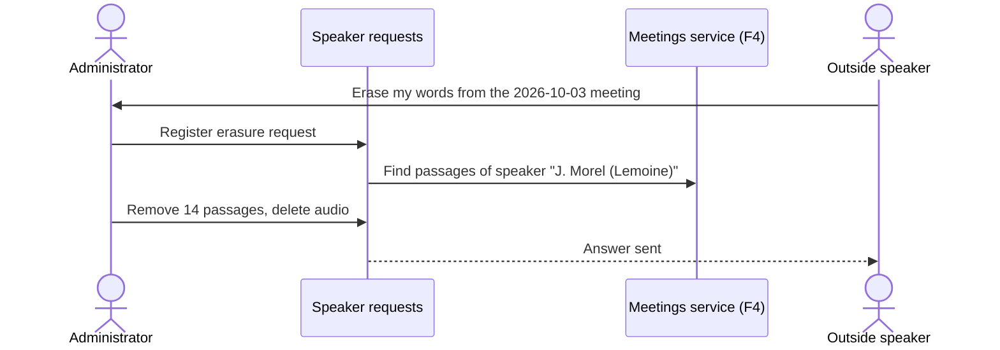

🏠 [Specs](../../../../README.md) › 🧩 [Functional capabilities](../../../README.md) › 🎙️ [F4 Meetings](../../README.md) ›
📝 [Use cases](../README.md) › 📝 [Use cases: FL-F4-13 Outside people and follow-up](README.md) ›
📝 UC-F4-23 Handle an outside speaker's objection or erasure

# 📝 UC-F4-23 Handle an outside speaker's objection or erasure

**Status:** 🔄 waiting for the owner

## Summary

A customer, candidate or supplier who spoke in a recorded meeting objects to it or asks to erase their words; the
administrator handles the request within the legal time.

## Personas

- [U07 Administrator](../../../../01-users/personas/u07-administrator.md)
- [U09 Customer](../../../../01-users/personas/u09-customer.md)

## Goal

Outside people's GDPR rights are met for meetings too.

## Trigger

An outside person asks, by email, by the portal or during the meeting.

## Frequency

Rare: a few a year.

## Preconditions

- The request names the meeting or can be matched to it.

## Postconditions

- **Succeeded:** the speaker's passages and audio are removed or anonymised, or kept with the legal reason.
- **Failed:** the request is refused with its reason, which the person receives.

## Main flow

1. The administrator registers the request
   ([S-F4-22](../../screens/13-outside-people-and-follow-up/s-f04-22-speaker-requests.md)): who, which meetings,
   objection or erasure.
2. SimpleERP finds the person's passages by their speaker name in the meetings (no voice print,
   [BR-F4-02](../../business-rules/br-f04-02-no-voice-prints.md)).
3. The administrator checks whether a law requires keeping them (a legal hold, a contract dispute).
4. Passages are removed or anonymised in the transcript and summary, the audio deleted; the person is answered
   ([BR-F4-26](../../business-rules/br-f04-26-an-outside-speakers-request-is-answered-within-a-month.md)).

## Alternative flows

- 1a. During the meeting: the person asks to stop; recording stops
  ([BR-F4-01](../../business-rules/br-f04-01-every-recording-is-announced.md)).
- 3a. A legal reason to keep: the passages are restricted to the administrator and the answer gives the reason.

## Error flows

- 2e. The person cannot be found in any meeting: the answer says so.
- 4e. The deadline nears (one month): the administrator is reminded a week before (Proposed).

## Business rules

- [BR-F4-26 An outside speaker's request is answered within a month](../../business-rules/br-f04-26-an-outside-speakers-request-is-answered-within-a-month.md)
- [BR-F4-02 No voice prints](../../business-rules/br-f04-02-no-voice-prints.md)
- [BR-F4-03 Recordings are deleted once checked](../../business-rules/br-f04-03-recordings-are-deleted-once-checked.md)

## Entities

- [E-F4-14 Speaker request](../../data/e-f04-14-speaker-request.md)
- [E-F4-02 Transcript](../../data/e-f04-02-transcript.md)

## Permissions

Administrators; the data protection contact.

## Notifications

The person gets the answer; the organiser is told what was removed.

## Audit events

Request received, passages removed or kept with reason, answer sent.

## AI involvement

The AI assistant lists candidate passages; the administrator decides.

## API, MCP and A2A exposure

None.

## Screens

- [S-F4-22 Speaker requests](../../screens/13-outside-people-and-follow-up/s-f04-22-speaker-requests.md)

## Flowchart

See [FL-F4-13 Outside people and follow-up](../../flows/fl-f04-13-outside-people-and-follow-up.md#flowchart).

## Sequence diagram

## Acceptance criteria

1. **Given** J. Morel of Distribution Lemoine spoke in 2 meetings **when** the administrator registers his erasure
   request **then** his 14 passages are listed.
2. **Given** the passages removed **when** a participant reads the transcript **then** they read "passage removed at the
   speaker's request".
3. **Given** a meeting under legal hold **when** the erasure is asked **then** the passages are restricted and the
   answer gives the reason.

## Non-functional notes

None.

## Regulatory references

[CR-FR-051](../../../../10-country-packs/france/data-protection/cr-fr-051-access-and-erasure.md); recordings announced,
[CR-FR-059](../../../../10-country-packs/france/ai-and-recording/cr-fr-059-recordings-are-announced.md).

## Related use cases

- [UC-F4-05 Review a meeting](../03-review-a-meeting/uc-f04-05-review-a-meeting.md)
- [UC-F1-12 Draft the record of processing activities](../../../f01-administration/use-cases/09-administration-reports/uc-f01-12-draft-the-record-of-processing-activities.md)

## Open questions

None.

---

⬅️ [UC-F4-22](../11-insights-and-accessibility/uc-f04-22-turn-on-live-captions-and-translation.md) ·
⬆️ [Up](README.md) ·
➡️ [UC-F4-24](../11-insights-and-accessibility/uc-f04-24-track-transcription-accuracy-per-language-and-model.md)
