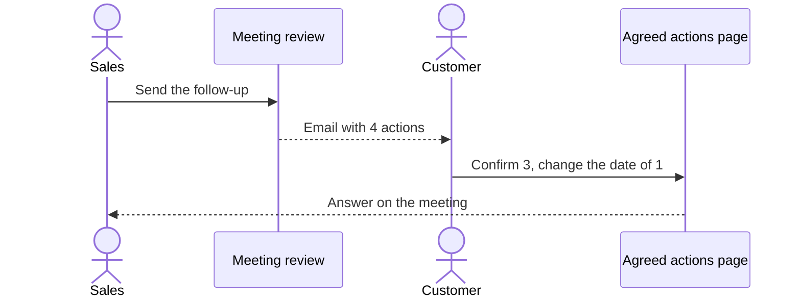

🏠 [Specs](../../../../README.md) › 🧩 [Functional capabilities](../../../README.md) › 🎙️ [F4 Meetings](../../README.md) ›
📝 [Use cases](../README.md) › 📝 [Use cases: FL-F4-13 Outside people and follow-up](README.md) ›
📝 UC-F4-26 Receive and confirm the agreed actions

# 📝 UC-F4-26 Receive and confirm the agreed actions

**Status:** ✅ specified

## Summary

After a checked meeting, the customer receives the actions agreed (theirs and the company's) and confirms them or asks a
change.

## Personas

- [U09 Customer](../../../../01-users/personas/u09-customer.md)
- [U03 Sales](../../../../01-users/personas/u03-sales.md)

## Goal

Both sides agree on who does what by when.

## Trigger

The organiser sends the follow-up of a checked meeting
([UC-F4-05](../03-review-a-meeting/uc-f04-05-review-a-meeting.md)).

## Frequency

After most customer meetings.

## Preconditions

- The meeting is checked; the customer has an email or a portal account.

## Postconditions

- **Succeeded:** the customer confirmed, or asked a change the organiser handles.
- **Failed:** no answer: reminded once (after 3 days).

## Main flow

1. The organiser sends the follow-up with the agreed actions
   ([BR-F4-14](../../business-rules/br-f04-14-colleagues-get-tasks-outsiders-the-follow-up.md)).
2. The customer opens it in the email or on the portal
   ([S-F4-23](../../screens/13-outside-people-and-follow-up/s-f04-23-agreed-actions.md)): each action with its owner and
   date.
3. They confirm all, or ask a change on an action with a comment
   ([BR-F4-29](../../business-rules/br-f04-29-customers-see-only-the-actions-sent-to-them.md)).
4. The organiser sees the answer on the meeting; a change asked reopens that action.

## Alternative flows

- 2a. The customer has no portal account: the email holds a link valid 30 days.

## Error flows

- 3e. The link expired: the customer asks the organiser for a new one.

## Business rules

- [BR-F4-29 Customers see only the actions sent to them](../../business-rules/br-f04-29-customers-see-only-the-actions-sent-to-them.md)
- [BR-F4-14 Colleagues get tasks, outsiders the follow-up](../../business-rules/br-f04-14-colleagues-get-tasks-outsiders-the-follow-up.md)

## Entities

- [E-F4-04 Action item](../../data/e-f04-04-action-item.md)
- [E-F4-01 Meeting](../../data/e-f04-01-meeting.md)

## Permissions

The customer for the meetings sent to them; the organiser.

## Notifications

The organiser is told of the answer.

## Audit events

Follow-up sent, opened, confirmed, change asked.

## AI involvement

The AI assistant answers about it within the user's rights
([BR-F3-02](../../../f03-assistant/business-rules/br-f03-02-answers-use-only-what-the-user-may-see.md)) and never
changes a record without the confirmation card
([BR-F3-07](../../../f03-assistant/business-rules/br-f03-07-no-deletes-no-irreversible-acts.md)).

## API, MCP and A2A exposure

None.

## Screens

- [S-F4-23 Agreed actions](../../screens/13-outside-people-and-follow-up/s-f04-23-agreed-actions.md)
- [S-F4-05 Meeting review](../../screens/03-review-a-meeting/s-f04-05-meeting-review.md)

## Flowchart

See [FL-F4-13 Outside people and follow-up](../../flows/fl-f04-13-outside-people-and-follow-up.md#flowchart).

## Sequence diagram

## Acceptance criteria

1. **Given** a checked meeting with Durand SA and 4 agreed actions **when** the follow-up is sent **then** Claire Durand
   receives the 4 actions with owners and dates.
2. **Given** the follow-up **when** she asks to move "send the plans" to 2026-12-10 **then** the organiser sees the
   request on the action.
3. **Given** no answer after 3 days **when** the time passes **then** she is reminded once.

## Non-functional notes

Works on a phone.

## Regulatory references

None.

## Related use cases

- [UC-F4-05 Review a meeting](../03-review-a-meeting/uc-f04-05-review-a-meeting.md)
- [UC-F6-11 Use the customer portal](../../../f06-customers-and-sales/use-cases/02-quote-to-order/uc-f06-11-use-the-customer-portal.md)

## Open questions

None.

---

⬅️ [UC-F4-25 Hold a client video meeting](../12-rooms-and-client-video/uc-f04-25-hold-a-client-video-meeting.md) ·
⬆️ [Up](README.md) ·
➡️ [UC-F4-27 Keep meeting actions in step with tasks](uc-f04-27-keep-meeting-actions-in-step-with-tasks.md)
