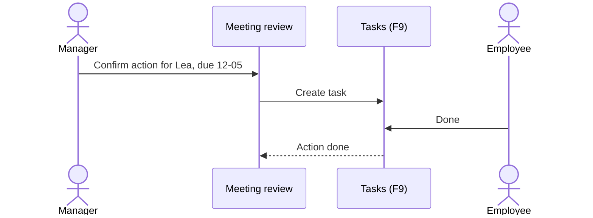

🏠 [Specs](../../../../README.md) › 🧩 [Functional capabilities](../../../README.md) › 🎙️ [F4 Meetings](../../README.md) ›
📝 [Use cases](../README.md) › 📝 [Use cases: FL-F4-13 Outside people and follow-up](README.md) ›
📝 UC-F4-27 Keep meeting actions in step with tasks

# 📝 UC-F4-27 Keep meeting actions in step with tasks

**Status:** ✅ specified

## Summary

Actions confirmed at review become F9 tasks, and their status stays in step both ways: closing the task closes the
action and the meeting shows it.

## Personas

- [U02 Manager](../../../../01-users/personas/u02-manager.md)
- [U01 Employee](../../../../01-users/personas/u01-employee.md)

## Goal

One list of what was agreed, wherever it is followed.

## Trigger

A colleague's action is confirmed at review.

## Frequency

After every reviewed meeting with actions.

## Preconditions

- F9 projects or tasks are in use.

## Postconditions

- **Succeeded:** the task and the action share their status, owner and date.
- **Failed:** the action stays on the meeting only.

## Main flow

1. At review, the organiser confirms an action for a colleague
   ([UC-F4-05](../03-review-a-meeting/uc-f04-05-review-a-meeting.md)); it becomes an F9 task,
   [UC-F9-17](../../../f09-hr-and-projects/use-cases/06-plan-and-deliver-work/uc-f09-17-manage-projects-and-tasks.md).
2. The colleague works on the task; its status, owner and date show on the meeting
   ([S-F4-05](../../screens/03-review-a-meeting/s-f04-05-meeting-review.md)).
3. When the task is done, the action is done; the next recurring meeting's agenda shows it closed
   ([BR-F4-16](../../business-rules/br-f04-16-recurring-meetings-get-their-next-agenda.md)).
4. When the action changes on the meeting, the task follows
   ([BR-F4-30](../../business-rules/br-f04-30-actions-and-tasks-stay-in-step.md)).

## Alternative flows

- 1a. The action belongs to a project: the task is created in that project.

## Error flows

- 4e. Both changed at once: the task's change wins and the organiser is told.
- 3e. The task was deleted: the action shows "task removed" and stays open.

## Business rules

- [BR-F4-30 Actions and tasks stay in step](../../business-rules/br-f04-30-actions-and-tasks-stay-in-step.md)
- [BR-F4-14 Colleagues get tasks, outsiders the follow-up](../../business-rules/br-f04-14-colleagues-get-tasks-outsiders-the-follow-up.md)

## Entities

- [E-F4-04 Action item](../../data/e-f04-04-action-item.md)

## Permissions

As the task's and the meeting's own rights.

## Notifications

The task owner as in F9.

## Audit events

Action linked to a task; each synced change.

## AI involvement

The AI assistant answers about it within the user's rights
([BR-F3-02](../../../f03-assistant/business-rules/br-f03-02-answers-use-only-what-the-user-may-see.md)) and never
changes a record without the confirmation card
([BR-F3-07](../../../f03-assistant/business-rules/br-f03-07-no-deletes-no-irreversible-acts.md)).

## API, MCP and A2A exposure

T5 task and action operations.

## Screens

- [S-F4-05 Meeting review](../../screens/03-review-a-meeting/s-f04-05-meeting-review.md)

## Flowchart

See [FL-F4-13 Outside people and follow-up](../../flows/fl-f04-13-outside-people-and-follow-up.md#flowchart).

## Sequence diagram

## Acceptance criteria

1. **Given** an action "send the plans" for Lea due 2026-12-05 **when** it is confirmed **then** an F9 task exists for
   Lea with that date.
2. **Given** the task **when** Lea marks it done **then** the action shows done on the meeting.
3. **Given** the action's date changed on the meeting **when** it is saved **then** the task's date changes.

## Non-functional notes

Sync within a minute.

## Regulatory references

None.

## Related use cases

- [UC-F4-05 Review a meeting](../03-review-a-meeting/uc-f04-05-review-a-meeting.md)
- [UC-F9-17 Manage projects and tasks](../../../f09-hr-and-projects/use-cases/06-plan-and-deliver-work/uc-f09-17-manage-projects-and-tasks.md)

## Open questions

None.

---

⬅️ [UC-F4-26 Receive and confirm the agreed actions](uc-f04-26-receive-and-confirm-the-agreed-actions.md) ·
⬆️ [Up](README.md) · ➡️ [UC-F4-28](../14-video-messages-and-webinars/uc-f04-28-record-and-share-a-video-message.md)
