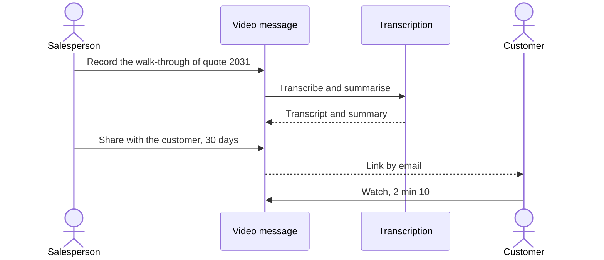

🏠 [Specs](../../../../README.md) › 🧩 [Functional capabilities](../../../README.md) › 🎙️ [F4 Meetings](../../README.md) ›
📝 [Use cases](../README.md) › 📝 [Use cases: FL-F4-14 Video messages, webinars and templates](README.md) ›
📝 UC-F4-28 Record and share a video message

# 📝 UC-F4-28 Record and share a video message

**Status:** ✅ specified

## Summary

A user records a short video message of their screen, their camera or both, for a customer or a colleague: a quote
walk-through, a bug demonstration, a thank-you. SimpleERP transcribes and summarises it, and the user shares a link
that expires. The message is kept as long as the company's meeting recordings are.

## Personas

- [U03 Sales](../../../../01-users/personas/u03-sales.md)
- [U01 Employee](../../../../01-users/personas/u01-employee.md)

## Goal

Explain something once, in two minutes, instead of a long email or a meeting.

## Trigger

A quote to explain, a question easier to show than to write, a follow-up after a call.

## Frequency

A few messages a week for sales people, now and then for others.

## Preconditions

- Video messages are switched on for the company
  ([S-F4-07](../../screens/06-set-up-meetings-and-calendars/s-f04-07-meeting-settings.md),
  [E-F4-25 Meeting recording setting](../../data/e-f04-25-meeting-recording-setting.md)).
- The user allowed the camera, the microphone and, for the screen, the screen capture of their device
  ([UC-F4-10](../07-prepare-and-capture-anywhere/uc-f04-10-capture-from-the-desktop-a-file-or-dictation.md)).
- The user has the right to share outside the company when the recipient is a customer
  ([BR-F4-22](../../business-rules/br-f04-22-only-chosen-content-leaves.md)).

## Postconditions

- **Succeeded:** the message is saved ([E-F4-27 Video message](../../data/e-f04-27-video-message.md)) with its
  transcript and summary, shared by a link with an end date, and its views are counted.
- **Failed:** nothing is shared; a recording that failed is lost and the user is told at once.

## Main flow

1. The user opens Video message ([S-F4-25](../../screens/14-video-messages-and-webinars/s-f04-25-video-message.md)) from
   a record (a quote, a lead), the meeting menu or the phone, and chooses screen, camera or both.
2. The screen shows that recording is on
   ([BR-F4-19](../../business-rules/br-f04-19-desktop-capture-is-announced-too.md)); the user records up to 10 minutes
   and stops.
3. The user previews the message and may cut the start or the end, or record again.
4. SimpleERP transcribes the message and writes a short summary, in the language of the speech
   ([BR-F4-05](../../business-rules/br-f04-05-summaries-in-the-reader-s-language.md)).
5. The user shares: a link with an end date (30 days by default) for a customer, or a colleague's name inside the
   company; the link may need a password.
6. The recipient watches in the browser with captions; the user sees who opened it and for how long.
7. The message is deleted at the end of its retention or when the user deletes it
   ([BR-F4-33](../../business-rules/br-f04-33-video-messages-follow-meeting-retention.md)).

## Alternative flows

- 1a. The user attaches the message to a record: the quote, the lead or the ticket shows it.
- 5a. The user stops the link early: it no longer opens.
- 6a. The recipient replies with a video message of their own: it reaches the user as a new message.

## Error flows

- 2e. The recording fails (a permission refused, the device out of space): the user is told at once and nothing is kept
  ([BR-F4-10](../../business-rules/br-f04-10-offline-recordings-upload-later.md) covers a lost network, the recording
  uploads later).
- 5e. The recipient's address is outside the allowed domains: refused with the reason
  ([BR-F1-18](../../../f01-administration/business-rules/br-f01-18-allowed-domains.md)).
- 4e. The speech cannot be transcribed (too quiet): the message is kept without transcript and the user is told.
- Any step: a service does not answer; the call is retried first
  ([BR-F3-32](../../../f03-assistant/business-rules/br-f03-32-retry-before-an-error.md)), then the message follows the
  error pattern ([D122](../../../../06-decisions/ux/d122-error-message-standard.md)) and a message already recorded
  stays on the device until it uploads.

## Business rules

- [BR-F4-33 Video messages follow meeting retention](../../business-rules/br-f04-33-video-messages-follow-meeting-retention.md)
- [BR-F4-01 Every recording is announced](../../business-rules/br-f04-01-every-recording-is-announced.md)
- [BR-F4-19 Desktop capture is announced too](../../business-rules/br-f04-19-desktop-capture-is-announced-too.md)
- [BR-F4-22 Only chosen content leaves](../../business-rules/br-f04-22-only-chosen-content-leaves.md)
- [BR-F4-05 Summaries in the reader's language](../../business-rules/br-f04-05-summaries-in-the-reader-s-language.md)

## Entities

- [E-F4-27 Video message](../../data/e-f04-27-video-message.md): created, changed
- [E-F4-25 Meeting recording setting](../../data/e-f04-25-meeting-recording-setting.md): read
- [E-F4-02 Transcript](../../data/e-f04-02-transcript.md): created

## Permissions

Every user who may record; the recipient outside the company sees only the message shared with them. Others in the
company see it only if the user shared it.

## Notifications

- The user: the first view of a shared link.
- The recipient: the message, by email, with the sender's name.

## Audit events

Each message recorded, shared, viewed (by whom, when), unshared and deleted.

## AI involvement

The AI assistant writes the transcript and the summary; it does not decide what is shared. No voice print is made
([BR-F4-02](../../business-rules/br-f04-02-no-voice-prints.md)).

## API, MCP and A2A exposure

T5 operations of F4 for the user's own messages; the share link opens in the browser. No MCP tool records and there is
no A2A skill.

## Screens

- [S-F4-25 Video message](../../screens/14-video-messages-and-webinars/s-f04-25-video-message.md)

## Flowchart

See [FL-F4-14 Video messages, webinars and templates](../../flows/fl-f04-14-video-messages-and-webinars.md#flowchart).

## Sequence diagram

## Acceptance criteria

1. **Given** a user who records for 3 minutes **when** they stop **then** the message is saved with its transcript and
   summary.
2. **Given** a link with an end date of 30 days **when** day 31 comes **then** the link no longer opens.
3. **Given** a recording in progress **when** the screen is shown **then** it shows that recording is on.
4. **Given** a recipient outside the allowed domains **when** the user shares **then** it is refused.
5. **Given** the company's recording retention of 90 days **when** day 91 comes **then** the message is deleted.

## Non-functional notes

A 5-minute message is transcribed within 2 minutes; the link opens in under 2 seconds.

## Regulatory references

Recordings are announced:
[CR-FR-059](../../../../10-country-packs/france/ai-and-recording/cr-fr-059-recordings-are-announced.md); call recording
at work: [CR-FR-207](../../../../10-country-packs/france/data-protection/cr-fr-207-call-recording-proportionate.md); no
voice prints: [CR-FR-053](../../../../10-country-packs/france/data-protection/cr-fr-053-no-biometric-voice-prints.md).

## Related use cases

- [UC-F4-10 Capture from the desktop, a file or dictation](../07-prepare-and-capture-anywhere/uc-f04-10-capture-from-the-desktop-a-file-or-dictation.md)
- [UC-F4-11 Share, export and clip a meeting](../08-share-and-reuse-outside/uc-f04-11-share-export-and-clip-a-meeting.md)
- [UC-F4-25 Hold a client video meeting](../12-rooms-and-client-video/uc-f04-25-hold-a-client-video-meeting.md)
- [UC-F6-01 Capture and qualify a lead](../../../f06-customers-and-sales/use-cases/01-lead-to-quote/uc-f06-01-capture-and-qualify-a-lead.md)

## Open questions

None.

---

⬅️ [UC-F4-27](../13-outside-people-and-follow-up/uc-f04-27-keep-meeting-actions-in-step-with-tasks.md) ·
⬆️ [Up](README.md) · ➡️ [UC-F4-29 Host a webinar](uc-f04-29-host-a-webinar.md)
